# Benchmark results

Generated by `report.py` from `results/*.json`; the summary is in the [README](README.md).

**How to read this.** Each sample is one draw in a fresh browser context: the page sends one request and the time runs until the frame showing the new plot is painted. Every case is the median of several samples. The baseline (1x) is **orjson without compression**, for the same app and the same data. Speedup = baseline time / this time: ▲ + means faster than the baseline, ▼ - means slower, and = means within 5%. The server and the browser run on one machine (loopback), so there is no real network: compression only adds CPU time here. Wire sizes are listed so you can work out transfer times for your own link.

**Transports.** *orjson*: stock Dash 4.5.0 / `orjson.dumps`. *msgspec*: Dash PR #4067 / `msgspec.json`. *arrow*: Arrow IPC with stock plotly.js 4.3.0 (timestamps become ISO strings in the browser, the fast way chosen in section 4). *arrow-ms*: the same Arrow response, drawn by plotly.js with [patches/optimisations/plotly-date-typed-array.patch](patches/optimisations/plotly-date-typed-array.patch), so timestamps go to plotly.js as a Float64Array of UTC ms. It needs that plotly.js change; the other three run on stock plotly.js.

**Apps.** FastAPI + Plotly.js is written like a typical dashboard: the page gets the dataframe's columns and builds one trace per column, all sharing one x array. Dash is written like a typical Dash app: a callback builds `go.Figure()` and `add_trace(go.Scatter(...))` per column from a pandas DataFrame; all transports get that same figure.

## 1. Quick benchmark: scale, gzip level 1

Float32 values with a UTC timestamp per minute, drawn as scattergl lines. Every transport with gzip level 1 at 10k, 1M and 10M points, plus the uncompressed orjson baseline. **Points = rows x traces**, so 10M points is 10M rows for 1 trace or 100k rows for 100 traces.

- **Command:** `python bench.py quick`
- **Finished:** 2026-11-18T23:21:39+00:00 (24.0 min, median of 3 samples per case)
- **Machine:** Intel(R) Core(TM) Ultra 7 155H, Linux-6.18.58.1-microsoft-standard-WSL2-x86_64-with-glibc2.39
- **Browser:** Chromium 159.0.8154.6, visible window, WebGL on `ANGLE (Microsoft Corporation, D3D12 (NVIDIA RTX 500 Ada Generation Laptop GPU), OpenGL 4.6)`
- **Packages:** Python 3.15.2, dash 4.5.0, plotly 7.1.0, fastapi 0.164.0, uvicorn 0.54.0, orjson 3.13.0, msgspec 0.22.0, polars 2.1.0, pyarrow 26.0.1, pandas 3.1.1, numpy 2.5.5, plotly.js-dist-min 4.3.0, apache-arrow 21.2.0
- **Plot check:** every transport drew the same traces, point counts and axis ranges

### FastAPI + Plotly.js

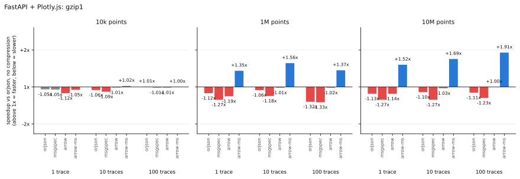

Same numbers as the chart (speedup vs orjson without compression): 10k points, 1 trace: orjson gzip1 -1.05x, msgspec gzip1 -1.05x, arrow gzip1 -1.12x, arrow-ms gzip1 -1.05x; 10k points, 10 traces: orjson gzip1 -1.06x, msgspec gzip1 -1.09x, arrow gzip1 -1.01x, arrow-ms gzip1 +1.02x; 10k points, 100 traces: orjson gzip1 +1.01x, msgspec gzip1 -1.01x, arrow gzip1 -1.01x, arrow-ms gzip1 +1.00x; 1M points, 1 trace: orjson gzip1 -1.12x, msgspec gzip1 -1.27x, arrow gzip1 -1.19x, arrow-ms gzip1 +1.35x; 1M points, 10 traces: orjson gzip1 -1.06x, msgspec gzip1 -1.18x, arrow gzip1 -1.01x, arrow-ms gzip1 +1.56x; 1M points, 100 traces: orjson gzip1 -1.32x, msgspec gzip1 -1.33x, arrow gzip1 -1.02x, arrow-ms gzip1 +1.37x; 10M points, 1 trace: orjson gzip1 -1.13x, msgspec gzip1 -1.27x, arrow gzip1 -1.14x, arrow-ms gzip1 +1.52x; 10M points, 10 traces: orjson gzip1 -1.10x, msgspec gzip1 -1.27x, arrow gzip1 -1.03x, arrow-ms gzip1 +1.69x; 10M points, 100 traces: orjson gzip1 -1.11x, msgspec gzip1 -1.23x, arrow gzip1 +1.00x, arrow-ms gzip1 +1.91x.

Total time, request sent to plot painted (median), one table per compression level:

**gzip1**

| Points | Traces | orjson, none (baseline) | orjson gzip1 | msgspec gzip1 | arrow gzip1 | arrow-ms gzip1 |
| --- | --- | --- | --- | --- | --- | --- |
| 10k | 1 | 242 ms | 252 ms = same (0.96x) | 254 ms = same (0.95x) | 271 ms ▼ **-1.12x slower** | 254 ms ▼ **-1.05x slower** |
| 10k | 10 | 261 ms | 276 ms ▼ **-1.06x slower** | 285 ms ▼ **-1.09x slower** | 264 ms = same (0.99x) | 256 ms = same (1.02x) |
| 10k | 100 | 351 ms | 349 ms = same (1.01x) | 356 ms = same (0.99x) | 355 ms = same (0.99x) | 350 ms = same (1.00x) |
| 1M | 1 | 1,125 ms | 1,264 ms ▼ **-1.12x slower** | 1,429 ms ▼ **-1.27x slower** | 1,338 ms ▼ **-1.19x slower** | 830 ms ▲ **+1.35x faster** |
| 1M | 10 | 986 ms | 1,046 ms ▼ **-1.06x slower** | 1,166 ms ▼ **-1.18x slower** | 1,000 ms = same (0.99x) | 631 ms ▲ **+1.56x faster** |
| 1M | 100 | 1,053 ms | 1,388 ms ▼ **-1.32x slower** | 1,402 ms ▼ **-1.33x slower** | 1,069 ms = same (0.98x) | 770 ms ▲ **+1.37x faster** |
| 10M | 1 | 10,626 ms | 12,047 ms ▼ **-1.13x slower** | 13,486 ms ▼ **-1.27x slower** | 12,063 ms ▼ **-1.14x slower** | 6,998 ms ▲ **+1.52x faster** |
| 10M | 10 | 8,119 ms | 8,946 ms ▼ **-1.10x slower** | 10,315 ms ▼ **-1.27x slower** | 8,324 ms = same (0.98x) | 4,807 ms ▲ **+1.69x faster** |
| 10M | 100 | 7,452 ms | 8,292 ms ▼ **-1.11x slower** | 9,156 ms ▼ **-1.23x slower** | 7,450 ms = same (1.00x) | 3,910 ms ▲ **+1.91x faster** |

Where the time goes

Build (Dash: running the callback, i.e. building the go.Figure), Encode and Gzip are measured on the server. Wait is request sent to first byte (includes them), Download is first to last byte, Browser is last byte to painted. For FastAPI, Browser splits into decode (JSON.parse or Arrow read, building traces), plotly.js, and paint.

| Points | Traces | Variant | Wire MB | Raw MB | Build | Encode | Gzip | Wait | Download | Browser | (decode | plot | paint) | Total |
| --- | --- | --- | --- | --- | --- | --- | --- | --- | --- | --- | --- | --- | --- | --- |
| 10k | 1 | orjson | 0.32 | 0.32 | - | 0.5 | 0.0 | 2.3 | 0.6 | 239 | 0.6 | 235 | 1.6 | **242** |
| 10k | 1 | orjson gzip1 | 0.07 | 0.32 | - | 0.5 | 1.3 | 3.7 | 0.8 | 248 | 0.7 | 245 | 1.9 | **252** |
| 10k | 1 | msgspec gzip1 | 0.12 | 0.41 | - | 0.8 | 2.0 | 4.6 | 0.9 | 248 | 0.7 | 245 | 1.7 | **254** |
| 10k | 1 | arrow gzip1 | 0.07 | 0.12 | - | 0.3 | 1.6 | 3.7 | 0.7 | 267 | 5.6 | 260 | 1.5 | **271** |
| 10k | 1 | arrow-ms gzip1 | 0.07 | 0.12 | - | 0.3 | 1.5 | 3.6 | 0.6 | 250 | 3.3 | 245 | 1.5 | **254** |
| 10k | 10 | orjson | 0.12 | 0.12 | - | 0.3 | 0.0 | 2.2 | 0.4 | 258 | 0.3 | 255 | 2.0 | **261** |
| 10k | 10 | orjson gzip1 | 0.05 | 0.12 | - | 0.2 | 0.9 | 3.0 | 0.6 | 273 | 0.3 | 270 | 1.9 | **276** |
| 10k | 10 | msgspec gzip1 | 0.09 | 0.20 | - | 0.5 | 1.6 | 4.3 | 0.7 | 281 | 0.4 | 278 | 2.2 | **285** |
| 10k | 10 | arrow gzip1 | 0.04 | 0.05 | - | 0.2 | 0.9 | 3.3 | 0.6 | 260 | 4.7 | 253 | 1.6 | **264** |
| 10k | 10 | arrow-ms gzip1 | 0.04 | 0.05 | - | 0.2 | 1.0 | 3.0 | 0.5 | 253 | 3.3 | 247 | 1.7 | **256** |
| 10k | 100 | orjson | 0.10 | 0.10 | - | 0.3 | 0.0 | 2.0 | 0.4 | 348 | 0.7 | 345 | 1.6 | **351** |
| 10k | 100 | orjson gzip1 | 0.05 | 0.10 | - | 0.3 | 0.8 | 3.0 | 0.6 | 346 | 0.5 | 343 | 1.8 | **349** |
| 10k | 100 | msgspec gzip1 | 0.07 | 0.18 | - | 0.6 | 1.4 | 3.9 | 0.7 | 351 | 0.5 | 348 | 1.7 | **356** |
| 10k | 100 | arrow gzip1 | 0.04 | 0.06 | - | 0.4 | 0.9 | 3.2 | 0.6 | 352 | 5.7 | 344 | 1.8 | **355** |
| 10k | 100 | arrow-ms gzip1 | 0.04 | 0.06 | - | 0.4 | 0.8 | 3.2 | 0.5 | 347 | 5.0 | 339 | 2.0 | **350** |
| 1M | 1 | orjson | 32.27 | 32.27 | - | 45 | 0.0 | 47 | 27 | 1,054 | 104 | 923 | 3.5 | **1,125** |
| 1M | 1 | orjson gzip1 | 7.30 | 32.27 | - | 47 | 122 | 173 | 43 | 1,050 | 100 | 934 | 3.2 | **1,264** |
| 1M | 1 | msgspec gzip1 | 11.64 | 40.95 | - | 122 | 181 | 308 | 57 | 1,060 | 104 | 932 | 3.4 | **1,429** |
| 1M | 1 | arrow gzip1 | 6.86 | 12.00 | - | 12 | 159 | 176 | 31 | 1,132 | 110 | 996 | 3.4 | **1,338** |
| 1M | 1 | arrow-ms gzip1 | 6.86 | 12.00 | - | 11 | 161 | 175 | 35 | 634 | 27 | 580 | 1.7 | **830** |
| 1M | 10 | orjson | 11.76 | 11.76 | - | 13 | 0.0 | 15 | 10 | 958 | 32 | 897 | 3.2 | **986** |
| 1M | 10 | orjson gzip1 | 4.66 | 11.76 | - | 14 | 75 | 90 | 24 | 927 | 31 | 864 | 3.7 | **1,046** |
| 1M | 10 | msgspec gzip1 | 8.46 | 20.41 | - | 45 | 151 | 192 | 49 | 929 | 42 | 870 | 3.2 | **1,166** |
| 1M | 10 | arrow gzip1 | 3.66 | 4.80 | - | 5.3 | 87 | 95 | 18 | 888 | 15 | 855 | 3.3 | **1,000** |
| 1M | 10 | arrow-ms gzip1 | 3.66 | 4.80 | - | 5.6 | 89 | 98 | 21 | 513 | 8.7 | 494 | 1.6 | **631** |
| 1M | 100 | orjson | 9.74 | 9.74 | - | 12 | 0.0 | 14 | 8.3 | 1,028 | 28 | 976 | 3.7 | **1,053** |
| 1M | 100 | orjson gzip1 | 4.22 | 9.74 | - | 13 | 77 | 92 | 21 | 1,276 | 26 | 948 | 267 | **1,388** |
| 1M | 100 | msgspec gzip1 | 6.79 | 18.09 | - | 37 | 117 | 156 | 178 | 1,068 | 34 | 990 | 3.6 | **1,402** |
| 1M | 100 | arrow gzip1 | 3.03 | 4.09 | - | 4.6 | 60 | 67 | 16 | 986 | 7.7 | 965 | 3.5 | **1,069** |
| 1M | 100 | arrow-ms gzip1 | 3.03 | 4.09 | - | 4.4 | 62 | 69 | 16 | 684 | 5.9 | 668 | 2.0 | **770** |
| 10M | 1 | orjson | 323 | 323 | - | 437 | 0.0 | 439 | 163 | 10,012 | 1,113 | 8,763 | 3.4 | **10,626** |
| 10M | 1 | orjson gzip1 | 72.95 | 323 | - | 477 | 1,146 | 1,646 | 352 | 10,044 | 1,082 | 8,745 | 2.0 | **12,047** |
| 10M | 1 | msgspec gzip1 | 116 | 410 | - | 1,169 | 1,784 | 2,979 | 504 | 9,976 | 1,202 | 8,533 | 2.0 | **13,486** |
| 10M | 1 | arrow gzip1 | 68.62 | 120 | - | 91 | 1,537 | 1,633 | 282 | 10,154 | 982 | 9,098 | 1.8 | **12,063** |
| 10M | 1 | arrow-ms gzip1 | 68.62 | 120 | - | 99 | 1,588 | 1,686 | 292 | 4,987 | 248 | 4,690 | 1.8 | **6,998** |
| 10M | 10 | orjson | 118 | 118 | - | 172 | 0.0 | 174 | 64 | 7,885 | 297 | 7,514 | 3.4 | **8,119** |
| 10M | 10 | orjson gzip1 | 46.27 | 118 | - | 169 | 764 | 939 | 194 | 7,801 | 289 | 7,451 | 1.8 | **8,946** |
| 10M | 10 | msgspec gzip1 | 84.36 | 204 | - | 573 | 1,389 | 1,980 | 341 | 7,973 | 365 | 7,457 | 1.9 | **10,315** |
| 10M | 10 | arrow gzip1 | 35.50 | 48.00 | - | 69 | 784 | 857 | 160 | 7,307 | 103 | 7,176 | 1.9 | **8,324** |
| 10M | 10 | arrow-ms gzip1 | 35.50 | 48.00 | - | 77 | 785 | 865 | 161 | 3,798 | 48 | 3,721 | 1.8 | **4,807** |
| 10M | 100 | orjson | 97.40 | 97.40 | - | 150 | 0.0 | 152 | 57 | 7,139 | 223 | 6,858 | 3.2 | **7,452** |
| 10M | 100 | orjson gzip1 | 40.55 | 97.40 | - | 151 | 716 | 884 | 164 | 7,240 | 225 | 6,956 | 1.9 | **8,292** |
| 10M | 100 | msgspec gzip1 | 66.01 | 181 | - | 441 | 1,147 | 1,598 | 302 | 7,256 | 296 | 6,860 | 2.0 | **9,156** |
| 10M | 100 | arrow gzip1 | 29.06 | 40.81 | - | 84 | 615 | 696 | 141 | 6,612 | 16 | 6,565 | 3.3 | **7,450** |
| 10M | 100 | arrow-ms gzip1 | 29.06 | 40.81 | - | 84 | 611 | 703 | 134 | 3,079 | 8.7 | 3,043 | 3.3 | **3,910** |

### Dash

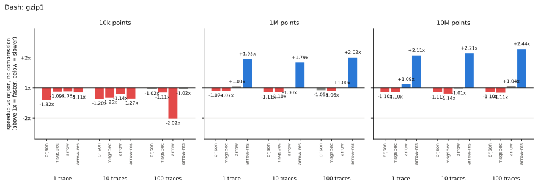

Same numbers as the chart (speedup vs orjson without compression): 10k points, 1 trace: orjson gzip1 -1.32x, msgspec gzip1 -1.09x, arrow gzip1 -1.08x, arrow-ms gzip1 -1.11x; 10k points, 10 traces: orjson gzip1 -1.28x, msgspec gzip1 -1.25x, arrow gzip1 -1.14x, arrow-ms gzip1 -1.27x; 10k points, 100 traces: orjson gzip1 -1.02x, msgspec gzip1 -1.11x, arrow gzip1 -2.02x, arrow-ms gzip1 -1.02x; 1M points, 1 trace: orjson gzip1 -1.07x, msgspec gzip1 -1.07x, arrow gzip1 +1.03x, arrow-ms gzip1 +1.95x; 1M points, 10 traces: orjson gzip1 -1.11x, msgspec gzip1 -1.10x, arrow gzip1 -1.00x, arrow-ms gzip1 +1.79x; 1M points, 100 traces: orjson gzip1 -1.05x, msgspec gzip1 -1.06x, arrow gzip1 +1.00x, arrow-ms gzip1 +2.02x; 10M points, 1 trace: orjson gzip1 -1.10x, msgspec gzip1 -1.10x, arrow gzip1 +1.09x, arrow-ms gzip1 +2.11x; 10M points, 10 traces: orjson gzip1 -1.11x, msgspec gzip1 -1.14x, arrow gzip1 -1.01x, arrow-ms gzip1 +2.21x; 10M points, 100 traces: orjson gzip1 -1.10x, msgspec gzip1 -1.11x, arrow gzip1 +1.04x, arrow-ms gzip1 +2.44x.

Total time, request sent to plot painted (median), one table per compression level:

**gzip1**

| Points | Traces | orjson, none (baseline) | orjson gzip1 | msgspec gzip1 | arrow gzip1 | arrow-ms gzip1 |
| --- | --- | --- | --- | --- | --- | --- |
| 10k | 1 | 179 ms | 236 ms ▼ **-1.32x slower** | 195 ms ▼ **-1.09x slower** | 194 ms ▼ **-1.08x slower** | 199 ms ▼ **-1.11x slower** |
| 10k | 10 | 201 ms | 257 ms ▼ **-1.28x slower** | 251 ms ▼ **-1.25x slower** | 229 ms ▼ **-1.14x slower** | 255 ms ▼ **-1.27x slower** |
| 10k | 100 | 301 ms | 308 ms = same (0.98x) | 334 ms ▼ **-1.11x slower** | 607 ms ▼ **-2.02x slower** | 306 ms = same (0.98x) |
| 1M | 1 | 1,520 ms | 1,619 ms ▼ **-1.07x slower** | 1,627 ms ▼ **-1.07x slower** | 1,470 ms = same (1.03x) | 781 ms ▲ **+1.95x faster** |
| 1M | 10 | 1,375 ms | 1,522 ms ▼ **-1.11x slower** | 1,506 ms ▼ **-1.10x slower** | 1,378 ms = same (1.00x) | 768 ms ▲ **+1.79x faster** |
| 1M | 100 | 1,458 ms | 1,532 ms = same (0.95x) | 1,547 ms ▼ **-1.06x slower** | 1,455 ms = same (1.00x) | 722 ms ▲ **+2.02x faster** |
| 10M | 1 | 14,857 ms | 16,269 ms ▼ **-1.10x slower** | 16,378 ms ▼ **-1.10x slower** | 13,670 ms ▲ **+1.09x faster** | 7,049 ms ▲ **+2.11x faster** |
| 10M | 10 | 12,594 ms | 13,929 ms ▼ **-1.11x slower** | 14,319 ms ▼ **-1.14x slower** | 12,736 ms = same (0.99x) | 5,686 ms ▲ **+2.21x faster** |
| 10M | 100 | 12,657 ms | 13,882 ms ▼ **-1.10x slower** | 14,106 ms ▼ **-1.11x slower** | 12,187 ms = same (1.04x) | 5,179 ms ▲ **+2.44x faster** |

Where the time goes

Build (Dash: running the callback, i.e. building the go.Figure), Encode and Gzip are measured on the server. Wait is request sent to first byte (includes them), Download is first to last byte, Browser is last byte to painted.

| Points | Traces | Variant | Wire MB | Raw MB | Build | Encode | Gzip | Wait | Download | Browser | Total |
| --- | --- | --- | --- | --- | --- | --- | --- | --- | --- | --- | --- |
| 10k | 1 | orjson | 0.33 | 0.33 | 1.2 | 3.0 | 0.0 | 6.6 | 0.8 | 173 | **179** |
| 10k | 1 | orjson gzip1 | 0.07 | 0.33 | 1.4 | 2.8 | 1.5 | 8.1 | 0.9 | 228 | **236** |
| 10k | 1 | msgspec gzip1 | 0.07 | 0.33 | 1.1 | 2.6 | 1.6 | 7.8 | 1.1 | 186 | **195** |
| 10k | 1 | arrow gzip1 | 0.07 | 0.13 | 1.3 | 0.6 | 1.5 | 5.5 | 0.7 | 188 | **194** |
| 10k | 1 | arrow-ms gzip1 | 0.07 | 0.13 | 1.2 | 0.5 | 1.6 | 5.5 | 0.8 | 192 | **199** |
| 10k | 10 | orjson | 0.32 | 0.32 | 3.3 | 3.1 | 0.0 | 8.8 | 0.7 | 192 | **201** |
| 10k | 10 | orjson gzip1 | 0.07 | 0.32 | 3.8 | 3.3 | 1.3 | 10 | 1.1 | 242 | **257** |
| 10k | 10 | msgspec gzip1 | 0.07 | 0.32 | 3.3 | 2.8 | 1.3 | 9.5 | 1.0 | 241 | **251** |
| 10k | 10 | arrow gzip1 | 0.04 | 0.13 | 3.6 | 0.9 | 0.9 | 7.7 | 0.6 | 221 | **229** |
| 10k | 10 | arrow-ms gzip1 | 0.04 | 0.13 | 4.1 | 1.1 | 0.9 | 8.5 | 0.8 | 246 | **255** |
| 10k | 100 | orjson | 0.33 | 0.33 | 23 | 8.6 | 0.0 | 35 | 0.8 | 266 | **301** |
| 10k | 100 | orjson gzip1 | 0.05 | 0.33 | 27 | 7.9 | 1.0 | 38 | 1.0 | 272 | **308** |
| 10k | 100 | msgspec gzip1 | 0.05 | 0.33 | 26 | 7.5 | 1.0 | 38 | 0.9 | 298 | **334** |
| 10k | 100 | arrow gzip1 | 0.05 | 0.18 | 24 | 2.5 | 1.0 | 31 | 0.7 | 578 | **607** |
| 10k | 100 | arrow-ms gzip1 | 0.05 | 0.18 | 26 | 2.5 | 1.0 | 31 | 0.8 | 276 | **306** |
| 1M | 1 | orjson | 32.02 | 32.02 | 6.7 | 300 | 0.0 | 313 | 44 | 1,155 | **1,520** |
| 1M | 1 | orjson gzip1 | 6.65 | 32.02 | 7.2 | 279 | 139 | 439 | 57 | 1,116 | **1,619** |
| 1M | 1 | msgspec gzip1 | 6.65 | 32.02 | 7.2 | 291 | 140 | 448 | 62 | 1,112 | **1,627** |
| 1M | 1 | arrow gzip1 | 6.86 | 12.01 | 15 | 11 | 152 | 184 | 30 | 1,255 | **1,470** |
| 1M | 1 | arrow-ms gzip1 | 6.86 | 12.01 | 8.1 | 11 | 153 | 173 | 33 | 578 | **781** |
| 1M | 10 | orjson | 31.59 | 31.59 | 8.7 | 254 | 0.0 | 267 | 50 | 1,069 | **1,375** |
| 1M | 10 | orjson gzip1 | 6.39 | 31.59 | 8.6 | 255 | 129 | 397 | 56 | 1,063 | **1,522** |
| 1M | 10 | msgspec gzip1 | 6.39 | 31.59 | 9.2 | 254 | 127 | 393 | 49 | 1,073 | **1,506** |
| 1M | 10 | arrow gzip1 | 6.68 | 12.01 | 9.9 | 11 | 142 | 165 | 33 | 1,174 | **1,378** |
| 1M | 10 | arrow-ms gzip1 | 6.68 | 12.01 | 9.1 | 14 | 141 | 165 | 38 | 565 | **768** |
| 1M | 100 | orjson | 31.63 | 31.63 | 32 | 222 | 0.0 | 259 | 65 | 1,107 | **1,458** |
| 1M | 100 | orjson gzip1 | 6.41 | 31.63 | 30 | 237 | 120 | 391 | 52 | 1,086 | **1,532** |
| 1M | 100 | msgspec gzip1 | 6.41 | 31.63 | 30 | 232 | 121 | 393 | 56 | 1,095 | **1,547** |
| 1M | 100 | arrow gzip1 | 6.52 | 12.06 | 32 | 16 | 131 | 181 | 32 | 1,224 | **1,455** |
| 1M | 100 | arrow-ms gzip1 | 6.52 | 12.06 | 32 | 13 | 128 | 180 | 30 | 523 | **722** |
| 10M | 1 | orjson | 320 | 320 | 138 | 2,892 | 0.0 | 3,173 | 482 | 11,026 | **14,857** |
| 10M | 1 | orjson gzip1 | 66.48 | 320 | 139 | 2,891 | 1,448 | 4,643 | 554 | 11,016 | **16,269** |
| 10M | 1 | msgspec gzip1 | 66.48 | 320 | 129 | 3,052 | 1,452 | 4,793 | 598 | 10,970 | **16,378** |
| 10M | 1 | arrow gzip1 | 68.58 | 120 | 141 | 86 | 1,538 | 1,756 | 285 | 11,671 | **13,670** |
| 10M | 1 | arrow-ms gzip1 | 68.58 | 120 | 92 | 83 | 1,544 | 1,738 | 281 | 4,991 | **7,049** |
| 10M | 10 | orjson | 316 | 316 | 113 | 2,516 | 0.0 | 2,748 | 448 | 9,432 | **12,594** |
| 10M | 10 | orjson gzip1 | 63.41 | 316 | 99 | 2,544 | 1,247 | 4,032 | 539 | 9,428 | **13,929** |
| 10M | 10 | msgspec gzip1 | 63.41 | 316 | 62 | 2,713 | 1,258 | 4,182 | 581 | 9,377 | **14,319** |
| 10M | 10 | arrow gzip1 | 65.53 | 120 | 81 | 117 | 1,325 | 1,510 | 317 | 10,814 | **12,736** |
| 10M | 10 | arrow-ms gzip1 | 65.53 | 120 | 76 | 109 | 1,355 | 1,523 | 291 | 3,873 | **5,686** |
| 10M | 100 | orjson | 316 | 316 | 71 | 2,624 | 0.0 | 2,848 | 417 | 9,369 | **12,657** |
| 10M | 100 | orjson gzip1 | 60.92 | 316 | 70 | 2,625 | 1,250 | 4,042 | 500 | 9,320 | **13,882** |
| 10M | 100 | msgspec gzip1 | 60.92 | 316 | 71 | 2,694 | 1,201 | 4,129 | 602 | 9,351 | **14,106** |
| 10M | 100 | arrow gzip1 | 62.29 | 120 | 77 | 96 | 1,224 | 1,390 | 300 | 10,495 | **12,187** |
| 10M | 100 | arrow-ms gzip1 | 62.29 | 120 | 74 | 80 | 1,221 | 1,374 | 299 | 3,510 | **5,179** |

### Dash vs FastAPI

Same transport, compression and data. ⚠️ marks Dash taking 1.5x FastAPI's time or more (8 cases). In JSON, Dash's figure repeats the timestamps in every trace, where FastAPI sends each column once, so its payload grows with the trace count.

All cases

| Points | Traces | Variant | FastAPI ms | Dash ms | Dash / FastAPI | Wire MB FastAPI / Dash |
| --- | --- | --- | --- | --- | --- | --- |
| 10k | 1 | orjson | 242 | 179 | 0.74x | 0.32 / 0.33 |
| 10k | 1 | orjson gzip1 | 252 | 236 | 0.93x | 0.07 / 0.07 |
| 10k | 1 | msgspec gzip1 | 254 | 195 | 0.77x | 0.12 / 0.07 |
| 10k | 1 | arrow gzip1 | 271 | 194 | 0.72x | 0.07 / 0.07 |
| 10k | 1 | arrow-ms gzip1 | 254 | 199 | 0.78x | 0.07 / 0.07 |
| 10k | 10 | orjson | 261 | 201 | 0.77x | 0.12 / 0.32 |
| 10k | 10 | orjson gzip1 | 276 | 257 | 0.93x | 0.05 / 0.07 |
| 10k | 10 | msgspec gzip1 | 285 | 251 | 0.88x | 0.09 / 0.07 |
| 10k | 10 | arrow gzip1 | 264 | 229 | 0.87x | 0.04 / 0.04 |
| 10k | 10 | arrow-ms gzip1 | 256 | 255 | 1.00x | 0.04 / 0.04 |
| 10k | 100 | orjson | 351 | 301 | 0.86x | 0.10 / 0.33 |
| 10k | 100 | orjson gzip1 | 349 | 308 | 0.88x | 0.05 / 0.05 |
| 10k | 100 | msgspec gzip1 | 356 | 334 | 0.94x | 0.07 / 0.05 |
| 10k | 100 | arrow gzip1 | 355 | 607 | ⚠️ **1.71x** | 0.04 / 0.05 |
| 10k | 100 | arrow-ms gzip1 | 350 | 306 | 0.87x | 0.04 / 0.05 |
| 1M | 1 | orjson | 1,125 | 1,520 | 1.35x | 32.27 / 32.02 |
| 1M | 1 | orjson gzip1 | 1,264 | 1,619 | 1.28x | 7.30 / 6.65 |
| 1M | 1 | msgspec gzip1 | 1,429 | 1,627 | 1.14x | 11.64 / 6.65 |
| 1M | 1 | arrow gzip1 | 1,338 | 1,470 | 1.10x | 6.86 / 6.86 |
| 1M | 1 | arrow-ms gzip1 | 830 | 781 | 0.94x | 6.86 / 6.86 |
| 1M | 10 | orjson | 986 | 1,375 | 1.39x | 11.76 / 31.59 |
| 1M | 10 | orjson gzip1 | 1,046 | 1,522 | 1.46x | 4.66 / 6.39 |
| 1M | 10 | msgspec gzip1 | 1,166 | 1,506 | 1.29x | 8.46 / 6.39 |
| 1M | 10 | arrow gzip1 | 1,000 | 1,378 | 1.38x | 3.66 / 6.68 |
| 1M | 10 | arrow-ms gzip1 | 631 | 768 | 1.22x | 3.66 / 6.68 |
| 1M | 100 | orjson | 1,053 | 1,458 | 1.38x | 9.74 / 31.63 |
| 1M | 100 | orjson gzip1 | 1,388 | 1,532 | 1.10x | 4.22 / 6.41 |
| 1M | 100 | msgspec gzip1 | 1,402 | 1,547 | 1.10x | 6.79 / 6.41 |
| 1M | 100 | arrow gzip1 | 1,069 | 1,455 | 1.36x | 3.03 / 6.52 |
| 1M | 100 | arrow-ms gzip1 | 770 | 722 | 0.94x | 3.03 / 6.52 |
| 10M | 1 | orjson | 10,626 | 14,857 | 1.40x | 323 / 320 |
| 10M | 1 | orjson gzip1 | 12,047 | 16,269 | 1.35x | 72.95 / 66.48 |
| 10M | 1 | msgspec gzip1 | 13,486 | 16,378 | 1.21x | 116 / 66.48 |
| 10M | 1 | arrow gzip1 | 12,063 | 13,670 | 1.13x | 68.62 / 68.58 |
| 10M | 1 | arrow-ms gzip1 | 6,998 | 7,049 | 1.01x | 68.62 / 68.58 |
| 10M | 10 | orjson | 8,119 | 12,594 | ⚠️ **1.55x** | 118 / 316 |
| 10M | 10 | orjson gzip1 | 8,946 | 13,929 | ⚠️ **1.56x** | 46.27 / 63.41 |
| 10M | 10 | msgspec gzip1 | 10,315 | 14,319 | 1.39x | 84.36 / 63.41 |
| 10M | 10 | arrow gzip1 | 8,324 | 12,736 | ⚠️ **1.53x** | 35.50 / 65.53 |
| 10M | 10 | arrow-ms gzip1 | 4,807 | 5,686 | 1.18x | 35.50 / 65.53 |
| 10M | 100 | orjson | 7,452 | 12,657 | ⚠️ **1.70x** | 97.40 / 316 |
| 10M | 100 | orjson gzip1 | 8,292 | 13,882 | ⚠️ **1.67x** | 40.55 / 60.92 |
| 10M | 100 | msgspec gzip1 | 9,156 | 14,106 | ⚠️ **1.54x** | 66.01 / 60.92 |
| 10M | 100 | arrow gzip1 | 7,450 | 12,187 | ⚠️ **1.64x** | 29.06 / 62.29 |
| 10M | 100 | arrow-ms gzip1 | 3,910 | 5,179 | 1.32x | 29.06 / 62.29 |

## 2. Full benchmark: scale, no compression, gzip 1, gzip 6

The same data as section 1, every transport at every compression level, from 5k to 10M points.

- **Command:** `python bench.py full`
- **Finished:** 2026-11-19T00:48:57+00:00 (87.3 min, median of 3 samples per case)
- **Machine:** Intel(R) Core(TM) Ultra 7 155H, Linux-6.18.58.1-microsoft-standard-WSL2-x86_64-with-glibc2.39
- **Browser:** Chromium 159.0.8154.6, visible window, WebGL on `ANGLE (Microsoft Corporation, D3D12 (NVIDIA RTX 500 Ada Generation Laptop GPU), OpenGL 4.6)`
- **Packages:** Python 3.15.2, dash 4.5.0, plotly 7.1.0, fastapi 0.164.0, uvicorn 0.54.0, orjson 3.13.0, msgspec 0.22.0, polars 2.1.0, pyarrow 26.0.1, pandas 3.1.1, numpy 2.5.5, plotly.js-dist-min 4.3.0, apache-arrow 21.2.0
- **Plot check:** every transport drew the same traces, point counts and axis ranges

### FastAPI + Plotly.js

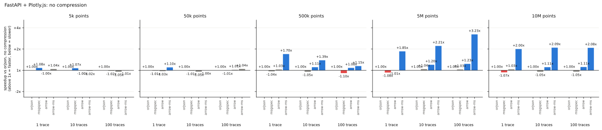

Same numbers as the chart (speedup vs orjson without compression): 5k points, 1 trace: orjson +1.00x, msgspec +1.08x, arrow -1.00x, arrow-ms +1.04x; 5k points, 10 traces: orjson +1.00x, msgspec +1.07x, arrow -1.00x, arrow-ms -1.02x; 5k points, 100 traces: orjson +1.00x, msgspec -1.02x, arrow -1.05x, arrow-ms -1.01x; 50k points, 1 trace: orjson +1.00x, msgspec -1.01x, arrow -1.03x, arrow-ms +1.10x; 50k points, 10 traces: orjson +1.00x, msgspec -1.01x, arrow -1.05x, arrow-ms -1.00x; 50k points, 100 traces: orjson +1.00x, msgspec -1.01x, arrow +1.01x, arrow-ms +1.04x; 500k points, 1 trace: orjson +1.00x, msgspec -1.04x, arrow +1.03x, arrow-ms +1.70x; 500k points, 10 traces: orjson +1.00x, msgspec -1.05x, arrow +1.11x, arrow-ms +1.39x; 500k points, 100 traces: orjson +1.00x, msgspec -1.10x, arrow +1.08x, arrow-ms +1.15x; 5M points, 1 trace: orjson +1.00x, msgspec -1.08x, arrow -1.01x, arrow-ms +1.85x; 5M points, 10 traces: orjson +1.00x, msgspec +1.04x, arrow +1.20x, arrow-ms +2.21x; 5M points, 100 traces: orjson +1.00x, msgspec +1.03x, arrow +1.23x, arrow-ms +3.23x; 10M points, 1 trace: orjson +1.00x, msgspec -1.07x, arrow +1.03x, arrow-ms +2.00x; 10M points, 10 traces: orjson +1.00x, msgspec -1.05x, arrow +1.11x, arrow-ms +2.09x; 10M points, 100 traces: orjson +1.00x, msgspec -1.05x, arrow +1.11x, arrow-ms +2.08x.

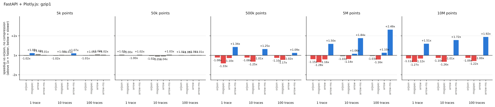

Same numbers as the chart (speedup vs orjson without compression): 5k points, 1 trace: orjson gzip1 -1.02x, msgspec gzip1 +1.08x, arrow gzip1 +1.04x, arrow-ms gzip1 +1.01x; 5k points, 10 traces: orjson gzip1 -1.02x, msgspec gzip1 +1.02x, arrow gzip1 +1.01x, arrow-ms gzip1 +1.07x; 5k points, 100 traces: orjson gzip1 -1.01x, msgspec gzip1 +1.01x, arrow gzip1 +1.03x, arrow-ms gzip1 +1.02x; 50k points, 1 trace: orjson gzip1 +1.03x, msgspec gzip1 +1.00x, arrow gzip1 -1.00x, arrow-ms gzip1 +1.02x; 50k points, 10 traces: orjson gzip1 -1.02x, msgspec gzip1 -1.05x, arrow gzip1 -1.04x, arrow-ms gzip1 +1.03x; 50k points, 100 traces: orjson gzip1 +1.01x, msgspec gzip1 +1.00x, arrow gzip1 +1.01x, arrow-ms gzip1 +1.01x; 500k points, 1 trace: orjson gzip1 -1.08x, msgspec gzip1 -1.33x, arrow gzip1 -1.10x, arrow-ms gzip1 +1.34x; 500k points, 10 traces: orjson gzip1 -1.08x, msgspec gzip1 -1.25x, arrow gzip1 -1.01x, arrow-ms gzip1 +1.25x; 500k points, 100 traces: orjson gzip1 -1.10x, msgspec gzip1 -1.17x, arrow gzip1 -1.02x, arrow-ms gzip1 +1.09x; 5M points, 1 trace: orjson gzip1 -1.15x, msgspec gzip1 -1.28x, arrow gzip1 -1.16x, arrow-ms gzip1 +1.50x; 5M points, 10 traces: orjson gzip1 -1.03x, msgspec gzip1 -1.14x, arrow gzip1 +1.06x, arrow-ms gzip1 +1.84x; 5M points, 100 traces: orjson gzip1 -1.03x, msgspec gzip1 -1.16x, arrow gzip1 +1.10x, arrow-ms gzip1 +2.49x; 10M points, 1 trace: orjson gzip1 -1.11x, msgspec gzip1 -1.27x, arrow gzip1 -1.12x, arrow-ms gzip1 +1.51x; 10M points, 10 traces: orjson gzip1 -1.10x, msgspec gzip1 -1.26x, arrow gzip1 -1.01x, arrow-ms gzip1 +1.72x; 10M points, 100 traces: orjson gzip1 -1.09x, msgspec gzip1 -1.22x, arrow gzip1 -1.00x, arrow-ms gzip1 +1.92x.

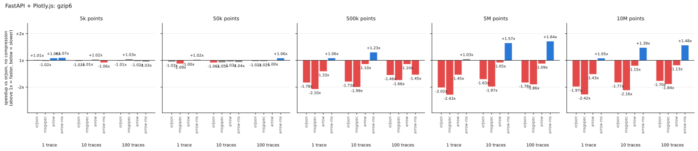

Same numbers as the chart (speedup vs orjson without compression): 5k points, 1 trace: orjson gzip6 +1.01x, msgspec gzip6 -1.02x, arrow gzip6 +1.06x, arrow-ms gzip6 +1.07x; 5k points, 10 traces: orjson gzip6 -1.02x, msgspec gzip6 -1.01x, arrow gzip6 +1.02x, arrow-ms gzip6 -1.06x; 5k points, 100 traces: orjson gzip6 -1.01x, msgspec gzip6 +1.03x, arrow gzip6 -1.02x, arrow-ms gzip6 -1.03x; 50k points, 1 trace: orjson gzip6 -1.03x, msgspec gzip6 -1.09x, arrow gzip6 -1.00x, arrow-ms gzip6 +1.02x; 50k points, 10 traces: orjson gzip6 -1.06x, msgspec gzip6 -1.05x, arrow gzip6 -1.03x, arrow-ms gzip6 -1.04x; 50k points, 100 traces: orjson gzip6 -1.02x, msgspec gzip6 -1.02x, arrow gzip6 -1.00x, arrow-ms gzip6 +1.06x; 500k points, 1 trace: orjson gzip6 -1.78x, msgspec gzip6 -2.10x, arrow gzip6 -1.33x, arrow-ms gzip6 +1.06x; 500k points, 10 traces: orjson gzip6 -1.73x, msgspec gzip6 -1.99x, arrow gzip6 -1.10x, arrow-ms gzip6 +1.23x; 500k points, 100 traces: orjson gzip6 -1.46x, msgspec gzip6 -1.66x, arrow gzip6 -1.10x, arrow-ms gzip6 -1.45x; 5M points, 1 trace: orjson gzip6 -2.02x, msgspec gzip6 -2.43x, arrow gzip6 -1.45x, arrow-ms gzip6 +1.03x; 5M points, 10 traces: orjson gzip6 -1.63x, msgspec gzip6 -1.97x, arrow gzip6 -1.05x, arrow-ms gzip6 +1.57x; 5M points, 100 traces: orjson gzip6 -1.78x, msgspec gzip6 -1.86x, arrow gzip6 -1.09x, arrow-ms gzip6 +1.64x; 10M points, 1 trace: orjson gzip6 -1.97x, msgspec gzip6 -2.42x, arrow gzip6 -1.43x, arrow-ms gzip6 +1.05x; 10M points, 10 traces: orjson gzip6 -1.77x, msgspec gzip6 -2.16x, arrow gzip6 -1.15x, arrow-ms gzip6 +1.39x; 10M points, 100 traces: orjson gzip6 -1.70x, msgspec gzip6 -1.84x, arrow gzip6 -1.13x, arrow-ms gzip6 +1.48x.

Total time, request sent to plot painted (median), one table per compression level:

**No compression**

| Points | Traces | orjson, none (baseline) | msgspec | arrow | arrow-ms |
| --- | --- | --- | --- | --- | --- |
| 5k | 1 | 264 ms | 244 ms ▲ **+1.08x faster** | 264 ms = same (1.00x) | 253 ms = same (1.04x) |
| 5k | 10 | 270 ms | 252 ms ▲ **+1.07x faster** | 271 ms = same (1.00x) | 274 ms = same (0.99x) |
| 5k | 100 | 352 ms | 358 ms = same (0.98x) | 370 ms = same (0.95x) | 355 ms = same (0.99x) |
| 50k | 1 | 286 ms | 289 ms = same (0.99x) | 294 ms = same (0.97x) | 260 ms ▲ **+1.10x faster** |
| 50k | 10 | 286 ms | 290 ms = same (0.99x) | 299 ms = same (0.96x) | 286 ms = same (1.00x) |
| 50k | 100 | 408 ms | 410 ms = same (0.99x) | 402 ms = same (1.01x) | 391 ms = same (1.04x) |
| 500k | 1 | 673 ms | 697 ms = same (0.97x) | 656 ms = same (1.03x) | 396 ms ▲ **+1.70x faster** |
| 500k | 10 | 488 ms | 512 ms = same (0.95x) | 441 ms ▲ **+1.11x faster** | 352 ms ▲ **+1.39x faster** |
| 500k | 100 | 593 ms | 650 ms ▼ **-1.10x slower** | 548 ms ▲ **+1.08x faster** | 517 ms ▲ **+1.15x faster** |
| 5M | 1 | 5,291 ms | 5,693 ms ▼ **-1.08x slower** | 5,321 ms = same (0.99x) | 2,854 ms ▲ **+1.85x faster** |
| 5M | 10 | 4,474 ms | 4,306 ms = same (1.04x) | 3,738 ms ▲ **+1.20x faster** | 2,021 ms ▲ **+2.21x faster** |
| 5M | 100 | 3,360 ms | 3,272 ms = same (1.03x) | 2,726 ms ▲ **+1.23x faster** | 1,041 ms ▲ **+3.23x faster** |
| 10M | 1 | 10,603 ms | 11,343 ms ▼ **-1.07x slower** | 10,290 ms = same (1.03x) | 5,301 ms ▲ **+2.00x faster** |
| 10M | 10 | 8,219 ms | 8,630 ms = same (0.95x) | 7,432 ms ▲ **+1.11x faster** | 3,930 ms ▲ **+2.09x faster** |
| 10M | 100 | 7,461 ms | 7,820 ms = same (0.95x) | 6,705 ms ▲ **+1.11x faster** | 3,586 ms ▲ **+2.08x faster** |

**gzip1**

| Points | Traces | orjson, none (baseline) | orjson gzip1 | msgspec gzip1 | arrow gzip1 | arrow-ms gzip1 |
| --- | --- | --- | --- | --- | --- | --- |
| 5k | 1 | 264 ms | 268 ms = same (0.99x) | 244 ms ▲ **+1.08x faster** | 253 ms = same (1.04x) | 260 ms = same (1.01x) |
| 5k | 10 | 270 ms | 274 ms = same (0.98x) | 265 ms = same (1.02x) | 267 ms = same (1.01x) | 251 ms ▲ **+1.07x faster** |
| 5k | 100 | 352 ms | 356 ms = same (0.99x) | 348 ms = same (1.01x) | 341 ms = same (1.03x) | 345 ms = same (1.02x) |
| 50k | 1 | 286 ms | 278 ms = same (1.03x) | 285 ms = same (1.00x) | 286 ms = same (1.00x) | 280 ms = same (1.02x) |
| 50k | 10 | 286 ms | 292 ms = same (0.98x) | 299 ms = same (0.96x) | 297 ms = same (0.96x) | 279 ms = same (1.03x) |
| 50k | 100 | 408 ms | 404 ms = same (1.01x) | 408 ms = same (1.00x) | 402 ms = same (1.01x) | 404 ms = same (1.01x) |
| 500k | 1 | 673 ms | 728 ms ▼ **-1.08x slower** | 896 ms ▼ **-1.33x slower** | 742 ms ▼ **-1.10x slower** | 500 ms ▲ **+1.34x faster** |
| 500k | 10 | 488 ms | 529 ms ▼ **-1.08x slower** | 610 ms ▼ **-1.25x slower** | 494 ms = same (0.99x) | 390 ms ▲ **+1.25x faster** |
| 500k | 100 | 593 ms | 650 ms ▼ **-1.10x slower** | 696 ms ▼ **-1.17x slower** | 607 ms = same (0.98x) | 544 ms ▲ **+1.09x faster** |
| 5M | 1 | 5,291 ms | 6,072 ms ▼ **-1.15x slower** | 6,775 ms ▼ **-1.28x slower** | 6,114 ms ▼ **-1.16x slower** | 3,519 ms ▲ **+1.50x faster** |
| 5M | 10 | 4,474 ms | 4,619 ms = same (0.97x) | 5,103 ms ▼ **-1.14x slower** | 4,234 ms ▲ **+1.06x faster** | 2,428 ms ▲ **+1.84x faster** |
| 5M | 100 | 3,360 ms | 3,446 ms = same (0.97x) | 3,897 ms ▼ **-1.16x slower** | 3,066 ms ▲ **+1.10x faster** | 1,348 ms ▲ **+2.49x faster** |
| 10M | 1 | 10,603 ms | 11,806 ms ▼ **-1.11x slower** | 13,439 ms ▼ **-1.27x slower** | 11,885 ms ▼ **-1.12x slower** | 7,019 ms ▲ **+1.51x faster** |
| 10M | 10 | 8,219 ms | 9,015 ms ▼ **-1.10x slower** | 10,344 ms ▼ **-1.26x slower** | 8,333 ms = same (0.99x) | 4,776 ms ▲ **+1.72x faster** |
| 10M | 100 | 7,461 ms | 8,169 ms ▼ **-1.09x slower** | 9,134 ms ▼ **-1.22x slower** | 7,496 ms = same (1.00x) | 3,880 ms ▲ **+1.92x faster** |

**gzip6**

| Points | Traces | orjson, none (baseline) | orjson gzip6 | msgspec gzip6 | arrow gzip6 | arrow-ms gzip6 |
| --- | --- | --- | --- | --- | --- | --- |
| 5k | 1 | 264 ms | 261 ms = same (1.01x) | 268 ms = same (0.99x) | 250 ms ▲ **+1.06x faster** | 247 ms ▲ **+1.07x faster** |
| 5k | 10 | 270 ms | 274 ms = same (0.98x) | 272 ms = same (0.99x) | 264 ms = same (1.02x) | 285 ms ▼ **-1.06x slower** |
| 5k | 100 | 352 ms | 356 ms = same (0.99x) | 341 ms = same (1.03x) | 359 ms = same (0.98x) | 364 ms = same (0.97x) |
| 50k | 1 | 286 ms | 295 ms = same (0.97x) | 310 ms ▼ **-1.09x slower** | 287 ms = same (1.00x) | 281 ms = same (1.02x) |
| 50k | 10 | 286 ms | 302 ms ▼ **-1.06x slower** | 301 ms = same (0.95x) | 294 ms = same (0.97x) | 298 ms = same (0.96x) |
| 50k | 100 | 408 ms | 416 ms = same (0.98x) | 416 ms = same (0.98x) | 409 ms = same (1.00x) | 386 ms ▲ **+1.06x faster** |
| 500k | 1 | 673 ms | 1,195 ms ▼ **-1.78x slower** | 1,414 ms ▼ **-2.10x slower** | 892 ms ▼ **-1.33x slower** | 636 ms ▲ **+1.06x faster** |
| 500k | 10 | 488 ms | 845 ms ▼ **-1.73x slower** | 971 ms ▼ **-1.99x slower** | 537 ms ▼ **-1.10x slower** | 396 ms ▲ **+1.23x faster** |
| 500k | 100 | 593 ms | 866 ms ▼ **-1.46x slower** | 987 ms ▼ **-1.66x slower** | 653 ms ▼ **-1.10x slower** | 859 ms ▼ **-1.45x slower** |
| 5M | 1 | 5,291 ms | 10,686 ms ▼ **-2.02x slower** | 12,866 ms ▼ **-2.43x slower** | 7,666 ms ▼ **-1.45x slower** | 5,123 ms = same (1.03x) |
| 5M | 10 | 4,474 ms | 7,274 ms ▼ **-1.63x slower** | 8,814 ms ▼ **-1.97x slower** | 4,716 ms ▼ **-1.05x slower** | 2,856 ms ▲ **+1.57x faster** |
| 5M | 100 | 3,360 ms | 5,964 ms ▼ **-1.78x slower** | 6,250 ms ▼ **-1.86x slower** | 3,648 ms ▼ **-1.09x slower** | 2,052 ms ▲ **+1.64x faster** |
| 10M | 1 | 10,603 ms | 20,893 ms ▼ **-1.97x slower** | 25,616 ms ▼ **-2.42x slower** | 15,139 ms ▼ **-1.43x slower** | 10,056 ms ▲ **+1.05x faster** |
| 10M | 10 | 8,219 ms | 14,535 ms ▼ **-1.77x slower** | 17,784 ms ▼ **-2.16x slower** | 9,442 ms ▼ **-1.15x slower** | 5,923 ms ▲ **+1.39x faster** |
| 10M | 100 | 7,461 ms | 12,690 ms ▼ **-1.70x slower** | 13,763 ms ▼ **-1.84x slower** | 8,464 ms ▼ **-1.13x slower** | 5,048 ms ▲ **+1.48x faster** |

Where the time goes

Build (Dash: running the callback, i.e. building the go.Figure), Encode and Gzip are measured on the server. Wait is request sent to first byte (includes them), Download is first to last byte, Browser is last byte to painted. For FastAPI, Browser splits into decode (JSON.parse or Arrow read, building traces), plotly.js, and paint.

| Points | Traces | Variant | Wire MB | Raw MB | Build | Encode | Gzip | Wait | Download | Browser | (decode | plot | paint) | Total |
| --- | --- | --- | --- | --- | --- | --- | --- | --- | --- | --- | --- | --- | --- | --- |
| 5k | 1 | orjson | 0.16 | 0.16 | - | 0.3 | 0.0 | 2.2 | 0.5 | 261 | 0.4 | 258 | 1.6 | **264** |
| 5k | 1 | msgspec | 0.20 | 0.20 | - | 0.6 | 0.0 | 2.4 | 0.6 | 242 | 0.4 | 239 | 1.7 | **244** |
| 5k | 1 | arrow | 0.06 | 0.06 | - | 0.3 | 0.0 | 2.0 | 0.5 | 261 | 5.8 | 252 | 2.0 | **264** |
| 5k | 1 | arrow-ms | 0.06 | 0.06 | - | 0.2 | 0.0 | 2.1 | 0.4 | 251 | 3.1 | 246 | 1.7 | **253** |
| 5k | 1 | orjson gzip1 | 0.04 | 0.16 | - | 0.3 | 0.7 | 2.8 | 0.5 | 264 | 0.3 | 262 | 1.6 | **268** |
| 5k | 1 | msgspec gzip1 | 0.06 | 0.20 | - | 0.5 | 1.0 | 3.4 | 0.7 | 240 | 0.3 | 236 | 1.7 | **244** |
| 5k | 1 | arrow gzip1 | 0.04 | 0.06 | - | 0.3 | 0.8 | 3.0 | 0.6 | 248 | 4.7 | 241 | 1.7 | **253** |
| 5k | 1 | arrow-ms gzip1 | 0.04 | 0.06 | - | 0.3 | 0.7 | 2.8 | 0.5 | 257 | 3.5 | 251 | 1.7 | **260** |
| 5k | 1 | orjson gzip6 | 0.04 | 0.16 | - | 0.3 | 4.4 | 6.8 | 0.7 | 253 | 0.5 | 250 | 1.6 | **261** |
| 5k | 1 | msgspec gzip6 | 0.06 | 0.20 | - | 0.5 | 6.6 | 9.4 | 0.8 | 258 | 0.4 | 255 | 1.7 | **268** |
| 5k | 1 | arrow gzip6 | 0.03 | 0.06 | - | 0.3 | 2.7 | 5.0 | 0.9 | 244 | 5.1 | 237 | 1.7 | **250** |
| 5k | 1 | arrow-ms gzip6 | 0.03 | 0.06 | - | 0.3 | 2.3 | 4.4 | 0.5 | 242 | 3.4 | 237 | 1.9 | **247** |
| 5k | 10 | orjson | 0.06 | 0.06 | - | 0.2 | 0.0 | 2.0 | 0.3 | 268 | 0.3 | 265 | 1.7 | **270** |
| 5k | 10 | msgspec | 0.10 | 0.10 | - | 0.3 | 0.0 | 2.3 | 0.4 | 249 | 0.3 | 246 | 1.9 | **252** |
| 5k | 10 | arrow | 0.03 | 0.03 | - | 0.2 | 0.0 | 2.1 | 0.3 | 269 | 3.8 | 263 | 1.9 | **271** |
| 5k | 10 | arrow-ms | 0.03 | 0.03 | - | 0.2 | 0.0 | 2.0 | 0.3 | 272 | 3.3 | 266 | 1.7 | **274** |
| 5k | 10 | orjson gzip1 | 0.03 | 0.06 | - | 0.2 | 0.4 | 2.4 | 0.4 | 271 | 0.3 | 268 | 1.8 | **274** |
| 5k | 10 | msgspec gzip1 | 0.05 | 0.10 | - | 0.3 | 0.8 | 2.9 | 0.6 | 262 | 0.3 | 259 | 1.8 | **265** |
| 5k | 10 | arrow gzip1 | 0.02 | 0.03 | - | 0.2 | 0.4 | 2.4 | 0.4 | 264 | 3.9 | 258 | 1.6 | **267** |
| 5k | 10 | arrow-ms gzip1 | 0.02 | 0.03 | - | 0.2 | 0.4 | 2.4 | 0.4 | 248 | 3.4 | 243 | 1.7 | **251** |
| 5k | 10 | orjson gzip6 | 0.02 | 0.06 | - | 0.2 | 2.1 | 4.2 | 0.5 | 270 | 0.3 | 267 | 1.7 | **274** |
| 5k | 10 | msgspec gzip6 | 0.04 | 0.10 | - | 0.3 | 3.5 | 5.7 | 0.6 | 266 | 0.2 | 263 | 1.6 | **272** |
| 5k | 10 | arrow gzip6 | 0.02 | 0.03 | - | 0.2 | 0.6 | 2.7 | 0.5 | 261 | 4.0 | 254 | 1.8 | **264** |
| 5k | 10 | arrow-ms gzip6 | 0.02 | 0.03 | - | 0.2 | 0.6 | 2.8 | 0.6 | 281 | 3.3 | 275 | 1.6 | **285** |
| 5k | 100 | orjson | 0.05 | 0.05 | - | 0.3 | 0.0 | 2.3 | 0.4 | 350 | 0.4 | 347 | 1.6 | **352** |
| 5k | 100 | msgspec | 0.09 | 0.09 | - | 0.4 | 0.0 | 2.3 | 0.3 | 356 | 0.4 | 353 | 1.6 | **358** |
| 5k | 100 | arrow | 0.04 | 0.04 | - | 0.3 | 0.0 | 2.1 | 0.3 | 367 | 5.7 | 359 | 1.8 | **370** |
| 5k | 100 | arrow-ms | 0.04 | 0.04 | - | 0.3 | 0.0 | 2.0 | 0.3 | 353 | 5.0 | 346 | 1.8 | **355** |
| 5k | 100 | orjson gzip1 | 0.02 | 0.05 | - | 0.3 | 0.5 | 2.7 | 0.6 | 353 | 0.4 | 350 | 1.7 | **356** |
| 5k | 100 | msgspec gzip1 | 0.04 | 0.09 | - | 0.4 | 0.7 | 2.9 | 0.5 | 344 | 0.4 | 341 | 1.6 | **348** |
| 5k | 100 | arrow gzip1 | 0.02 | 0.04 | - | 0.3 | 0.5 | 3.1 | 0.6 | 337 | 5.5 | 329 | 2.0 | **341** |
| 5k | 100 | arrow-ms gzip1 | 0.02 | 0.04 | - | 0.3 | 0.4 | 2.7 | 0.4 | 342 | 5.1 | 334 | 1.6 | **345** |
| 5k | 100 | orjson gzip6 | 0.02 | 0.05 | - | 0.3 | 2.1 | 4.2 | 0.4 | 351 | 0.4 | 348 | 1.8 | **356** |
| 5k | 100 | msgspec gzip6 | 0.03 | 0.09 | - | 0.4 | 3.0 | 5.4 | 0.7 | 335 | 0.5 | 333 | 1.9 | **341** |
| 5k | 100 | arrow gzip6 | 0.02 | 0.04 | - | 0.3 | 0.6 | 2.8 | 0.5 | 356 | 5.1 | 348 | 1.6 | **359** |
| 5k | 100 | arrow-ms gzip6 | 0.02 | 0.04 | - | 0.3 | 0.6 | 2.8 | 0.4 | 360 | 5.1 | 352 | 1.9 | **364** |
| 50k | 1 | orjson | 1.61 | 1.61 | - | 2.2 | 0.0 | 3.9 | 1.6 | 280 | 4.0 | 269 | 1.6 | **286** |
| 50k | 1 | msgspec | 2.05 | 2.05 | - | 3.3 | 0.0 | 5.6 | 2.0 | 282 | 4.5 | 271 | 1.7 | **289** |
| 50k | 1 | arrow | 0.60 | 0.60 | - | 0.7 | 0.0 | 2.6 | 0.7 | 290 | 12 | 279 | 1.7 | **294** |
| 50k | 1 | arrow-ms | 0.60 | 0.60 | - | 0.7 | 0.0 | 2.7 | 0.9 | 256 | 5.0 | 248 | 1.7 | **260** |
| 50k | 1 | orjson gzip1 | 0.37 | 1.61 | - | 2.0 | 5.8 | 9.7 | 2.8 | 266 | 4.2 | 256 | 1.8 | **278** |
| 50k | 1 | msgspec gzip1 | 0.58 | 2.05 | - | 4.1 | 9.4 | 16 | 4.0 | 264 | 4.9 | 254 | 1.6 | **285** |
| 50k | 1 | arrow gzip1 | 0.35 | 0.60 | - | 0.5 | 7.6 | 10 | 2.0 | 272 | 12 | 258 | 1.6 | **286** |
| 50k | 1 | arrow-ms gzip1 | 0.35 | 0.60 | - | 0.7 | 7.7 | 10 | 1.9 | 267 | 5.0 | 259 | 1.6 | **280** |
| 50k | 1 | orjson gzip6 | 0.36 | 1.61 | - | 1.9 | 50 | 54 | 2.7 | 240 | 4.3 | 230 | 1.6 | **295** |
| 50k | 1 | msgspec gzip6 | 0.56 | 2.05 | - | 3.6 | 70 | 75 | 4.3 | 227 | 4.4 | 215 | 1.8 | **310** |
| 50k | 1 | arrow gzip6 | 0.33 | 0.60 | - | 0.6 | 24 | 26 | 1.9 | 259 | 13 | 243 | 1.7 | **287** |
| 50k | 1 | arrow-ms gzip6 | 0.33 | 0.60 | - | 0.7 | 24 | 27 | 1.9 | 252 | 5.1 | 243 | 1.9 | **281** |
| 50k | 10 | orjson | 0.59 | 0.59 | - | 0.8 | 0.0 | 2.8 | 0.7 | 282 | 1.2 | 278 | 1.7 | **286** |
| 50k | 10 | msgspec | 1.02 | 1.02 | - | 1.9 | 0.0 | 3.9 | 1.0 | 285 | 2.0 | 278 | 1.8 | **290** |
| 50k | 10 | arrow | 0.24 | 0.24 | - | 0.5 | 0.0 | 2.2 | 0.4 | 296 | 5.2 | 288 | 1.8 | **299** |
| 50k | 10 | arrow-ms | 0.24 | 0.24 | - | 0.5 | 0.0 | 2.5 | 0.4 | 283 | 3.9 | 277 | 1.9 | **286** |
| 50k | 10 | orjson gzip1 | 0.24 | 0.59 | - | 0.8 | 3.9 | 6.6 | 1.6 | 283 | 1.3 | 279 | 1.6 | **292** |
| 50k | 10 | msgspec gzip1 | 0.44 | 1.02 | - | 2.1 | 6.9 | 11 | 2.8 | 285 | 1.8 | 278 | 1.9 | **299** |
| 50k | 10 | arrow gzip1 | 0.19 | 0.24 | - | 0.5 | 4.6 | 7.2 | 1.4 | 288 | 5.3 | 279 | 1.8 | **297** |
| 50k | 10 | arrow-ms gzip1 | 0.19 | 0.24 | - | 0.5 | 4.5 | 6.8 | 1.3 | 271 | 3.9 | 264 | 1.9 | **279** |
| 50k | 10 | orjson gzip6 | 0.22 | 0.59 | - | 0.8 | 34 | 37 | 1.8 | 263 | 1.3 | 259 | 1.7 | **302** |
| 50k | 10 | msgspec gzip6 | 0.37 | 1.02 | - | 1.9 | 47 | 51 | 2.7 | 248 | 1.7 | 242 | 1.7 | **301** |
| 50k | 10 | arrow gzip6 | 0.19 | 0.24 | - | 0.5 | 7.9 | 10 | 1.2 | 282 | 5.3 | 274 | 2.1 | **294** |
| 50k | 10 | arrow-ms gzip6 | 0.19 | 0.24 | - | 0.4 | 8.3 | 11 | 1.1 | 286 | 4.1 | 280 | 1.7 | **298** |
| 50k | 100 | orjson | 0.49 | 0.49 | - | 0.8 | 0.0 | 2.7 | 0.7 | 405 | 1.2 | 401 | 1.6 | **408** |
| 50k | 100 | msgspec | 0.91 | 0.91 | - | 2.3 | 0.0 | 4.2 | 1.0 | 405 | 2.0 | 398 | 2.1 | **410** |
| 50k | 100 | arrow | 0.22 | 0.22 | - | 0.5 | 0.0 | 2.4 | 0.5 | 399 | 5.7 | 391 | 2.0 | **402** |
| 50k | 100 | arrow-ms | 0.22 | 0.22 | - | 0.4 | 0.0 | 2.3 | 0.5 | 388 | 4.9 | 380 | 1.7 | **391** |
| 50k | 100 | orjson gzip1 | 0.22 | 0.49 | - | 0.9 | 3.8 | 6.8 | 1.3 | 396 | 1.4 | 392 | 2.0 | **404** |
| 50k | 100 | msgspec gzip1 | 0.35 | 0.91 | - | 2.1 | 5.5 | 9.9 | 2.3 | 396 | 1.6 | 390 | 1.7 | **408** |
| 50k | 100 | arrow gzip1 | 0.17 | 0.22 | - | 0.4 | 4.0 | 6.3 | 1.2 | 395 | 5.6 | 387 | 1.7 | **402** |
| 50k | 100 | arrow-ms gzip1 | 0.17 | 0.22 | - | 0.5 | 4.0 | 6.7 | 1.4 | 396 | 5.0 | 388 | 1.6 | **404** |
| 50k | 100 | orjson gzip6 | 0.20 | 0.49 | - | 1.0 | 31 | 34 | 1.7 | 380 | 1.5 | 376 | 1.7 | **416** |
| 50k | 100 | msgspec gzip6 | 0.29 | 0.91 | - | 2.1 | 31 | 36 | 2.3 | 378 | 1.4 | 373 | 1.7 | **416** |
| 50k | 100 | arrow gzip6 | 0.17 | 0.22 | - | 0.5 | 6.0 | 8.6 | 1.5 | 398 | 5.7 | 390 | 1.8 | **409** |
| 50k | 100 | arrow-ms gzip6 | 0.17 | 0.22 | - | 0.5 | 5.9 | 8.2 | 1.3 | 376 | 5.3 | 369 | 1.8 | **386** |
| 500k | 1 | orjson | 16.14 | 16.14 | - | 18 | 0.0 | 20 | 17 | 636 | 47 | 551 | 1.6 | **673** |
| 500k | 1 | msgspec | 20.48 | 20.48 | - | 48 | 0.0 | 50 | 19 | 614 | 62 | 544 | 1.9 | **697** |
| 500k | 1 | arrow | 6.00 | 6.00 | - | 5.7 | 0.0 | 8.1 | 4.9 | 643 | 59 | 575 | 1.6 | **656** |
| 500k | 1 | arrow-ms | 6.00 | 6.00 | - | 5.3 | 0.0 | 7.7 | 5.0 | 384 | 15 | 353 | 1.7 | **396** |
| 500k | 1 | orjson gzip1 | 3.65 | 16.14 | - | 18 | 56 | 76 | 20 | 635 | 47 | 551 | 1.7 | **728** |
| 500k | 1 | msgspec gzip1 | 5.82 | 20.48 | - | 51 | 87 | 140 | 30 | 726 | 52 | 546 | 116 | **896** |
| 500k | 1 | arrow gzip1 | 3.43 | 6.00 | - | 5.3 | 74 | 81 | 18 | 644 | 53 | 578 | 1.7 | **742** |
| 500k | 1 | arrow-ms gzip1 | 3.43 | 6.00 | - | 5.3 | 79 | 90 | 17 | 393 | 16 | 363 | 8.9 | **500** |
| 500k | 1 | orjson gzip6 | 3.50 | 16.14 | - | 18 | 516 | 539 | 22 | 635 | 42 | 560 | 3.1 | **1,195** |
| 500k | 1 | msgspec gzip6 | 5.44 | 20.48 | - | 50 | 717 | 775 | 30 | 609 | 50 | 542 | 3.1 | **1,414** |
| 500k | 1 | arrow gzip6 | 3.26 | 6.00 | - | 5.5 | 235 | 242 | 14 | 636 | 51 | 575 | 1.9 | **892** |
| 500k | 1 | arrow-ms gzip6 | 3.26 | 6.00 | - | 5.7 | 237 | 245 | 14 | 372 | 14 | 346 | 1.6 | **636** |
| 500k | 10 | orjson | 5.88 | 5.88 | - | 6.7 | 0.0 | 8.9 | 4.5 | 474 | 15 | 443 | 2.3 | **488** |
| 500k | 10 | msgspec | 10.21 | 10.21 | - | 18 | 0.0 | 21 | 8.2 | 482 | 19 | 439 | 2.5 | **512** |
| 500k | 10 | arrow | 2.40 | 2.40 | - | 2.6 | 0.0 | 4.9 | 1.8 | 435 | 12 | 414 | 1.8 | **441** |
| 500k | 10 | arrow-ms | 2.40 | 2.40 | - | 2.8 | 0.0 | 4.8 | 2.0 | 345 | 5.7 | 333 | 1.7 | **352** |
| 500k | 10 | orjson gzip1 | 2.34 | 5.88 | - | 6.5 | 37 | 46 | 11 | 471 | 16 | 441 | 1.9 | **529** |
| 500k | 10 | msgspec gzip1 | 4.25 | 10.21 | - | 18 | 69 | 89 | 21 | 499 | 20 | 445 | 1.5 | **610** |
| 500k | 10 | arrow gzip1 | 1.85 | 2.40 | - | 2.9 | 47 | 51 | 9.1 | 434 | 13 | 415 | 1.7 | **494** |
| 500k | 10 | arrow-ms gzip1 | 1.85 | 2.40 | - | 2.7 | 45 | 50 | 9.5 | 329 | 5.8 | 316 | 1.7 | **390** |
| 500k | 10 | orjson gzip6 | 2.14 | 5.88 | - | 6.6 | 353 | 362 | 13 | 474 | 15 | 447 | 1.6 | **845** |
| 500k | 10 | msgspec gzip6 | 3.66 | 10.21 | - | 18 | 440 | 460 | 20 | 490 | 18 | 447 | 2.9 | **971** |
| 500k | 10 | arrow gzip6 | 1.82 | 2.40 | - | 2.8 | 86 | 91 | 9.1 | 436 | 9.2 | 420 | 1.7 | **537** |
| 500k | 10 | arrow-ms gzip6 | 1.82 | 2.40 | - | 2.9 | 86 | 91 | 9.3 | 298 | 5.9 | 284 | 1.7 | **396** |
| 500k | 100 | orjson | 4.87 | 4.87 | - | 5.6 | 0.0 | 7.7 | 4.1 | 581 | 13 | 555 | 1.7 | **593** |
| 500k | 100 | msgspec | 9.04 | 9.04 | - | 18 | 0.0 | 20 | 8.4 | 623 | 16 | 582 | 1.8 | **650** |
| 500k | 100 | arrow | 2.05 | 2.05 | - | 2.1 | 0.0 | 3.9 | 1.7 | 543 | 6.8 | 529 | 1.8 | **548** |
| 500k | 100 | arrow-ms | 2.05 | 2.05 | - | 2.4 | 0.0 | 4.5 | 1.7 | 511 | 5.5 | 498 | 1.9 | **517** |
| 500k | 100 | orjson gzip1 | 2.14 | 4.87 | - | 5.5 | 37 | 44 | 10 | 595 | 13 | 568 | 1.8 | **650** |
| 500k | 100 | msgspec gzip1 | 3.41 | 9.04 | - | 19 | 56 | 76 | 18 | 601 | 16 | 563 | 1.9 | **696** |
| 500k | 100 | arrow gzip1 | 1.54 | 2.05 | - | 2.3 | 31 | 36 | 8.1 | 563 | 7.5 | 550 | 1.7 | **607** |
| 500k | 100 | arrow-ms gzip1 | 1.54 | 2.05 | - | 2.4 | 32 | 36 | 8.4 | 499 | 5.5 | 487 | 1.7 | **544** |
| 500k | 100 | orjson gzip6 | 1.83 | 4.87 | - | 5.5 | 313 | 321 | 12 | 534 | 12 | 510 | 1.8 | **866** |
| 500k | 100 | msgspec gzip6 | 2.76 | 9.04 | - | 18 | 346 | 366 | 16 | 619 | 16 | 580 | 3.2 | **987** |
| 500k | 100 | arrow gzip6 | 1.53 | 2.05 | - | 2.2 | 71 | 75 | 8.7 | 566 | 8.0 | 552 | 1.9 | **653** |
| 500k | 100 | arrow-ms gzip6 | 1.53 | 2.05 | - | 2.3 | 73 | 78 | 8.7 | 772 | 5.5 | 413 | 349 | **859** |
| 5M | 1 | orjson | 161 | 161 | - | 230 | 0.0 | 232 | 79 | 4,977 | 573 | 4,312 | 3.1 | **5,291** |
| 5M | 1 | msgspec | 205 | 205 | - | 554 | 0.0 | 556 | 94 | 5,038 | 583 | 4,332 | 3.0 | **5,693** |
| 5M | 1 | arrow | 60.00 | 60.00 | - | 42 | 0.0 | 44 | 41 | 5,241 | 538 | 4,617 | 2.9 | **5,321** |
| 5M | 1 | arrow-ms | 60.00 | 60.00 | - | 45 | 0.0 | 47 | 41 | 2,766 | 126 | 2,338 | 275 | **2,854** |
| 5M | 1 | orjson gzip1 | 36.48 | 161 | - | 232 | 559 | 800 | 173 | 5,094 | 557 | 4,454 | 1.9 | **6,072** |
| 5M | 1 | msgspec gzip1 | 58.17 | 205 | - | 547 | 896 | 1,460 | 266 | 5,030 | 608 | 4,313 | 1.8 | **6,775** |
| 5M | 1 | arrow gzip1 | 34.31 | 60.00 | - | 42 | 768 | 815 | 144 | 5,138 | 508 | 4,590 | 1.8 | **6,114** |
| 5M | 1 | arrow-ms gzip1 | 34.31 | 60.00 | - | 19 | 778 | 812 | 146 | 2,564 | 115 | 2,412 | 1.7 | **3,519** |
| 5M | 1 | orjson gzip6 | 34.81 | 161 | - | 226 | 5,131 | 5,374 | 195 | 5,167 | 581 | 4,496 | 1.7 | **10,686** |
| 5M | 1 | msgspec gzip6 | 54.34 | 205 | - | 597 | 6,976 | 7,574 | 268 | 5,020 | 583 | 4,344 | 1.8 | **12,866** |
| 5M | 1 | arrow gzip6 | 32.55 | 60.00 | - | 24 | 2,332 | 2,393 | 127 | 5,172 | 429 | 4,708 | 1.7 | **7,666** |
| 5M | 1 | arrow-ms gzip6 | 32.55 | 60.00 | - | 47 | 2,356 | 2,408 | 125 | 2,581 | 114 | 2,436 | 1.6 | **5,123** |
| 5M | 10 | orjson | 58.77 | 58.77 | - | 91 | 0.0 | 92 | 43 | 4,342 | 159 | 3,756 | 384 | **4,474** |
| 5M | 10 | msgspec | 102 | 102 | - | 278 | 0.0 | 280 | 56 | 3,969 | 190 | 3,727 | 3.7 | **4,306** |
| 5M | 10 | arrow | 24.00 | 24.00 | - | 26 | 0.0 | 28 | 23 | 3,685 | 60 | 3,614 | 3.1 | **3,738** |
| 5M | 10 | arrow-ms | 24.00 | 24.00 | - | 29 | 0.0 | 31 | 21 | 1,973 | 16 | 1,940 | 3.4 | **2,021** |
| 5M | 10 | orjson gzip1 | 23.15 | 58.77 | - | 88 | 377 | 472 | 98 | 4,053 | 156 | 3,851 | 3.9 | **4,619** |
| 5M | 10 | msgspec gzip1 | 42.19 | 102 | - | 280 | 678 | 968 | 170 | 3,973 | 186 | 3,716 | 2.1 | **5,103** |
| 5M | 10 | arrow gzip1 | 17.83 | 24.00 | - | 29 | 395 | 442 | 78 | 3,698 | 51 | 3,630 | 3.4 | **4,234** |
| 5M | 10 | arrow-ms gzip1 | 17.83 | 24.00 | - | 26 | 398 | 425 | 82 | 1,925 | 14 | 1,895 | 2.8 | **2,428** |
| 5M | 10 | orjson gzip6 | 20.44 | 58.77 | - | 91 | 3,178 | 3,276 | 111 | 3,887 | 148 | 3,712 | 1.8 | **7,274** |
| 5M | 10 | msgspec gzip6 | 35.40 | 102 | - | 274 | 4,401 | 4,682 | 184 | 3,986 | 188 | 3,738 | 1.9 | **8,814** |
| 5M | 10 | arrow gzip6 | 17.62 | 24.00 | - | 30 | 870 | 906 | 77 | 3,732 | 53 | 3,660 | 2.0 | **4,716** |
| 5M | 10 | arrow-ms gzip6 | 17.62 | 24.00 | - | 25 | 861 | 891 | 76 | 1,881 | 16 | 1,849 | 1.7 | **2,856** |
| 5M | 100 | orjson | 48.70 | 48.70 | - | 78 | 0.0 | 80 | 34 | 3,247 | 117 | 2,773 | 350 | **3,360** |
| 5M | 100 | msgspec | 90.42 | 90.42 | - | 214 | 0.0 | 216 | 102 | 2,962 | 155 | 2,752 | 3.0 | **3,272** |
| 5M | 100 | arrow | 20.41 | 20.41 | - | 24 | 0.0 | 27 | 24 | 2,676 | 14 | 2,645 | 2.9 | **2,726** |
| 5M | 100 | arrow-ms | 20.41 | 20.41 | - | 24 | 0.0 | 26 | 21 | 988 | 7.0 | 965 | 3.4 | **1,041** |
| 5M | 100 | orjson gzip1 | 20.52 | 48.70 | - | 81 | 341 | 424 | 84 | 2,926 | 111 | 2,784 | 3.1 | **3,446** |
| 5M | 100 | msgspec gzip1 | 33.26 | 90.42 | - | 224 | 577 | 809 | 142 | 2,985 | 153 | 2,777 | 1.9 | **3,897** |
| 5M | 100 | arrow gzip1 | 14.68 | 20.41 | - | 24 | 308 | 334 | 72 | 2,659 | 11 | 2,630 | 3.2 | **3,066** |
| 5M | 100 | arrow-ms gzip1 | 14.68 | 20.41 | - | 25 | 305 | 333 | 75 | 947 | 6.3 | 924 | 3.2 | **1,348** |
| 5M | 100 | orjson gzip6 | 17.59 | 48.70 | - | 75 | 2,896 | 2,974 | 103 | 2,883 | 115 | 2,734 | 1.9 | **5,964** |
| 5M | 100 | msgspec gzip6 | 26.88 | 90.42 | - | 221 | 2,906 | 3,138 | 154 | 2,983 | 154 | 2,780 | 1.7 | **6,250** |
| 5M | 100 | arrow gzip6 | 14.79 | 20.41 | - | 26 | 959 | 983 | 64 | 2,591 | 13 | 2,564 | 1.7 | **3,648** |
| 5M | 100 | arrow-ms gzip6 | 14.79 | 20.41 | - | 26 | 964 | 992 | 67 | 985 | 6.6 | 965 | 1.7 | **2,052** |
| 10M | 1 | orjson | 323 | 323 | - | 456 | 0.0 | 458 | 155 | 9,990 | 1,147 | 8,716 | 3.2 | **10,603** |
| 10M | 1 | msgspec | 410 | 410 | - | 1,127 | 0.0 | 1,129 | 177 | 9,925 | 1,145 | 8,532 | 1.7 | **11,343** |
| 10M | 1 | arrow | 120 | 120 | - | 89 | 0.0 | 92 | 70 | 10,086 | 820 | 9,203 | 4.2 | **10,290** |
| 10M | 1 | arrow-ms | 120 | 120 | - | 82 | 0.0 | 84 | 79 | 5,119 | 230 | 4,701 | 158 | **5,301** |
| 10M | 1 | orjson gzip1 | 72.95 | 323 | - | 462 | 1,139 | 1,617 | 344 | 9,834 | 1,101 | 8,573 | 2.0 | **11,806** |
| 10M | 1 | msgspec gzip1 | 116 | 410 | - | 1,166 | 1,768 | 2,963 | 509 | 9,964 | 1,218 | 8,572 | 2.0 | **13,439** |
| 10M | 1 | arrow gzip1 | 68.62 | 120 | - | 90 | 1,543 | 1,652 | 278 | 9,994 | 915 | 9,014 | 1.8 | **11,885** |
| 10M | 1 | arrow-ms gzip1 | 68.62 | 120 | - | 90 | 1,543 | 1,640 | 277 | 5,097 | 227 | 4,801 | 1.8 | **7,019** |
| 10M | 1 | orjson gzip6 | 69.61 | 323 | - | 463 | 10,273 | 10,754 | 360 | 9,788 | 1,126 | 8,499 | 1.9 | **20,893** |
| 10M | 1 | msgspec gzip6 | 109 | 410 | - | 1,143 | 13,907 | 15,084 | 534 | 9,965 | 1,182 | 8,575 | 1.9 | **25,616** |
| 10M | 1 | arrow gzip6 | 65.10 | 120 | - | 82 | 4,681 | 4,772 | 243 | 10,142 | 788 | 9,149 | 1.7 | **15,139** |
| 10M | 1 | arrow-ms gzip6 | 65.10 | 120 | - | 85 | 4,672 | 4,765 | 245 | 5,023 | 221 | 4,739 | 1.7 | **10,056** |
| 10M | 10 | orjson | 118 | 118 | - | 166 | 0.0 | 168 | 69 | 7,973 | 298 | 7,612 | 3.2 | **8,219** |
| 10M | 10 | msgspec | 204 | 204 | - | 553 | 0.0 | 556 | 102 | 7,987 | 362 | 7,487 | 3.0 | **8,630** |
| 10M | 10 | arrow | 48.00 | 48.00 | - | 51 | 0.0 | 53 | 32 | 7,341 | 111 | 7,203 | 3.8 | **7,432** |
| 10M | 10 | arrow-ms | 48.00 | 48.00 | - | 52 | 0.0 | 54 | 34 | 3,836 | 51 | 3,754 | 3.4 | **3,930** |
| 10M | 10 | orjson gzip1 | 46.27 | 118 | - | 176 | 776 | 952 | 189 | 7,861 | 305 | 7,499 | 2.0 | **9,015** |
| 10M | 10 | msgspec gzip1 | 84.36 | 204 | - | 571 | 1,370 | 1,955 | 337 | 8,042 | 361 | 7,550 | 2.1 | **10,344** |
| 10M | 10 | arrow gzip1 | 35.50 | 48.00 | - | 49 | 791 | 841 | 162 | 7,322 | 97 | 7,197 | 2.0 | **8,333** |
| 10M | 10 | arrow-ms gzip1 | 35.50 | 48.00 | - | 46 | 784 | 835 | 161 | 3,810 | 48 | 3,730 | 1.9 | **4,776** |
| 10M | 10 | orjson gzip6 | 40.67 | 118 | - | 179 | 6,280 | 6,470 | 234 | 7,829 | 283 | 7,480 | 2.2 | **14,535** |
| 10M | 10 | msgspec gzip6 | 70.68 | 204 | - | 573 | 8,901 | 9,479 | 349 | 7,937 | 348 | 7,471 | 2.0 | **17,784** |
| 10M | 10 | arrow gzip6 | 35.19 | 48.00 | - | 47 | 1,881 | 1,930 | 147 | 7,368 | 102 | 7,232 | 1.9 | **9,442** |
| 10M | 10 | arrow-ms gzip6 | 35.19 | 48.00 | - | 53 | 1,882 | 1,939 | 146 | 3,835 | 46 | 3,760 | 1.8 | **5,923** |
| 10M | 100 | orjson | 97.40 | 97.40 | - | 148 | 0.0 | 150 | 59 | 7,248 | 227 | 6,856 | 3.4 | **7,461** |
| 10M | 100 | msgspec | 181 | 181 | - | 451 | 0.0 | 453 | 95 | 7,266 | 296 | 6,850 | 3.3 | **7,820** |
| 10M | 100 | arrow | 40.81 | 40.81 | - | 63 | 0.0 | 65 | 31 | 6,606 | 19 | 6,561 | 3.4 | **6,705** |
| 10M | 100 | arrow-ms | 40.81 | 40.81 | - | 58 | 0.0 | 60 | 37 | 3,500 | 9.8 | 3,059 | 432 | **3,586** |
| 10M | 100 | orjson gzip1 | 40.55 | 97.40 | - | 149 | 698 | 851 | 159 | 7,149 | 222 | 6,868 | 2.1 | **8,169** |
| 10M | 100 | msgspec gzip1 | 66.01 | 181 | - | 436 | 1,127 | 1,572 | 299 | 7,245 | 292 | 6,853 | 2.1 | **9,134** |
| 10M | 100 | arrow gzip1 | 29.06 | 40.81 | - | 66 | 631 | 711 | 144 | 6,618 | 18 | 6,565 | 3.3 | **7,496** |
| 10M | 100 | arrow-ms gzip1 | 29.06 | 40.81 | - | 67 | 587 | 674 | 134 | 3,074 | 8.3 | 3,039 | 3.5 | **3,880** |
| 10M | 100 | orjson gzip6 | 34.56 | 97.40 | - | 150 | 5,175 | 5,333 | 192 | 7,171 | 221 | 6,907 | 1.9 | **12,690** |
| 10M | 100 | msgspec gzip6 | 52.66 | 181 | - | 443 | 5,770 | 6,222 | 278 | 7,279 | 288 | 6,891 | 2.0 | **13,763** |
| 10M | 100 | arrow gzip6 | 29.11 | 40.81 | - | 70 | 1,727 | 1,810 | 129 | 6,525 | 17 | 6,482 | 1.9 | **8,464** |
| 10M | 100 | arrow-ms gzip6 | 29.11 | 40.81 | - | 74 | 1,758 | 1,838 | 135 | 3,081 | 8.9 | 3,046 | 1.7 | **5,048** |

### Dash

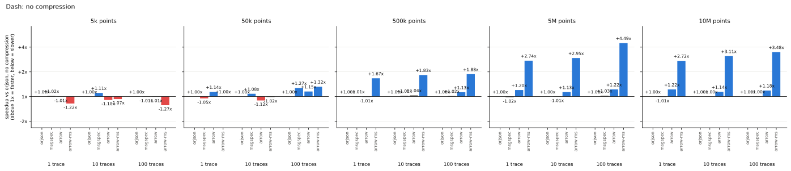

Same numbers as the chart (speedup vs orjson without compression): 5k points, 1 trace: orjson +1.00x, msgspec +1.02x, arrow -1.01x, arrow-ms -1.22x; 5k points, 10 traces: orjson +1.00x, msgspec +1.11x, arrow -1.10x, arrow-ms -1.07x; 5k points, 100 traces: orjson +1.00x, msgspec -1.01x, arrow -1.01x, arrow-ms -1.27x; 50k points, 1 trace: orjson +1.00x, msgspec -1.05x, arrow +1.14x, arrow-ms +1.00x; 50k points, 10 traces: orjson +1.00x, msgspec +1.08x, arrow -1.12x, arrow-ms -1.02x; 50k points, 100 traces: orjson +1.00x, msgspec +1.27x, arrow +1.15x, arrow-ms +1.32x; 500k points, 1 trace: orjson +1.00x, msgspec +1.01x, arrow -1.01x, arrow-ms +1.67x; 500k points, 10 traces: orjson +1.00x, msgspec +1.02x, arrow +1.04x, arrow-ms +1.83x; 500k points, 100 traces: orjson +1.00x, msgspec +1.02x, arrow +1.13x, arrow-ms +1.88x; 5M points, 1 trace: orjson +1.00x, msgspec -1.02x, arrow +1.20x, arrow-ms +2.74x; 5M points, 10 traces: orjson +1.00x, msgspec -1.01x, arrow +1.13x, arrow-ms +2.95x; 5M points, 100 traces: orjson +1.00x, msgspec +1.03x, arrow +1.22x, arrow-ms +4.49x; 10M points, 1 trace: orjson +1.00x, msgspec -1.01x, arrow +1.22x, arrow-ms +2.72x; 10M points, 10 traces: orjson +1.00x, msgspec +1.00x, arrow +1.14x, arrow-ms +3.11x; 10M points, 100 traces: orjson +1.00x, msgspec +1.00x, arrow +1.18x, arrow-ms +3.48x.

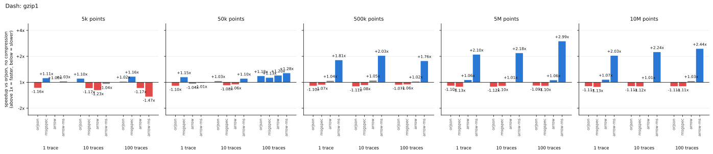

Same numbers as the chart (speedup vs orjson without compression): 5k points, 1 trace: orjson gzip1 -1.16x, msgspec gzip1 +1.11x, arrow gzip1 +1.00x, arrow-ms gzip1 +1.03x; 5k points, 10 traces: orjson gzip1 +1.10x, msgspec gzip1 -1.17x, arrow gzip1 -1.23x, arrow-ms gzip1 -1.04x; 5k points, 100 traces: orjson gzip1 +1.02x, msgspec gzip1 +1.16x, arrow gzip1 -1.17x, arrow-ms gzip1 -1.47x; 50k points, 1 trace: orjson gzip1 -1.10x, msgspec gzip1 +1.15x, arrow gzip1 -1.04x, arrow-ms gzip1 -1.01x; 50k points, 10 traces: orjson gzip1 +1.03x, msgspec gzip1 -1.08x, arrow gzip1 -1.06x, arrow-ms gzip1 +1.10x; 50k points, 100 traces: orjson gzip1 +1.18x, msgspec gzip1 +1.13x, arrow gzip1 +1.20x, arrow-ms gzip1 +1.28x; 500k points, 1 trace: orjson gzip1 -1.10x, msgspec gzip1 -1.07x, arrow gzip1 +1.04x, arrow-ms gzip1 +1.81x; 500k points, 10 traces: orjson gzip1 -1.11x, msgspec gzip1 -1.08x, arrow gzip1 +1.05x, arrow-ms gzip1 +2.03x; 500k points, 100 traces: orjson gzip1 -1.07x, msgspec gzip1 -1.06x, arrow gzip1 +1.02x, arrow-ms gzip1 +1.76x; 5M points, 1 trace: orjson gzip1 -1.10x, msgspec gzip1 -1.13x, arrow gzip1 +1.06x, arrow-ms gzip1 +2.10x; 5M points, 10 traces: orjson gzip1 -1.12x, msgspec gzip1 -1.10x, arrow gzip1 +1.01x, arrow-ms gzip1 +2.18x; 5M points, 100 traces: orjson gzip1 -1.09x, msgspec gzip1 -1.10x, arrow gzip1 +1.06x, arrow-ms gzip1 +2.99x; 10M points, 1 trace: orjson gzip1 -1.11x, msgspec gzip1 -1.13x, arrow gzip1 +1.07x, arrow-ms gzip1 +2.03x; 10M points, 10 traces: orjson gzip1 -1.11x, msgspec gzip1 -1.12x, arrow gzip1 +1.01x, arrow-ms gzip1 +2.24x; 10M points, 100 traces: orjson gzip1 -1.11x, msgspec gzip1 -1.11x, arrow gzip1 +1.03x, arrow-ms gzip1 +2.44x.

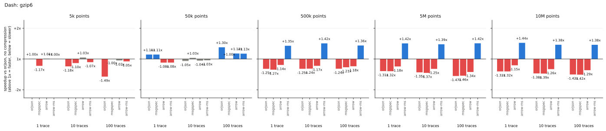

Same numbers as the chart (speedup vs orjson without compression): 5k points, 1 trace: orjson gzip6 +1.00x, msgspec gzip6 -1.17x, arrow gzip6 +1.01x, arrow-ms gzip6 +1.00x; 5k points, 10 traces: orjson gzip6 -1.18x, msgspec gzip6 -1.10x, arrow gzip6 +1.03x, arrow-ms gzip6 -1.07x; 5k points, 100 traces: orjson gzip6 -1.49x, msgspec gzip6 -1.00x, arrow gzip6 -1.03x, arrow-ms gzip6 -1.05x; 50k points, 1 trace: orjson gzip6 +1.11x, msgspec gzip6 +1.11x, arrow gzip6 -1.08x, arrow-ms gzip6 -1.08x; 50k points, 10 traces: orjson gzip6 -1.05x, msgspec gzip6 +1.03x, arrow gzip6 -1.04x, arrow-ms gzip6 -1.03x; 50k points, 100 traces: orjson gzip6 +1.30x, msgspec gzip6 +1.00x, arrow gzip6 +1.13x, arrow-ms gzip6 +1.13x; 500k points, 1 trace: orjson gzip6 -1.25x, msgspec gzip6 -1.27x, arrow gzip6 -1.14x, arrow-ms gzip6 +1.35x; 500k points, 10 traces: orjson gzip6 -1.25x, msgspec gzip6 -1.24x, arrow gzip6 -1.17x, arrow-ms gzip6 +1.42x; 500k points, 100 traces: orjson gzip6 -1.24x, msgspec gzip6 -1.21x, arrow gzip6 -1.18x, arrow-ms gzip6 +1.36x; 5M points, 1 trace: orjson gzip6 -1.31x, msgspec gzip6 -1.32x, arrow gzip6 -1.18x, arrow-ms gzip6 +1.42x; 5M points, 10 traces: orjson gzip6 -1.35x, msgspec gzip6 -1.37x, arrow gzip6 -1.25x, arrow-ms gzip6 +1.39x; 5M points, 100 traces: orjson gzip6 -1.47x, msgspec gzip6 -1.46x, arrow gzip6 -1.34x, arrow-ms gzip6 +1.42x; 10M points, 1 trace: orjson gzip6 -1.32x, msgspec gzip6 -1.32x, arrow gzip6 -1.15x, arrow-ms gzip6 +1.44x; 10M points, 10 traces: orjson gzip6 -1.38x, msgspec gzip6 -1.39x, arrow gzip6 -1.26x, arrow-ms gzip6 +1.38x; 10M points, 100 traces: orjson gzip6 -1.42x, msgspec gzip6 -1.42x, arrow gzip6 -1.29x, arrow-ms gzip6 +1.38x.

Total time, request sent to plot painted (median), one table per compression level:

**No compression**

| Points | Traces | orjson, none (baseline) | msgspec | arrow | arrow-ms |
| --- | --- | --- | --- | --- | --- |
| 5k | 1 | 196 ms | 192 ms = same (1.02x) | 196 ms = same (0.99x) | 238 ms ▼ **-1.22x slower** |
| 5k | 10 | 218 ms | 197 ms ▲ **+1.11x faster** | 240 ms ▼ **-1.10x slower** | 233 ms ▼ **-1.07x slower** |
| 5k | 100 | 306 ms | 309 ms = same (0.99x) | 309 ms = same (0.99x) | 390 ms ▼ **-1.27x slower** |
| 50k | 1 | 261 ms | 275 ms ▼ **-1.05x slower** | 229 ms ▲ **+1.14x faster** | 260 ms = same (1.00x) |
| 50k | 10 | 266 ms | 246 ms ▲ **+1.08x faster** | 296 ms ▼ **-1.12x slower** | 270 ms = same (0.98x) |
| 50k | 100 | 450 ms | 354 ms ▲ **+1.27x faster** | 391 ms ▲ **+1.15x faster** | 342 ms ▲ **+1.32x faster** |
| 500k | 1 | 838 ms | 834 ms = same (1.01x) | 850 ms = same (0.99x) | 503 ms ▲ **+1.67x faster** |
| 500k | 10 | 743 ms | 726 ms = same (1.02x) | 715 ms = same (1.04x) | 406 ms ▲ **+1.83x faster** |
| 500k | 100 | 841 ms | 828 ms = same (1.02x) | 745 ms ▲ **+1.13x faster** | 448 ms ▲ **+1.88x faster** |
| 5M | 1 | 7,246 ms | 7,423 ms = same (0.98x) | 6,038 ms ▲ **+1.20x faster** | 2,649 ms ▲ **+2.74x faster** |
| 5M | 10 | 6,349 ms | 6,386 ms = same (0.99x) | 5,606 ms ▲ **+1.13x faster** | 2,155 ms ▲ **+2.95x faster** |
| 5M | 100 | 5,385 ms | 5,247 ms = same (1.03x) | 4,408 ms ▲ **+1.22x faster** | 1,200 ms ▲ **+4.49x faster** |
| 10M | 1 | 14,583 ms | 14,776 ms = same (0.99x) | 11,946 ms ▲ **+1.22x faster** | 5,355 ms ▲ **+2.72x faster** |
| 10M | 10 | 12,662 ms | 12,646 ms = same (1.00x) | 11,101 ms ▲ **+1.14x faster** | 4,072 ms ▲ **+3.11x faster** |
| 10M | 100 | 12,120 ms | 12,076 ms = same (1.00x) | 10,238 ms ▲ **+1.18x faster** | 3,483 ms ▲ **+3.48x faster** |

**gzip1**

| Points | Traces | orjson, none (baseline) | orjson gzip1 | msgspec gzip1 | arrow gzip1 | arrow-ms gzip1 |
| --- | --- | --- | --- | --- | --- | --- |
| 5k | 1 | 196 ms | 227 ms ▼ **-1.16x slower** | 175 ms ▲ **+1.11x faster** | 195 ms = same (1.00x) | 191 ms = same (1.03x) |
| 5k | 10 | 218 ms | 198 ms ▲ **+1.10x faster** | 254 ms ▼ **-1.17x slower** | 268 ms ▼ **-1.23x slower** | 227 ms = same (0.96x) |
| 5k | 100 | 306 ms | 301 ms = same (1.02x) | 264 ms ▲ **+1.16x faster** | 357 ms ▼ **-1.17x slower** | 449 ms ▼ **-1.47x slower** |
| 50k | 1 | 261 ms | 286 ms ▼ **-1.10x slower** | 228 ms ▲ **+1.15x faster** | 271 ms = same (0.96x) | 265 ms = same (0.99x) |
| 50k | 10 | 266 ms | 257 ms = same (1.03x) | 288 ms ▼ **-1.08x slower** | 280 ms ▼ **-1.06x slower** | 241 ms ▲ **+1.10x faster** |
| 50k | 100 | 450 ms | 381 ms ▲ **+1.18x faster** | 399 ms ▲ **+1.13x faster** | 376 ms ▲ **+1.20x faster** | 353 ms ▲ **+1.28x faster** |
| 500k | 1 | 838 ms | 920 ms ▼ **-1.10x slower** | 894 ms ▼ **-1.07x slower** | 806 ms = same (1.04x) | 464 ms ▲ **+1.81x faster** |
| 500k | 10 | 743 ms | 828 ms ▼ **-1.11x slower** | 800 ms ▼ **-1.08x slower** | 709 ms = same (1.05x) | 366 ms ▲ **+2.03x faster** |
| 500k | 100 | 841 ms | 898 ms ▼ **-1.07x slower** | 890 ms ▼ **-1.06x slower** | 824 ms = same (1.02x) | 477 ms ▲ **+1.76x faster** |
| 5M | 1 | 7,246 ms | 7,934 ms ▼ **-1.10x slower** | 8,154 ms ▼ **-1.13x slower** | 6,826 ms ▲ **+1.06x faster** | 3,459 ms ▲ **+2.10x faster** |
| 5M | 10 | 6,349 ms | 7,127 ms ▼ **-1.12x slower** | 6,994 ms ▼ **-1.10x slower** | 6,290 ms = same (1.01x) | 2,913 ms ▲ **+2.18x faster** |
| 5M | 100 | 5,385 ms | 5,875 ms ▼ **-1.09x slower** | 5,930 ms ▼ **-1.10x slower** | 5,097 ms ▲ **+1.06x faster** | 1,802 ms ▲ **+2.99x faster** |
| 10M | 1 | 14,583 ms | 16,189 ms ▼ **-1.11x slower** | 16,505 ms ▼ **-1.13x slower** | 13,624 ms ▲ **+1.07x faster** | 7,178 ms ▲ **+2.03x faster** |
| 10M | 10 | 12,662 ms | 14,043 ms ▼ **-1.11x slower** | 14,118 ms ▼ **-1.12x slower** | 12,594 ms = same (1.01x) | 5,656 ms ▲ **+2.24x faster** |
| 10M | 100 | 12,120 ms | 13,481 ms ▼ **-1.11x slower** | 13,486 ms ▼ **-1.11x slower** | 11,739 ms = same (1.03x) | 4,958 ms ▲ **+2.44x faster** |

**gzip6**

| Points | Traces | orjson, none (baseline) | orjson gzip6 | msgspec gzip6 | arrow gzip6 | arrow-ms gzip6 |
| --- | --- | --- | --- | --- | --- | --- |
| 5k | 1 | 196 ms | 195 ms = same (1.00x) | 228 ms ▼ **-1.17x slower** | 194 ms = same (1.01x) | 195 ms = same (1.00x) |
| 5k | 10 | 218 ms | 257 ms ▼ **-1.18x slower** | 238 ms ▼ **-1.10x slower** | 210 ms = same (1.03x) | 234 ms ▼ **-1.07x slower** |
| 5k | 100 | 306 ms | 456 ms ▼ **-1.49x slower** | 307 ms = same (1.00x) | 316 ms = same (0.97x) | 323 ms ▼ **-1.05x slower** |
| 50k | 1 | 261 ms | 236 ms ▲ **+1.11x faster** | 236 ms ▲ **+1.11x faster** | 283 ms ▼ **-1.08x slower** | 283 ms ▼ **-1.08x slower** |
| 50k | 10 | 266 ms | 278 ms = same (0.96x) | 259 ms = same (1.03x) | 275 ms = same (0.96x) | 273 ms = same (0.97x) |
| 50k | 100 | 450 ms | 346 ms ▲ **+1.30x faster** | 449 ms = same (1.00x) | 398 ms ▲ **+1.13x faster** | 399 ms ▲ **+1.13x faster** |
| 500k | 1 | 838 ms | 1,045 ms ▼ **-1.25x slower** | 1,065 ms ▼ **-1.27x slower** | 958 ms ▼ **-1.14x slower** | 622 ms ▲ **+1.35x faster** |
| 500k | 10 | 743 ms | 926 ms ▼ **-1.25x slower** | 924 ms ▼ **-1.24x slower** | 866 ms ▼ **-1.17x slower** | 522 ms ▲ **+1.42x faster** |
| 500k | 100 | 841 ms | 1,047 ms ▼ **-1.24x slower** | 1,014 ms ▼ **-1.21x slower** | 991 ms ▼ **-1.18x slower** | 621 ms ▲ **+1.36x faster** |
| 5M | 1 | 7,246 ms | 9,514 ms ▼ **-1.31x slower** | 9,537 ms ▼ **-1.32x slower** | 8,572 ms ▼ **-1.18x slower** | 5,097 ms ▲ **+1.42x faster** |
| 5M | 10 | 6,349 ms | 8,573 ms ▼ **-1.35x slower** | 8,675 ms ▼ **-1.37x slower** | 7,927 ms ▼ **-1.25x slower** | 4,557 ms ▲ **+1.39x faster** |
| 5M | 100 | 5,385 ms | 7,897 ms ▼ **-1.47x slower** | 7,842 ms ▼ **-1.46x slower** | 7,211 ms ▼ **-1.34x slower** | 3,780 ms ▲ **+1.42x faster** |
| 10M | 1 | 14,583 ms | 19,282 ms ▼ **-1.32x slower** | 19,288 ms ▼ **-1.32x slower** | 16,808 ms ▼ **-1.15x slower** | 10,134 ms ▲ **+1.44x faster** |
| 10M | 10 | 12,662 ms | 17,522 ms ▼ **-1.38x slower** | 17,576 ms ▼ **-1.39x slower** | 15,907 ms ▼ **-1.26x slower** | 9,183 ms ▲ **+1.38x faster** |
| 10M | 100 | 12,120 ms | 17,168 ms ▼ **-1.42x slower** | 17,245 ms ▼ **-1.42x slower** | 15,596 ms ▼ **-1.29x slower** | 8,801 ms ▲ **+1.38x faster** |

Where the time goes

Build (Dash: running the callback, i.e. building the go.Figure), Encode and Gzip are measured on the server. Wait is request sent to first byte (includes them), Download is first to last byte, Browser is last byte to painted.

| Points | Traces | Variant | Wire MB | Raw MB | Build | Encode | Gzip | Wait | Download | Browser | Total |
| --- | --- | --- | --- | --- | --- | --- | --- | --- | --- | --- | --- |
| 5k | 1 | orjson | 0.17 | 0.17 | 1.2 | 1.6 | 0.0 | 4.9 | 0.6 | 190 | **196** |
| 5k | 1 | msgspec | 0.17 | 0.17 | 1.4 | 1.8 | 0.0 | 5.3 | 0.5 | 186 | **192** |
| 5k | 1 | arrow | 0.07 | 0.07 | 1.1 | 0.5 | 0.0 | 3.7 | 0.4 | 192 | **196** |
| 5k | 1 | arrow-ms | 0.07 | 0.07 | 1.3 | 0.5 | 0.0 | 4.0 | 0.5 | 234 | **238** |
| 5k | 1 | orjson gzip1 | 0.04 | 0.17 | 1.1 | 1.7 | 0.8 | 6.2 | 0.9 | 220 | **227** |
| 5k | 1 | msgspec gzip1 | 0.04 | 0.17 | 1.3 | 1.5 | 0.7 | 5.4 | 0.8 | 169 | **175** |
| 5k | 1 | arrow gzip1 | 0.04 | 0.07 | 1.1 | 0.5 | 0.8 | 4.3 | 0.7 | 191 | **195** |
| 5k | 1 | arrow-ms gzip1 | 0.04 | 0.07 | 1.3 | 0.6 | 0.8 | 4.9 | 0.7 | 185 | **191** |
| 5k | 1 | orjson gzip6 | 0.04 | 0.17 | 1.1 | 1.7 | 2.0 | 7.1 | 0.7 | 187 | **195** |
| 5k | 1 | msgspec gzip6 | 0.04 | 0.17 | 1.2 | 1.6 | 1.9 | 6.7 | 0.7 | 220 | **228** |
| 5k | 1 | arrow gzip6 | 0.04 | 0.07 | 1.3 | 0.5 | 2.4 | 6.4 | 0.5 | 187 | **194** |
| 5k | 1 | arrow-ms gzip6 | 0.04 | 0.07 | 1.2 | 0.5 | 2.4 | 6.2 | 0.6 | 189 | **195** |
| 5k | 10 | orjson | 0.17 | 0.17 | 3.8 | 2.9 | 0.0 | 8.8 | 0.6 | 208 | **218** |
| 5k | 10 | msgspec | 0.17 | 0.17 | 3.9 | 1.9 | 0.0 | 8.2 | 0.6 | 188 | **197** |
| 5k | 10 | arrow | 0.07 | 0.07 | 3.2 | 0.7 | 0.0 | 5.8 | 0.6 | 233 | **240** |
| 5k | 10 | arrow-ms | 0.07 | 0.07 | 3.4 | 0.8 | 0.0 | 6.4 | 0.5 | 226 | **233** |
| 5k | 10 | orjson gzip1 | 0.04 | 0.17 | 3.5 | 2.1 | 0.7 | 8.1 | 0.8 | 189 | **198** |
| 5k | 10 | msgspec gzip1 | 0.04 | 0.17 | 3.2 | 1.9 | 0.6 | 7.8 | 0.8 | 246 | **254** |
| 5k | 10 | arrow gzip1 | 0.02 | 0.07 | 3.1 | 0.7 | 0.5 | 6.3 | 0.5 | 260 | **268** |
| 5k | 10 | arrow-ms gzip1 | 0.02 | 0.07 | 4.0 | 0.9 | 0.5 | 7.6 | 0.6 | 219 | **227** |
| 5k | 10 | orjson gzip6 | 0.02 | 0.17 | 3.4 | 2.2 | 1.0 | 8.9 | 0.7 | 247 | **257** |
| 5k | 10 | msgspec gzip6 | 0.02 | 0.17 | 3.7 | 2.3 | 1.0 | 8.8 | 0.8 | 229 | **238** |
| 5k | 10 | arrow gzip6 | 0.02 | 0.07 | 3.6 | 0.8 | 0.8 | 7.5 | 0.6 | 202 | **210** |
| 5k | 10 | arrow-ms gzip6 | 0.02 | 0.07 | 3.6 | 0.9 | 0.8 | 7.4 | 0.6 | 226 | **234** |
| 5k | 100 | orjson | 0.18 | 0.18 | 25 | 7.2 | 0.0 | 35 | 0.5 | 271 | **306** |
| 5k | 100 | msgspec | 0.18 | 0.18 | 28 | 6.3 | 0.0 | 36 | 0.6 | 274 | **309** |
| 5k | 100 | arrow | 0.12 | 0.12 | 27 | 2.8 | 0.0 | 32 | 0.4 | 274 | **309** |
| 5k | 100 | arrow-ms | 0.12 | 0.12 | 25 | 3.0 | 0.0 | 30 | 0.6 | 357 | **390** |
| 5k | 100 | orjson gzip1 | 0.02 | 0.18 | 26 | 8.2 | 0.6 | 37 | 0.7 | 264 | **301** |
| 5k | 100 | msgspec gzip1 | 0.02 | 0.18 | 24 | 6.4 | 0.5 | 32 | 0.6 | 227 | **264** |
| 5k | 100 | arrow gzip1 | 0.03 | 0.12 | 26 | 2.6 | 0.7 | 31 | 0.5 | 325 | **357** |
| 5k | 100 | arrow-ms gzip1 | 0.03 | 0.12 | 25 | 2.7 | 0.7 | 30 | 0.6 | 419 | **449** |
| 5k | 100 | orjson gzip6 | 0.02 | 0.18 | 25 | 7.1 | 0.9 | 35 | 0.7 | 420 | **456** |
| 5k | 100 | msgspec gzip6 | 0.02 | 0.18 | 25 | 7.1 | 0.9 | 36 | 0.7 | 270 | **307** |
| 5k | 100 | arrow gzip6 | 0.03 | 0.12 | 28 | 3.0 | 1.1 | 35 | 0.6 | 281 | **316** |
| 5k | 100 | arrow-ms gzip6 | 0.03 | 0.12 | 25 | 3.1 | 1.3 | 31 | 0.7 | 291 | **323** |
| 50k | 1 | orjson | 1.61 | 1.61 | 1.6 | 14 | 0.0 | 17 | 1.8 | 244 | **261** |
| 50k | 1 | msgspec | 1.61 | 1.61 | 1.4 | 12 | 0.0 | 16 | 1.8 | 257 | **275** |
| 50k | 1 | arrow | 0.61 | 0.61 | 1.6 | 1.1 | 0.0 | 5.3 | 1.0 | 224 | **229** |
| 50k | 1 | arrow-ms | 0.61 | 0.61 | 1.4 | 1.2 | 0.0 | 4.7 | 1.0 | 254 | **260** |
| 50k | 1 | orjson gzip1 | 0.34 | 1.61 | 1.4 | 11 | 7.5 | 23 | 3.0 | 260 | **286** |
| 50k | 1 | msgspec gzip1 | 0.34 | 1.61 | 1.4 | 13 | 7.8 | 24 | 3.0 | 196 | **228** |
| 50k | 1 | arrow gzip1 | 0.35 | 0.61 | 1.4 | 1.2 | 7.8 | 13 | 2.4 | 256 | **271** |
| 50k | 1 | arrow-ms gzip1 | 0.35 | 0.61 | 1.3 | 1.0 | 7.8 | 12 | 2.2 | 250 | **265** |
| 50k | 1 | orjson gzip6 | 0.33 | 1.61 | 1.5 | 12 | 22 | 37 | 2.8 | 196 | **236** |
| 50k | 1 | msgspec gzip6 | 0.33 | 1.61 | 1.4 | 12 | 22 | 38 | 3.0 | 195 | **236** |
| 50k | 1 | arrow gzip6 | 0.34 | 0.61 | 1.4 | 1.1 | 24 | 29 | 2.1 | 252 | **283** |
| 50k | 1 | arrow-ms gzip6 | 0.34 | 0.61 | 1.6 | 1.2 | 24 | 29 | 2.3 | 252 | **283** |
| 50k | 10 | orjson | 1.59 | 1.59 | 3.8 | 11 | 0.0 | 17 | 1.9 | 247 | **266** |
| 50k | 10 | msgspec | 1.59 | 1.59 | 3.7 | 11 | 0.0 | 17 | 1.8 | 226 | **246** |
| 50k | 10 | arrow | 0.61 | 0.61 | 3.6 | 1.5 | 0.0 | 7.2 | 0.9 | 286 | **296** |
| 50k | 10 | arrow-ms | 0.61 | 0.61 | 3.8 | 1.6 | 0.0 | 7.4 | 0.9 | 261 | **270** |
| 50k | 10 | orjson gzip1 | 0.35 | 1.59 | 3.8 | 11 | 6.4 | 24 | 3.0 | 230 | **257** |
| 50k | 10 | msgspec gzip1 | 0.35 | 1.59 | 3.5 | 11 | 6.4 | 23 | 2.9 | 261 | **288** |
| 50k | 10 | arrow gzip1 | 0.35 | 0.61 | 3.9 | 1.3 | 7.6 | 15 | 2.5 | 264 | **280** |
| 50k | 10 | arrow-ms gzip1 | 0.35 | 0.61 | 4.1 | 1.5 | 8.4 | 16 | 2.5 | 223 | **241** |
| 50k | 10 | orjson gzip6 | 0.35 | 1.59 | 3.7 | 11 | 19 | 37 | 2.9 | 238 | **278** |
| 50k | 10 | msgspec gzip6 | 0.35 | 1.59 | 3.4 | 11 | 19 | 37 | 3.2 | 220 | **259** |
| 50k | 10 | arrow gzip6 | 0.33 | 0.61 | 3.6 | 1.4 | 23 | 30 | 2.3 | 242 | **275** |
| 50k | 10 | arrow-ms gzip6 | 0.33 | 0.61 | 4.0 | 1.3 | 23 | 31 | 2.1 | 240 | **273** |
| 50k | 100 | orjson | 1.60 | 1.60 | 24 | 17 | 0.0 | 43 | 2.0 | 400 | **450** |
| 50k | 100 | msgspec | 1.60 | 1.60 | 25 | 16 | 0.0 | 42 | 1.7 | 305 | **354** |
| 50k | 100 | arrow | 0.66 | 0.66 | 25 | 3.8 | 0.0 | 31 | 1.0 | 360 | **391** |
| 50k | 100 | arrow-ms | 0.66 | 0.66 | 26 | 3.9 | 0.0 | 32 | 1.1 | 307 | **342** |
| 50k | 100 | orjson gzip1 | 0.32 | 1.60 | 26 | 17 | 5.4 | 51 | 3.5 | 327 | **381** |
| 50k | 100 | msgspec gzip1 | 0.32 | 1.60 | 25 | 16 | 5.5 | 50 | 3.4 | 341 | **399** |
| 50k | 100 | arrow gzip1 | 0.20 | 0.66 | 27 | 3.9 | 4.1 | 37 | 1.7 | 335 | **376** |
| 50k | 100 | arrow-ms gzip1 | 0.20 | 0.66 | 24 | 3.9 | 4.0 | 35 | 1.7 | 317 | **353** |
| 50k | 100 | orjson gzip6 | 0.20 | 1.60 | 27 | 18 | 9.1 | 56 | 2.4 | 288 | **346** |
| 50k | 100 | msgspec gzip6 | 0.20 | 1.60 | 26 | 16 | 9.3 | 55 | 2.3 | 392 | **449** |
| 50k | 100 | arrow gzip6 | 0.18 | 0.66 | 28 | 3.6 | 6.5 | 40 | 1.4 | 352 | **398** |
| 50k | 100 | arrow-ms gzip6 | 0.18 | 0.66 | 25 | 4.7 | 6.7 | 40 | 1.5 | 357 | **399** |
| 500k | 1 | orjson | 16.01 | 16.01 | 4.3 | 140 | 0.0 | 148 | 33 | 663 | **838** |
| 500k | 1 | msgspec | 16.01 | 16.01 | 4.8 | 150 | 0.0 | 159 | 33 | 648 | **834** |
| 500k | 1 | arrow | 6.01 | 6.01 | 9.7 | 6.0 | 0.0 | 19 | 5.0 | 823 | **850** |
| 500k | 1 | arrow-ms | 6.01 | 6.01 | 3.7 | 4.9 | 0.0 | 11 | 5.1 | 484 | **503** |
| 500k | 1 | orjson gzip1 | 3.33 | 16.01 | 4.0 | 136 | 71 | 215 | 28 | 680 | **920** |
| 500k | 1 | msgspec gzip1 | 3.33 | 16.01 | 3.5 | 144 | 72 | 223 | 31 | 637 | **894** |
| 500k | 1 | arrow gzip1 | 3.44 | 6.01 | 3.5 | 5.8 | 79 | 91 | 18 | 702 | **806** |
| 500k | 1 | arrow-ms gzip1 | 3.44 | 6.01 | 3.6 | 5.1 | 77 | 89 | 17 | 358 | **464** |
| 500k | 1 | orjson gzip6 | 3.21 | 16.01 | 4.5 | 141 | 216 | 367 | 28 | 649 | **1,045** |
| 500k | 1 | msgspec gzip6 | 3.21 | 16.01 | 3.7 | 151 | 219 | 376 | 27 | 661 | **1,065** |
| 500k | 1 | arrow gzip6 | 3.26 | 6.01 | 3.7 | 4.2 | 233 | 245 | 14 | 701 | **958** |
| 500k | 1 | arrow-ms gzip6 | 3.26 | 6.01 | 4.2 | 4.6 | 237 | 249 | 14 | 361 | **622** |
| 500k | 10 | orjson | 15.80 | 15.80 | 7.3 | 134 | 0.0 | 145 | 27 | 571 | **743** |
| 500k | 10 | msgspec | 15.80 | 15.80 | 7.2 | 125 | 0.0 | 137 | 28 | 554 | **726** |
| 500k | 10 | arrow | 6.01 | 6.01 | 8.0 | 5.0 | 0.0 | 15 | 5.7 | 697 | **715** |
| 500k | 10 | arrow-ms | 6.01 | 6.01 | 6.4 | 5.2 | 0.0 | 15 | 4.6 | 387 | **406** |
| 500k | 10 | orjson gzip1 | 3.23 | 15.80 | 7.2 | 143 | 68 | 221 | 29 | 593 | **828** |
| 500k | 10 | msgspec gzip1 | 3.23 | 15.80 | 6.0 | 128 | 74 | 210 | 24 | 570 | **800** |
| 500k | 10 | arrow gzip1 | 3.36 | 6.01 | 8.0 | 5.0 | 73 | 88 | 17 | 602 | **709** |
| 500k | 10 | arrow-ms gzip1 | 3.36 | 6.01 | 6.6 | 6.0 | 73 | 87 | 18 | 260 | **366** |
| 500k | 10 | orjson gzip6 | 3.12 | 15.80 | 7.9 | 122 | 218 | 351 | 26 | 551 | **926** |
| 500k | 10 | msgspec gzip6 | 3.12 | 15.80 | 6.7 | 126 | 213 | 350 | 28 | 550 | **924** |
| 500k | 10 | arrow gzip6 | 3.19 | 6.01 | 7.4 | 5.7 | 238 | 254 | 14 | 601 | **866** |
| 500k | 10 | arrow-ms gzip6 | 3.19 | 6.01 | 7.0 | 5.8 | 240 | 255 | 14 | 252 | **522** |
| 500k | 100 | orjson | 15.82 | 15.82 | 29 | 114 | 0.0 | 146 | 24 | 669 | **841** |
| 500k | 100 | msgspec | 15.82 | 15.82 | 28 | 111 | 0.0 | 143 | 26 | 658 | **828** |
| 500k | 100 | arrow | 6.06 | 6.06 | 33 | 7.0 | 0.0 | 42 | 6.2 | 702 | **745** |
| 500k | 100 | arrow-ms | 6.06 | 6.06 | 30 | 8.2 | 0.0 | 42 | 5.0 | 402 | **448** |
| 500k | 100 | orjson gzip1 | 3.32 | 15.82 | 29 | 117 | 59 | 209 | 31 | 652 | **898** |
| 500k | 100 | msgspec gzip1 | 3.32 | 15.82 | 29 | 117 | 59 | 213 | 25 | 657 | **890** |
| 500k | 100 | arrow gzip1 | 3.38 | 6.06 | 28 | 9.0 | 67 | 106 | 17 | 697 | **824** |
| 500k | 100 | arrow-ms gzip1 | 3.38 | 6.06 | 28 | 8.5 | 67 | 106 | 19 | 356 | **477** |
| 500k | 100 | orjson gzip6 | 3.26 | 15.82 | 27 | 118 | 211 | 359 | 25 | 664 | **1,047** |
| 500k | 100 | msgspec gzip6 | 3.26 | 15.82 | 27 | 110 | 208 | 348 | 25 | 641 | **1,014** |
| 500k | 100 | arrow gzip6 | 3.17 | 6.06 | 28 | 9.1 | 234 | 274 | 14 | 704 | **991** |
| 500k | 100 | arrow-ms gzip6 | 3.17 | 6.06 | 28 | 7.5 | 238 | 275 | 16 | 334 | **621** |
| 5M | 1 | orjson | 160 | 160 | 27 | 1,458 | 0.0 | 1,555 | 208 | 5,447 | **7,246** |
| 5M | 1 | msgspec | 160 | 160 | 44 | 1,551 | 0.0 | 1,686 | 219 | 5,511 | **7,423** |
| 5M | 1 | arrow | 60.01 | 60.01 | 53 | 50 | 0.0 | 105 | 47 | 5,886 | **6,038** |
| 5M | 1 | arrow-ms | 60.01 | 60.01 | 35 | 49 | 0.0 | 85 | 36 | 2,534 | **2,649** |
| 5M | 1 | orjson gzip1 | 33.25 | 160 | 35 | 1,407 | 713 | 2,239 | 263 | 5,419 | **7,934** |
| 5M | 1 | msgspec gzip1 | 33.25 | 160 | 36 | 1,514 | 717 | 2,360 | 307 | 5,483 | **8,154** |
| 5M | 1 | arrow gzip1 | 34.29 | 60.01 | 28 | 51 | 762 | 845 | 144 | 5,813 | **6,826** |
| 5M | 1 | arrow-ms gzip1 | 34.29 | 60.01 | 30 | 50 | 764 | 866 | 144 | 2,440 | **3,459** |
| 5M | 1 | orjson gzip6 | 32.06 | 160 | 43 | 1,427 | 2,171 | 3,741 | 302 | 5,472 | **9,514** |
| 5M | 1 | msgspec gzip6 | 32.06 | 160 | 52 | 1,521 | 2,180 | 3,831 | 274 | 5,459 | **9,537** |
| 5M | 1 | arrow gzip6 | 32.54 | 60.01 | 33 | 49 | 2,314 | 2,406 | 122 | 5,986 | **8,572** |
| 5M | 1 | arrow-ms gzip6 | 32.54 | 60.01 | 52 | 46 | 2,330 | 2,432 | 124 | 2,541 | **5,097** |
| 5M | 10 | orjson | 158 | 158 | 29 | 1,323 | 0.0 | 1,420 | 225 | 4,687 | **6,349** |
| 5M | 10 | msgspec | 158 | 158 | 29 | 1,356 | 0.0 | 1,454 | 223 | 4,680 | **6,386** |
| 5M | 10 | arrow | 60.01 | 60.01 | 28 | 41 | 0.0 | 71 | 40 | 5,496 | **5,606** |
| 5M | 10 | arrow-ms | 60.01 | 60.01 | 29 | 63 | 0.0 | 94 | 42 | 2,018 | **2,155** |
| 5M | 10 | orjson gzip1 | 31.73 | 158 | 30 | 1,322 | 631 | 2,068 | 284 | 4,758 | **7,127** |
| 5M | 10 | msgspec gzip1 | 31.73 | 158 | 27 | 1,338 | 618 | 2,068 | 284 | 4,719 | **6,994** |
| 5M | 10 | arrow gzip1 | 32.86 | 60.01 | 54 | 48 | 655 | 742 | 150 | 5,342 | **6,290** |
| 5M | 10 | arrow-ms gzip1 | 32.86 | 60.01 | 28 | 58 | 663 | 756 | 152 | 2,005 | **2,913** |
| 5M | 10 | orjson gzip6 | 30.46 | 158 | 29 | 1,251 | 2,243 | 3,656 | 264 | 4,762 | **8,573** |
| 5M | 10 | msgspec gzip6 | 30.46 | 158 | 29 | 1,379 | 2,321 | 3,807 | 264 | 4,616 | **8,675** |
| 5M | 10 | arrow gzip6 | 31.20 | 60.01 | 31 | 40 | 2,442 | 2,556 | 131 | 5,240 | **7,927** |
| 5M | 10 | arrow-ms gzip6 | 31.20 | 60.01 | 35 | 43 | 2,342 | 2,442 | 129 | 1,953 | **4,557** |
| 5M | 100 | orjson | 158 | 158 | 50 | 1,235 | 0.0 | 1,350 | 218 | 3,802 | **5,385** |
| 5M | 100 | msgspec | 158 | 158 | 47 | 1,170 | 0.0 | 1,285 | 224 | 3,758 | **5,247** |
| 5M | 100 | arrow | 60.06 | 60.06 | 51 | 43 | 0.0 | 92 | 53 | 4,241 | **4,408** |
| 5M | 100 | arrow-ms | 60.06 | 60.06 | 46 | 39 | 0.0 | 86 | 42 | 1,033 | **1,200** |
| 5M | 100 | orjson gzip1 | 30.72 | 158 | 46 | 1,168 | 588 | 1,875 | 245 | 3,754 | **5,875** |
| 5M | 100 | msgspec gzip1 | 30.72 | 158 | 49 | 1,168 | 596 | 1,893 | 279 | 3,741 | **5,930** |
| 5M | 100 | arrow gzip1 | 31.39 | 60.06 | 46 | 58 | 590 | 700 | 145 | 4,252 | **5,097** |
| 5M | 100 | arrow-ms gzip1 | 31.39 | 60.06 | 46 | 35 | 591 | 677 | 148 | 974 | **1,802** |
| 5M | 100 | orjson gzip6 | 29.04 | 158 | 49 | 1,212 | 2,530 | 3,865 | 238 | 3,758 | **7,897** |
| 5M | 100 | msgspec gzip6 | 29.04 | 158 | 51 | 1,174 | 2,613 | 3,913 | 237 | 3,755 | **7,842** |
| 5M | 100 | arrow gzip6 | 29.88 | 60.06 | 56 | 65 | 2,677 | 2,804 | 130 | 4,278 | **7,211** |
| 5M | 100 | arrow-ms gzip6 | 29.88 | 60.06 | 48 | 39 | 2,580 | 2,666 | 126 | 1,008 | **3,780** |
| 10M | 1 | orjson | 320 | 320 | 92 | 2,849 | 0.0 | 3,075 | 382 | 11,019 | **14,583** |
| 10M | 1 | msgspec | 320 | 320 | 78 | 2,898 | 0.0 | 3,119 | 427 | 11,180 | **14,776** |
| 10M | 1 | arrow | 120 | 120 | 77 | 88 | 0.0 | 172 | 65 | 11,655 | **11,946** |
| 10M | 1 | arrow-ms | 120 | 120 | 136 | 87 | 0.0 | 222 | 64 | 5,110 | **5,355** |
| 10M | 1 | orjson gzip1 | 66.48 | 320 | 139 | 2,862 | 1,449 | 4,589 | 562 | 10,988 | **16,189** |
| 10M | 1 | msgspec gzip1 | 66.48 | 320 | 118 | 3,029 | 1,504 | 4,801 | 596 | 11,168 | **16,505** |
| 10M | 1 | arrow gzip1 | 68.58 | 120 | 162 | 92 | 1,562 | 1,774 | 289 | 11,573 | **13,624** |
| 10M | 1 | arrow-ms gzip1 | 68.58 | 120 | 138 | 93 | 1,554 | 1,786 | 283 | 5,072 | **7,178** |
| 10M | 1 | orjson gzip6 | 64.12 | 320 | 136 | 2,848 | 4,440 | 7,584 | 516 | 11,000 | **19,282** |
| 10M | 1 | msgspec gzip6 | 64.12 | 320 | 144 | 3,072 | 4,415 | 7,743 | 548 | 10,974 | **19,288** |
| 10M | 1 | arrow gzip6 | 65.07 | 120 | 141 | 82 | 4,614 | 4,845 | 245 | 11,659 | **16,808** |
| 10M | 1 | arrow-ms gzip6 | 65.07 | 120 | 98 | 89 | 4,726 | 4,897 | 243 | 5,004 | **10,134** |
| 10M | 10 | orjson | 316 | 316 | 57 | 2,588 | 0.0 | 2,795 | 465 | 9,386 | **12,662** |
| 10M | 10 | msgspec | 316 | 316 | 61 | 2,671 | 0.0 | 2,879 | 405 | 9,392 | **12,646** |
| 10M | 10 | arrow | 120 | 120 | 57 | 74 | 0.0 | 133 | 62 | 10,891 | **11,101** |
| 10M | 10 | arrow-ms | 120 | 120 | 58 | 74 | 0.0 | 134 | 60 | 3,880 | **4,072** |
| 10M | 10 | orjson gzip1 | 63.41 | 316 | 58 | 2,580 | 1,239 | 4,058 | 552 | 9,410 | **14,043** |
| 10M | 10 | msgspec gzip1 | 63.41 | 316 | 67 | 2,697 | 1,228 | 4,132 | 536 | 9,450 | **14,118** |
| 10M | 10 | arrow gzip1 | 65.53 | 120 | 60 | 80 | 1,299 | 1,465 | 294 | 10,835 | **12,594** |
| 10M | 10 | arrow-ms gzip1 | 65.53 | 120 | 99 | 103 | 1,327 | 1,524 | 291 | 3,842 | **5,656** |
| 10M | 10 | orjson gzip6 | 60.65 | 316 | 84 | 2,621 | 4,742 | 7,609 | 574 | 9,342 | **17,522** |
| 10M | 10 | msgspec gzip6 | 60.65 | 316 | 73 | 2,642 | 4,727 | 7,613 | 525 | 9,386 | **17,576** |
| 10M | 10 | arrow gzip6 | 62.32 | 120 | 62 | 73 | 4,830 | 4,998 | 253 | 10,650 | **15,907** |
| 10M | 10 | arrow-ms gzip6 | 62.32 | 120 | 58 | 109 | 4,919 | 5,049 | 254 | 3,882 | **9,183** |
| 10M | 100 | orjson | 316 | 316 | 62 | 2,449 | 0.0 | 2,641 | 451 | 9,037 | **12,120** |
| 10M | 100 | msgspec | 316 | 316 | 71 | 2,458 | 0.0 | 2,656 | 444 | 8,993 | **12,076** |
| 10M | 100 | arrow | 120 | 120 | 73 | 80 | 0.0 | 155 | 61 | 9,983 | **10,238** |
| 10M | 100 | arrow-ms | 120 | 120 | 73 | 85 | 0.0 | 173 | 71 | 3,250 | **3,483** |
| 10M | 100 | orjson gzip1 | 60.92 | 316 | 70 | 2,559 | 1,212 | 3,961 | 554 | 8,939 | **13,481** |
| 10M | 100 | msgspec gzip1 | 60.92 | 316 | 75 | 2,480 | 1,222 | 3,892 | 546 | 9,044 | **13,486** |
| 10M | 100 | arrow gzip1 | 62.29 | 120 | 75 | 79 | 1,198 | 1,349 | 274 | 10,116 | **11,739** |
| 10M | 100 | arrow-ms gzip1 | 62.29 | 120 | 70 | 81 | 1,207 | 1,360 | 284 | 3,318 | **4,958** |
| 10M | 100 | orjson gzip6 | 57.69 | 316 | 73 | 2,477 | 4,956 | 7,632 | 494 | 8,986 | **17,168** |
| 10M | 100 | msgspec gzip6 | 57.69 | 316 | 91 | 2,474 | 4,904 | 7,617 | 488 | 9,015 | **17,245** |
| 10M | 100 | arrow gzip6 | 59.12 | 120 | 72 | 72 | 5,099 | 5,261 | 238 | 10,098 | **15,596** |
| 10M | 100 | arrow-ms gzip6 | 59.12 | 120 | 70 | 89 | 4,972 | 5,130 | 246 | 3,330 | **8,801** |

### Dash vs FastAPI

Same transport, compression and data. ⚠️ marks Dash taking 1.5x FastAPI's time or more (28 cases). In JSON, Dash's figure repeats the timestamps in every trace, where FastAPI sends each column once, so its payload grows with the trace count.

All cases

| Points | Traces | Variant | FastAPI ms | Dash ms | Dash / FastAPI | Wire MB FastAPI / Dash |
| --- | --- | --- | --- | --- | --- | --- |
| 5k | 1 | orjson | 264 | 196 | 0.74x | 0.16 / 0.17 |
| 5k | 1 | msgspec | 244 | 192 | 0.79x | 0.20 / 0.17 |
| 5k | 1 | arrow | 264 | 196 | 0.74x | 0.06 / 0.07 |
| 5k | 1 | arrow-ms | 253 | 238 | 0.94x | 0.06 / 0.07 |
| 5k | 1 | orjson gzip1 | 268 | 227 | 0.85x | 0.04 / 0.04 |
| 5k | 1 | msgspec gzip1 | 244 | 175 | 0.72x | 0.06 / 0.04 |
| 5k | 1 | arrow gzip1 | 253 | 195 | 0.77x | 0.04 / 0.04 |
| 5k | 1 | arrow-ms gzip1 | 260 | 191 | 0.73x | 0.04 / 0.04 |
| 5k | 1 | orjson gzip6 | 261 | 195 | 0.75x | 0.04 / 0.04 |
| 5k | 1 | msgspec gzip6 | 268 | 228 | 0.85x | 0.06 / 0.04 |
| 5k | 1 | arrow gzip6 | 250 | 194 | 0.78x | 0.03 / 0.04 |
| 5k | 1 | arrow-ms gzip6 | 247 | 195 | 0.79x | 0.03 / 0.04 |
| 5k | 10 | orjson | 270 | 218 | 0.81x | 0.06 / 0.17 |
| 5k | 10 | msgspec | 252 | 197 | 0.78x | 0.10 / 0.17 |
| 5k | 10 | arrow | 271 | 240 | 0.88x | 0.03 / 0.07 |
| 5k | 10 | arrow-ms | 274 | 233 | 0.85x | 0.03 / 0.07 |
| 5k | 10 | orjson gzip1 | 274 | 198 | 0.72x | 0.03 / 0.04 |
| 5k | 10 | msgspec gzip1 | 265 | 254 | 0.96x | 0.05 / 0.04 |
| 5k | 10 | arrow gzip1 | 267 | 268 | 1.00x | 0.02 / 0.02 |
| 5k | 10 | arrow-ms gzip1 | 251 | 227 | 0.90x | 0.02 / 0.02 |
| 5k | 10 | orjson gzip6 | 274 | 257 | 0.94x | 0.02 / 0.02 |
| 5k | 10 | msgspec gzip6 | 272 | 238 | 0.88x | 0.04 / 0.02 |
| 5k | 10 | arrow gzip6 | 264 | 210 | 0.80x | 0.02 / 0.02 |
| 5k | 10 | arrow-ms gzip6 | 285 | 234 | 0.82x | 0.02 / 0.02 |
| 5k | 100 | orjson | 352 | 306 | 0.87x | 0.05 / 0.18 |
| 5k | 100 | msgspec | 358 | 309 | 0.86x | 0.09 / 0.18 |
| 5k | 100 | arrow | 370 | 309 | 0.84x | 0.04 / 0.12 |
| 5k | 100 | arrow-ms | 355 | 390 | 1.10x | 0.04 / 0.12 |
| 5k | 100 | orjson gzip1 | 356 | 301 | 0.85x | 0.02 / 0.02 |
| 5k | 100 | msgspec gzip1 | 348 | 264 | 0.76x | 0.04 / 0.02 |
| 5k | 100 | arrow gzip1 | 341 | 357 | 1.05x | 0.02 / 0.03 |
| 5k | 100 | arrow-ms gzip1 | 345 | 449 | 1.30x | 0.02 / 0.03 |
| 5k | 100 | orjson gzip6 | 356 | 456 | 1.28x | 0.02 / 0.02 |
| 5k | 100 | msgspec gzip6 | 341 | 307 | 0.90x | 0.03 / 0.02 |
| 5k | 100 | arrow gzip6 | 359 | 316 | 0.88x | 0.02 / 0.03 |
| 5k | 100 | arrow-ms gzip6 | 364 | 323 | 0.89x | 0.02 / 0.03 |
| 50k | 1 | orjson | 286 | 261 | 0.91x | 1.61 / 1.61 |
| 50k | 1 | msgspec | 289 | 275 | 0.95x | 2.05 / 1.61 |
| 50k | 1 | arrow | 294 | 229 | 0.78x | 0.60 / 0.61 |
| 50k | 1 | arrow-ms | 260 | 260 | 1.00x | 0.60 / 0.61 |
| 50k | 1 | orjson gzip1 | 278 | 286 | 1.03x | 0.37 / 0.34 |
| 50k | 1 | msgspec gzip1 | 285 | 228 | 0.80x | 0.58 / 0.34 |
| 50k | 1 | arrow gzip1 | 286 | 271 | 0.95x | 0.35 / 0.35 |
| 50k | 1 | arrow-ms gzip1 | 280 | 265 | 0.95x | 0.35 / 0.35 |
| 50k | 1 | orjson gzip6 | 295 | 236 | 0.80x | 0.36 / 0.33 |
| 50k | 1 | msgspec gzip6 | 310 | 236 | 0.76x | 0.56 / 0.33 |
| 50k | 1 | arrow gzip6 | 287 | 283 | 0.99x | 0.33 / 0.34 |
| 50k | 1 | arrow-ms gzip6 | 281 | 283 | 1.01x | 0.33 / 0.34 |
| 50k | 10 | orjson | 286 | 266 | 0.93x | 0.59 / 1.59 |
| 50k | 10 | msgspec | 290 | 246 | 0.85x | 1.02 / 1.59 |
| 50k | 10 | arrow | 299 | 296 | 0.99x | 0.24 / 0.61 |
| 50k | 10 | arrow-ms | 286 | 270 | 0.95x | 0.24 / 0.61 |
| 50k | 10 | orjson gzip1 | 292 | 257 | 0.88x | 0.24 / 0.35 |
| 50k | 10 | msgspec gzip1 | 299 | 288 | 0.96x | 0.44 / 0.35 |
| 50k | 10 | arrow gzip1 | 297 | 280 | 0.94x | 0.19 / 0.35 |
| 50k | 10 | arrow-ms gzip1 | 279 | 241 | 0.87x | 0.19 / 0.35 |
| 50k | 10 | orjson gzip6 | 302 | 278 | 0.92x | 0.22 / 0.35 |
| 50k | 10 | msgspec gzip6 | 301 | 259 | 0.86x | 0.37 / 0.35 |
| 50k | 10 | arrow gzip6 | 294 | 275 | 0.94x | 0.19 / 0.33 |
| 50k | 10 | arrow-ms gzip6 | 298 | 273 | 0.92x | 0.19 / 0.33 |
| 50k | 100 | orjson | 408 | 450 | 1.10x | 0.49 / 1.60 |
| 50k | 100 | msgspec | 410 | 354 | 0.86x | 0.91 / 1.60 |
| 50k | 100 | arrow | 402 | 391 | 0.97x | 0.22 / 0.66 |
| 50k | 100 | arrow-ms | 391 | 342 | 0.87x | 0.22 / 0.66 |
| 50k | 100 | orjson gzip1 | 404 | 381 | 0.94x | 0.22 / 0.32 |
| 50k | 100 | msgspec gzip1 | 408 | 399 | 0.98x | 0.35 / 0.32 |
| 50k | 100 | arrow gzip1 | 402 | 376 | 0.93x | 0.17 / 0.20 |
| 50k | 100 | arrow-ms gzip1 | 404 | 353 | 0.87x | 0.17 / 0.20 |
| 50k | 100 | orjson gzip6 | 416 | 346 | 0.83x | 0.20 / 0.20 |
| 50k | 100 | msgspec gzip6 | 416 | 449 | 1.08x | 0.29 / 0.20 |
| 50k | 100 | arrow gzip6 | 409 | 398 | 0.97x | 0.17 / 0.18 |
| 50k | 100 | arrow-ms gzip6 | 386 | 399 | 1.03x | 0.17 / 0.18 |
| 500k | 1 | orjson | 673 | 838 | 1.25x | 16.14 / 16.01 |
| 500k | 1 | msgspec | 697 | 834 | 1.20x | 20.48 / 16.01 |
| 500k | 1 | arrow | 656 | 850 | 1.30x | 6.00 / 6.01 |
| 500k | 1 | arrow-ms | 396 | 503 | 1.27x | 6.00 / 6.01 |
| 500k | 1 | orjson gzip1 | 728 | 920 | 1.26x | 3.65 / 3.33 |
| 500k | 1 | msgspec gzip1 | 896 | 894 | 1.00x | 5.82 / 3.33 |
| 500k | 1 | arrow gzip1 | 742 | 806 | 1.09x | 3.43 / 3.44 |
| 500k | 1 | arrow-ms gzip1 | 500 | 464 | 0.93x | 3.43 / 3.44 |
| 500k | 1 | orjson gzip6 | 1,195 | 1,045 | 0.87x | 3.50 / 3.21 |
| 500k | 1 | msgspec gzip6 | 1,414 | 1,065 | 0.75x | 5.44 / 3.21 |
| 500k | 1 | arrow gzip6 | 892 | 958 | 1.07x | 3.26 / 3.26 |
| 500k | 1 | arrow-ms gzip6 | 636 | 622 | 0.98x | 3.26 / 3.26 |
| 500k | 10 | orjson | 488 | 743 | ⚠️ **1.52x** | 5.88 / 15.80 |
| 500k | 10 | msgspec | 512 | 726 | 1.42x | 10.21 / 15.80 |
| 500k | 10 | arrow | 441 | 715 | ⚠️ **1.62x** | 2.40 / 6.01 |
| 500k | 10 | arrow-ms | 352 | 406 | 1.15x | 2.40 / 6.01 |
| 500k | 10 | orjson gzip1 | 529 | 828 | ⚠️ **1.57x** | 2.34 / 3.23 |
| 500k | 10 | msgspec gzip1 | 610 | 800 | 1.31x | 4.25 / 3.23 |
| 500k | 10 | arrow gzip1 | 494 | 709 | 1.43x | 1.85 / 3.36 |
| 500k | 10 | arrow-ms gzip1 | 390 | 366 | 0.94x | 1.85 / 3.36 |
| 500k | 10 | orjson gzip6 | 845 | 926 | 1.10x | 2.14 / 3.12 |
| 500k | 10 | msgspec gzip6 | 971 | 924 | 0.95x | 3.66 / 3.12 |
| 500k | 10 | arrow gzip6 | 537 | 866 | ⚠️ **1.61x** | 1.82 / 3.19 |
| 500k | 10 | arrow-ms gzip6 | 396 | 522 | 1.32x | 1.82 / 3.19 |
| 500k | 100 | orjson | 593 | 841 | 1.42x | 4.87 / 15.82 |
| 500k | 100 | msgspec | 650 | 828 | 1.27x | 9.04 / 15.82 |
| 500k | 100 | arrow | 548 | 745 | 1.36x | 2.05 / 6.06 |
| 500k | 100 | arrow-ms | 517 | 448 | 0.87x | 2.05 / 6.06 |
| 500k | 100 | orjson gzip1 | 650 | 898 | 1.38x | 2.14 / 3.32 |
| 500k | 100 | msgspec gzip1 | 696 | 890 | 1.28x | 3.41 / 3.32 |
| 500k | 100 | arrow gzip1 | 607 | 824 | 1.36x | 1.54 / 3.38 |
| 500k | 100 | arrow-ms gzip1 | 544 | 477 | 0.88x | 1.54 / 3.38 |
| 500k | 100 | orjson gzip6 | 866 | 1,047 | 1.21x | 1.83 / 3.26 |
| 500k | 100 | msgspec gzip6 | 987 | 1,014 | 1.03x | 2.76 / 3.26 |
| 500k | 100 | arrow gzip6 | 653 | 991 | ⚠️ **1.52x** | 1.53 / 3.17 |
| 500k | 100 | arrow-ms gzip6 | 859 | 621 | 0.72x | 1.53 / 3.17 |
| 5M | 1 | orjson | 5,291 | 7,246 | 1.37x | 161 / 160 |
| 5M | 1 | msgspec | 5,693 | 7,423 | 1.30x | 205 / 160 |
| 5M | 1 | arrow | 5,321 | 6,038 | 1.13x | 60.00 / 60.01 |
| 5M | 1 | arrow-ms | 2,854 | 2,649 | 0.93x | 60.00 / 60.01 |
| 5M | 1 | orjson gzip1 | 6,072 | 7,934 | 1.31x | 36.48 / 33.25 |
| 5M | 1 | msgspec gzip1 | 6,775 | 8,154 | 1.20x | 58.17 / 33.25 |
| 5M | 1 | arrow gzip1 | 6,114 | 6,826 | 1.12x | 34.31 / 34.29 |
| 5M | 1 | arrow-ms gzip1 | 3,519 | 3,459 | 0.98x | 34.31 / 34.29 |
| 5M | 1 | orjson gzip6 | 10,686 | 9,514 | 0.89x | 34.81 / 32.06 |
| 5M | 1 | msgspec gzip6 | 12,866 | 9,537 | 0.74x | 54.34 / 32.06 |
| 5M | 1 | arrow gzip6 | 7,666 | 8,572 | 1.12x | 32.55 / 32.54 |
| 5M | 1 | arrow-ms gzip6 | 5,123 | 5,097 | 0.99x | 32.55 / 32.54 |
| 5M | 10 | orjson | 4,474 | 6,349 | 1.42x | 58.77 / 158 |
| 5M | 10 | msgspec | 4,306 | 6,386 | 1.48x | 102 / 158 |
| 5M | 10 | arrow | 3,738 | 5,606 | 1.50x | 24.00 / 60.01 |
| 5M | 10 | arrow-ms | 2,021 | 2,155 | 1.07x | 24.00 / 60.01 |
| 5M | 10 | orjson gzip1 | 4,619 | 7,127 | ⚠️ **1.54x** | 23.15 / 31.73 |
| 5M | 10 | msgspec gzip1 | 5,103 | 6,994 | 1.37x | 42.19 / 31.73 |
| 5M | 10 | arrow gzip1 | 4,234 | 6,290 | 1.49x | 17.83 / 32.86 |
| 5M | 10 | arrow-ms gzip1 | 2,428 | 2,913 | 1.20x | 17.83 / 32.86 |
| 5M | 10 | orjson gzip6 | 7,274 | 8,573 | 1.18x | 20.44 / 30.46 |
| 5M | 10 | msgspec gzip6 | 8,814 | 8,675 | 0.98x | 35.40 / 30.46 |
| 5M | 10 | arrow gzip6 | 4,716 | 7,927 | ⚠️ **1.68x** | 17.62 / 31.20 |
| 5M | 10 | arrow-ms gzip6 | 2,856 | 4,557 | ⚠️ **1.60x** | 17.62 / 31.20 |
| 5M | 100 | orjson | 3,360 | 5,385 | ⚠️ **1.60x** | 48.70 / 158 |
| 5M | 100 | msgspec | 3,272 | 5,247 | ⚠️ **1.60x** | 90.42 / 158 |
| 5M | 100 | arrow | 2,726 | 4,408 | ⚠️ **1.62x** | 20.41 / 60.06 |
| 5M | 100 | arrow-ms | 1,041 | 1,200 | 1.15x | 20.41 / 60.06 |
| 5M | 100 | orjson gzip1 | 3,446 | 5,875 | ⚠️ **1.70x** | 20.52 / 30.72 |
| 5M | 100 | msgspec gzip1 | 3,897 | 5,930 | ⚠️ **1.52x** | 33.26 / 30.72 |
| 5M | 100 | arrow gzip1 | 3,066 | 5,097 | ⚠️ **1.66x** | 14.68 / 31.39 |
| 5M | 100 | arrow-ms gzip1 | 1,348 | 1,802 | 1.34x | 14.68 / 31.39 |
| 5M | 100 | orjson gzip6 | 5,964 | 7,897 | 1.32x | 17.59 / 29.04 |
| 5M | 100 | msgspec gzip6 | 6,250 | 7,842 | 1.25x | 26.88 / 29.04 |
| 5M | 100 | arrow gzip6 | 3,648 | 7,211 | ⚠️ **1.98x** | 14.79 / 29.88 |
| 5M | 100 | arrow-ms gzip6 | 2,052 | 3,780 | ⚠️ **1.84x** | 14.79 / 29.88 |
| 10M | 1 | orjson | 10,603 | 14,583 | 1.38x | 323 / 320 |
| 10M | 1 | msgspec | 11,343 | 14,776 | 1.30x | 410 / 320 |
| 10M | 1 | arrow | 10,290 | 11,946 | 1.16x | 120 / 120 |
| 10M | 1 | arrow-ms | 5,301 | 5,355 | 1.01x | 120 / 120 |
| 10M | 1 | orjson gzip1 | 11,806 | 16,189 | 1.37x | 72.95 / 66.48 |
| 10M | 1 | msgspec gzip1 | 13,439 | 16,505 | 1.23x | 116 / 66.48 |
| 10M | 1 | arrow gzip1 | 11,885 | 13,624 | 1.15x | 68.62 / 68.58 |
| 10M | 1 | arrow-ms gzip1 | 7,019 | 7,178 | 1.02x | 68.62 / 68.58 |
| 10M | 1 | orjson gzip6 | 20,893 | 19,282 | 0.92x | 69.61 / 64.12 |
| 10M | 1 | msgspec gzip6 | 25,616 | 19,288 | 0.75x | 109 / 64.12 |
| 10M | 1 | arrow gzip6 | 15,139 | 16,808 | 1.11x | 65.10 / 65.07 |
| 10M | 1 | arrow-ms gzip6 | 10,056 | 10,134 | 1.01x | 65.10 / 65.07 |
| 10M | 10 | orjson | 8,219 | 12,662 | ⚠️ **1.54x** | 118 / 316 |
| 10M | 10 | msgspec | 8,630 | 12,646 | 1.47x | 204 / 316 |
| 10M | 10 | arrow | 7,432 | 11,101 | 1.49x | 48.00 / 120 |
| 10M | 10 | arrow-ms | 3,930 | 4,072 | 1.04x | 48.00 / 120 |
| 10M | 10 | orjson gzip1 | 9,015 | 14,043 | ⚠️ **1.56x** | 46.27 / 63.41 |
| 10M | 10 | msgspec gzip1 | 10,344 | 14,118 | 1.36x | 84.36 / 63.41 |
| 10M | 10 | arrow gzip1 | 8,333 | 12,594 | ⚠️ **1.51x** | 35.50 / 65.53 |
| 10M | 10 | arrow-ms gzip1 | 4,776 | 5,656 | 1.18x | 35.50 / 65.53 |
| 10M | 10 | orjson gzip6 | 14,535 | 17,522 | 1.21x | 40.67 / 60.65 |
| 10M | 10 | msgspec gzip6 | 17,784 | 17,576 | 0.99x | 70.68 / 60.65 |
| 10M | 10 | arrow gzip6 | 9,442 | 15,907 | ⚠️ **1.68x** | 35.19 / 62.32 |
| 10M | 10 | arrow-ms gzip6 | 5,923 | 9,183 | ⚠️ **1.55x** | 35.19 / 62.32 |
| 10M | 100 | orjson | 7,461 | 12,120 | ⚠️ **1.62x** | 97.40 / 316 |
| 10M | 100 | msgspec | 7,820 | 12,076 | ⚠️ **1.54x** | 181 / 316 |
| 10M | 100 | arrow | 6,705 | 10,238 | ⚠️ **1.53x** | 40.81 / 120 |
| 10M | 100 | arrow-ms | 3,586 | 3,483 | 0.97x | 40.81 / 120 |
| 10M | 100 | orjson gzip1 | 8,169 | 13,481 | ⚠️ **1.65x** | 40.55 / 60.92 |
| 10M | 100 | msgspec gzip1 | 9,134 | 13,486 | 1.48x | 66.01 / 60.92 |
| 10M | 100 | arrow gzip1 | 7,496 | 11,739 | ⚠️ **1.57x** | 29.06 / 62.29 |
| 10M | 100 | arrow-ms gzip1 | 3,880 | 4,958 | 1.28x | 29.06 / 62.29 |
| 10M | 100 | orjson gzip6 | 12,690 | 17,168 | 1.35x | 34.56 / 57.69 |
| 10M | 100 | msgspec gzip6 | 13,763 | 17,245 | 1.25x | 52.66 / 57.69 |
| 10M | 100 | arrow gzip6 | 8,464 | 15,596 | ⚠️ **1.84x** | 29.11 / 59.12 |
| 10M | 100 | arrow-ms gzip6 | 5,048 | 8,801 | ⚠️ **1.74x** | 29.11 / 59.12 |

## 3. Forecast workload: per-site forecasts

Shaped like a dashboard of per-site forecasts: a week (336 rows) or 30 days (1,440 rows) of half-hourly float64 values with 2% nulls, for 50, 200 or 500 sites, drawn as stacked SVG `scatter` traces (`stackgroup`). Dash's DataFrame has a tz-aware (UTC) index, so plotly.py and every encoder take the slow path for its timestamps. A Europe/London index costs more still; dropping the zone removes most of that server time (section 4, a side finding).

- **Command:** `python bench.py forecast`
- **Finished:** 2026-11-18T22:57:38+00:00 (19.2 min, median of 3 samples per case)
- **Machine:** Intel(R) Core(TM) Ultra 7 155H, Linux-6.18.58.1-microsoft-standard-WSL2-x86_64-with-glibc2.39
- **Browser:** Chromium 159.0.8154.6, visible window, WebGL on `ANGLE (Microsoft Corporation, D3D12 (NVIDIA RTX 500 Ada Generation Laptop GPU), OpenGL 4.6)`
- **Packages:** Python 3.15.2, dash 4.5.0, plotly 7.1.0, fastapi 0.164.0, uvicorn 0.54.0, orjson 3.13.0, msgspec 0.22.0, polars 2.1.0, pyarrow 26.0.1, pandas 3.1.1, numpy 2.5.5, plotly.js-dist-min 4.3.0, apache-arrow 21.2.0
- **Plot check:** every transport drew the same traces, point counts and axis ranges

### FastAPI + Plotly.js

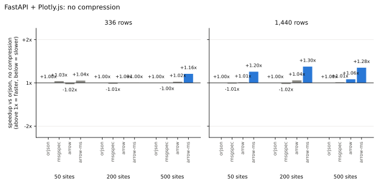

Same numbers as the chart (speedup vs orjson without compression): 336 rows, 50 sites: orjson +1.00x, msgspec +1.03x, arrow -1.02x, arrow-ms +1.04x; 336 rows, 200 sites: orjson +1.00x, msgspec -1.01x, arrow +1.00x, arrow-ms +1.00x; 336 rows, 500 sites: orjson +1.00x, msgspec -1.00x, arrow +1.02x, arrow-ms +1.16x; 1,440 rows, 50 sites: orjson +1.00x, msgspec -1.01x, arrow +1.01x, arrow-ms +1.20x; 1,440 rows, 200 sites: orjson +1.00x, msgspec -1.02x, arrow +1.04x, arrow-ms +1.30x; 1,440 rows, 500 sites: orjson +1.00x, msgspec +1.01x, arrow +1.06x, arrow-ms +1.28x.

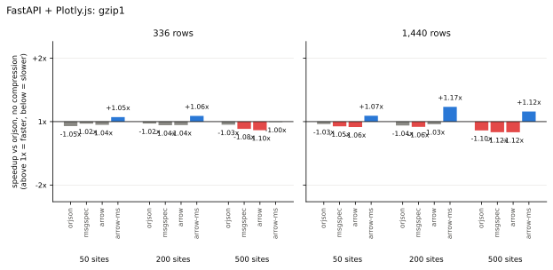

Same numbers as the chart (speedup vs orjson without compression): 336 rows, 50 sites: orjson gzip1 -1.05x, msgspec gzip1 -1.02x, arrow gzip1 -1.04x, arrow-ms gzip1 +1.05x; 336 rows, 200 sites: orjson gzip1 -1.02x, msgspec gzip1 -1.04x, arrow gzip1 -1.04x, arrow-ms gzip1 +1.06x; 336 rows, 500 sites: orjson gzip1 -1.03x, msgspec gzip1 -1.08x, arrow gzip1 -1.10x, arrow-ms gzip1 -1.00x; 1,440 rows, 50 sites: orjson gzip1 -1.03x, msgspec gzip1 -1.05x, arrow gzip1 -1.06x, arrow-ms gzip1 +1.07x; 1,440 rows, 200 sites: orjson gzip1 -1.04x, msgspec gzip1 -1.06x, arrow gzip1 -1.03x, arrow-ms gzip1 +1.17x; 1,440 rows, 500 sites: orjson gzip1 -1.10x, msgspec gzip1 -1.12x, arrow gzip1 -1.12x, arrow-ms gzip1 +1.12x.

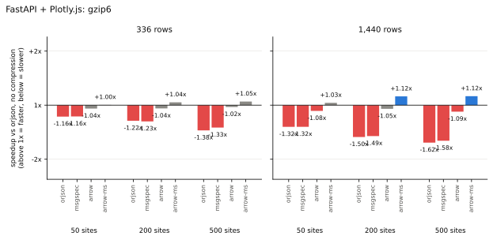

Same numbers as the chart (speedup vs orjson without compression): 336 rows, 50 sites: orjson gzip6 -1.16x, msgspec gzip6 -1.16x, arrow gzip6 -1.04x, arrow-ms gzip6 +1.00x; 336 rows, 200 sites: orjson gzip6 -1.22x, msgspec gzip6 -1.23x, arrow gzip6 -1.04x, arrow-ms gzip6 +1.04x; 336 rows, 500 sites: orjson gzip6 -1.38x, msgspec gzip6 -1.33x, arrow gzip6 -1.02x, arrow-ms gzip6 +1.05x; 1,440 rows, 50 sites: orjson gzip6 -1.32x, msgspec gzip6 -1.32x, arrow gzip6 -1.08x, arrow-ms gzip6 +1.03x; 1,440 rows, 200 sites: orjson gzip6 -1.50x, msgspec gzip6 -1.49x, arrow gzip6 -1.05x, arrow-ms gzip6 +1.12x; 1,440 rows, 500 sites: orjson gzip6 -1.62x, msgspec gzip6 -1.58x, arrow gzip6 -1.09x, arrow-ms gzip6 +1.12x.

Total time, request sent to plot painted (median), one table per compression level:

**No compression**

| Rows | Sites | orjson, none (baseline) | msgspec | arrow | arrow-ms |
| --- | --- | --- | --- | --- | --- |
| 336 | 50 | 125 ms | 122 ms = same (1.03x) | 128 ms = same (0.98x) | 121 ms = same (1.04x) |
| 336 | 200 | 284 ms | 288 ms = same (0.99x) | 283 ms = same (1.00x) | 283 ms = same (1.00x) |
| 336 | 500 | 568 ms | 569 ms = same (1.00x) | 558 ms = same (1.02x) | 492 ms ▲ **+1.16x faster** |
| 1,440 | 50 | 223 ms | 225 ms = same (0.99x) | 221 ms = same (1.01x) | 186 ms ▲ **+1.20x faster** |
| 1,440 | 200 | 622 ms | 633 ms = same (0.98x) | 598 ms = same (1.04x) | 480 ms ▲ **+1.30x faster** |
| 1,440 | 500 | 1,338 ms | 1,326 ms = same (1.01x) | 1,264 ms ▲ **+1.06x faster** | 1,049 ms ▲ **+1.28x faster** |

**gzip1**

| Rows | Sites | orjson, none (baseline) | orjson gzip1 | msgspec gzip1 | arrow gzip1 | arrow-ms gzip1 |
| --- | --- | --- | --- | --- | --- | --- |
| 336 | 50 | 125 ms | 131 ms = same (0.95x) | 128 ms = same (0.98x) | 130 ms = same (0.97x) | 119 ms ▲ **+1.05x faster** |
| 336 | 200 | 284 ms | 290 ms = same (0.98x) | 295 ms = same (0.96x) | 295 ms = same (0.96x) | 266 ms ▲ **+1.06x faster** |
| 336 | 500 | 568 ms | 587 ms = same (0.97x) | 615 ms ▼ **-1.08x slower** | 624 ms ▼ **-1.10x slower** | 570 ms = same (1.00x) |
| 1,440 | 50 | 223 ms | 229 ms = same (0.97x) | 234 ms ▼ **-1.05x slower** | 236 ms ▼ **-1.06x slower** | 209 ms ▲ **+1.07x faster** |
| 1,440 | 200 | 622 ms | 649 ms = same (0.96x) | 659 ms ▼ **-1.06x slower** | 640 ms = same (0.97x) | 530 ms ▲ **+1.17x faster** |
| 1,440 | 500 | 1,338 ms | 1,474 ms ▼ **-1.10x slower** | 1,502 ms ▼ **-1.12x slower** | 1,503 ms ▼ **-1.12x slower** | 1,199 ms ▲ **+1.12x faster** |

**gzip6**

| Rows | Sites | orjson, none (baseline) | orjson gzip6 | msgspec gzip6 | arrow gzip6 | arrow-ms gzip6 |
| --- | --- | --- | --- | --- | --- | --- |
| 336 | 50 | 125 ms | 145 ms ▼ **-1.16x slower** | 145 ms ▼ **-1.16x slower** | 131 ms = same (0.96x) | 125 ms = same (1.00x) |
| 336 | 200 | 284 ms | 346 ms ▼ **-1.22x slower** | 349 ms ▼ **-1.23x slower** | 296 ms = same (0.96x) | 274 ms = same (1.04x) |
| 336 | 500 | 568 ms | 785 ms ▼ **-1.38x slower** | 757 ms ▼ **-1.33x slower** | 581 ms = same (0.98x) | 542 ms = same (1.05x) |
| 1,440 | 50 | 223 ms | 294 ms ▼ **-1.32x slower** | 294 ms ▼ **-1.32x slower** | 240 ms ▼ **-1.08x slower** | 216 ms = same (1.03x) |
| 1,440 | 200 | 622 ms | 936 ms ▼ **-1.50x slower** | 925 ms ▼ **-1.49x slower** | 652 ms = same (0.95x) | 556 ms ▲ **+1.12x faster** |
| 1,440 | 500 | 1,338 ms | 2,164 ms ▼ **-1.62x slower** | 2,112 ms ▼ **-1.58x slower** | 1,455 ms ▼ **-1.09x slower** | 1,193 ms ▲ **+1.12x faster** |

Where the time goes

Build (Dash: running the callback, i.e. building the go.Figure), Encode and Gzip are measured on the server. Wait is request sent to first byte (includes them), Download is first to last byte, Browser is last byte to painted. For FastAPI, Browser splits into decode (JSON.parse or Arrow read, building traces), plotly.js, and paint.

| Rows | Sites | Variant | Wire MB | Raw MB | Build | Encode | Gzip | Wait | Download | Browser | (decode | plot | paint) | Total |
| --- | --- | --- | --- | --- | --- | --- | --- | --- | --- | --- | --- | --- | --- | --- |
| 336 | 50 | orjson | 0.31 | 0.31 | - | 0.6 | 0.0 | 2.6 | 0.5 | 122 | 0.7 | 118 | 3.2 | **125** |
| 336 | 50 | msgspec | 0.31 | 0.31 | - | 0.9 | 0.0 | 2.9 | 0.5 | 119 | 0.8 | 113 | 3.1 | **122** |
| 336 | 50 | arrow | 0.15 | 0.15 | - | 0.3 | 0.0 | 2.2 | 0.4 | 125 | 5.7 | 115 | 3.2 | **128** |
| 336 | 50 | arrow-ms | 0.15 | 0.15 | - | 0.4 | 0.0 | 2.2 | 0.4 | 118 | 6.0 | 108 | 3.5 | **121** |
| 336 | 50 | orjson gzip1 | 0.15 | 0.31 | - | 0.6 | 2.4 | 4.9 | 1.1 | 126 | 0.8 | 121 | 3.0 | **131** |
| 336 | 50 | msgspec gzip1 | 0.15 | 0.31 | - | 0.9 | 2.4 | 5.3 | 1.1 | 122 | 0.7 | 117 | 3.2 | **128** |
| 336 | 50 | arrow gzip1 | 0.13 | 0.15 | - | 0.4 | 2.7 | 4.9 | 0.8 | 124 | 6.0 | 114 | 3.5 | **130** |
| 336 | 50 | arrow-ms gzip1 | 0.13 | 0.15 | - | 0.3 | 2.8 | 4.9 | 0.8 | 113 | 6.2 | 104 | 3.1 | **119** |
| 336 | 50 | orjson gzip6 | 0.15 | 0.31 | - | 0.5 | 18 | 20 | 1.2 | 124 | 0.7 | 119 | 3.3 | **145** |
| 336 | 50 | msgspec gzip6 | 0.15 | 0.31 | - | 0.9 | 18 | 21 | 1.1 | 123 | 0.7 | 118 | 3.1 | **145** |
| 336 | 50 | arrow gzip6 | 0.13 | 0.15 | - | 0.4 | 3.4 | 5.6 | 0.8 | 124 | 5.8 | 114 | 3.2 | **131** |
| 336 | 50 | arrow-ms gzip6 | 0.13 | 0.15 | - | 0.3 | 3.5 | 5.9 | 0.8 | 118 | 5.7 | 106 | 3.5 | **125** |
| 336 | 200 | orjson | 1.23 | 1.23 | - | 1.8 | 0.0 | 4.0 | 1.2 | 278 | 3.0 | 265 | 7.3 | **284** |
| 336 | 200 | msgspec | 1.23 | 1.23 | - | 3.0 | 0.0 | 5.0 | 1.3 | 282 | 2.9 | 268 | 7.3 | **288** |
| 336 | 200 | arrow | 0.57 | 0.57 | - | 1.0 | 0.0 | 2.9 | 0.7 | 280 | 10 | 261 | 7.2 | **283** |
| 336 | 200 | arrow-ms | 0.57 | 0.57 | - | 0.8 | 0.0 | 2.6 | 0.8 | 280 | 9.9 | 262 | 7.9 | **283** |
| 336 | 200 | orjson gzip1 | 0.62 | 1.23 | - | 1.8 | 10 | 14 | 3.5 | 273 | 2.9 | 260 | 7.1 | **290** |
| 336 | 200 | msgspec gzip1 | 0.62 | 1.23 | - | 3.1 | 9.3 | 15 | 3.4 | 278 | 3.0 | 265 | 7.7 | **295** |
| 336 | 200 | arrow gzip1 | 0.53 | 0.57 | - | 1.1 | 12 | 15 | 2.4 | 279 | 10 | 260 | 7.8 | **295** |
| 336 | 200 | arrow-ms gzip1 | 0.53 | 0.57 | - | 0.8 | 11 | 14 | 2.8 | 250 | 9.9 | 231 | 7.1 | **266** |
| 336 | 200 | orjson gzip6 | 0.58 | 1.23 | - | 1.8 | 72 | 76 | 4.2 | 263 | 2.9 | 250 | 7.2 | **346** |
| 336 | 200 | msgspec gzip6 | 0.58 | 1.23 | - | 3.0 | 75 | 80 | 3.8 | 263 | 3.3 | 250 | 7.1 | **349** |
| 336 | 200 | arrow gzip6 | 0.52 | 0.57 | - | 1.0 | 14 | 17 | 2.2 | 276 | 9.9 | 257 | 7.4 | **296** |
| 336 | 200 | arrow-ms gzip6 | 0.52 | 0.57 | - | 0.9 | 15 | 18 | 2.4 | 254 | 10 | 233 | 7.3 | **274** |
| 336 | 500 | orjson | 3.07 | 3.07 | - | 4.1 | 0.0 | 6.1 | 3.1 | 558 | 9.8 | 516 | 23 | **568** |
| 336 | 500 | msgspec | 3.07 | 3.07 | - | 7.5 | 0.0 | 9.4 | 2.8 | 557 | 9.8 | 516 | 23 | **569** |
| 336 | 500 | arrow | 1.43 | 1.43 | - | 2.4 | 0.0 | 4.3 | 1.5 | 552 | 17 | 509 | 24 | **558** |
| 336 | 500 | arrow-ms | 1.43 | 1.43 | - | 2.6 | 0.0 | 4.4 | 1.3 | 486 | 17 | 445 | 22 | **492** |
| 336 | 500 | orjson gzip1 | 1.54 | 3.07 | - | 3.9 | 24 | 30 | 7.7 | 550 | 9.9 | 508 | 24 | **587** |
| 336 | 500 | msgspec gzip1 | 1.54 | 3.07 | - | 7.4 | 24 | 33 | 7.3 | 574 | 9.7 | 528 | 51 | **615** |
| 336 | 500 | arrow gzip1 | 1.31 | 1.43 | - | 3.0 | 28 | 33 | 5.6 | 582 | 17 | 507 | 55 | **624** |
| 336 | 500 | arrow-ms gzip1 | 1.31 | 1.43 | - | 2.5 | 29 | 33 | 5.5 | 532 | 18 | 487 | 21 | **570** |
| 336 | 500 | orjson gzip6 | 1.44 | 3.07 | - | 4.1 | 181 | 187 | 8.0 | 543 | 9.8 | 503 | 20 | **785** |
| 336 | 500 | msgspec gzip6 | 1.44 | 3.07 | - | 7.5 | 189 | 200 | 7.8 | 550 | 9.4 | 517 | 16 | **757** |
| 336 | 500 | arrow gzip6 | 1.30 | 1.43 | - | 2.3 | 34 | 39 | 5.4 | 537 | 18 | 494 | 24 | **581** |
| 336 | 500 | arrow-ms gzip6 | 1.30 | 1.43 | - | 2.9 | 35 | 40 | 5.3 | 497 | 16 | 456 | 23 | **542** |
| 1,440 | 50 | orjson | 1.34 | 1.34 | - | 1.6 | 0.0 | 3.6 | 1.4 | 218 | 2.9 | 206 | 5.1 | **223** |
| 1,440 | 50 | msgspec | 1.34 | 1.34 | - | 3.0 | 0.0 | 4.9 | 1.3 | 219 | 3.0 | 208 | 5.0 | **225** |
| 1,440 | 50 | arrow | 0.60 | 0.60 | - | 0.8 | 0.0 | 2.6 | 0.8 | 217 | 8.1 | 202 | 5.9 | **221** |
| 1,440 | 50 | arrow-ms | 0.60 | 0.60 | - | 0.9 | 0.0 | 2.7 | 0.6 | 183 | 7.3 | 169 | 5.6 | **186** |
| 1,440 | 50 | orjson gzip1 | 0.66 | 1.34 | - | 1.5 | 9.7 | 13 | 3.5 | 213 | 2.7 | 201 | 5.1 | **229** |
| 1,440 | 50 | msgspec gzip1 | 0.66 | 1.34 | - | 3.1 | 10.0 | 15 | 4.0 | 215 | 3.0 | 204 | 5.6 | **234** |
| 1,440 | 50 | arrow gzip1 | 0.56 | 0.60 | - | 0.8 | 12 | 15 | 2.8 | 218 | 8.5 | 203 | 5.2 | **236** |
| 1,440 | 50 | arrow-ms gzip1 | 0.56 | 0.60 | - | 0.8 | 12 | 15 | 2.9 | 191 | 7.8 | 176 | 5.9 | **209** |
| 1,440 | 50 | orjson gzip6 | 0.62 | 1.34 | - | 1.5 | 77 | 80 | 4.1 | 210 | 2.9 | 198 | 5.1 | **294** |
| 1,440 | 50 | msgspec gzip6 | 0.62 | 1.34 | - | 2.9 | 78 | 83 | 4.0 | 205 | 3.5 | 192 | 5.0 | **294** |
| 1,440 | 50 | arrow gzip6 | 0.56 | 0.60 | - | 0.8 | 15 | 18 | 2.5 | 219 | 8.6 | 204 | 5.1 | **240** |
| 1,440 | 50 | arrow-ms gzip6 | 0.56 | 0.60 | - | 0.7 | 15 | 18 | 2.9 | 194 | 8.8 | 179 | 5.5 | **216** |
| 1,440 | 200 | orjson | 5.27 | 5.27 | - | 6.2 | 0.0 | 8.2 | 4.4 | 610 | 15 | 567 | 16 | **622** |
| 1,440 | 200 | msgspec | 5.27 | 5.27 | - | 12 | 0.0 | 14 | 4.4 | 614 | 14 | 571 | 15 | **633** |
| 1,440 | 200 | arrow | 2.37 | 2.37 | - | 2.8 | 0.0 | 4.7 | 2.4 | 589 | 13 | 548 | 23 | **598** |
| 1,440 | 200 | arrow-ms | 2.37 | 2.37 | - | 2.9 | 0.0 | 4.7 | 2.2 | 472 | 14 | 432 | 22 | **480** |
| 1,440 | 200 | orjson gzip1 | 2.63 | 5.27 | - | 6.0 | 39 | 50 | 12 | 589 | 15 | 546 | 15 | **649** |
| 1,440 | 200 | msgspec gzip1 | 2.63 | 5.27 | - | 12 | 41 | 56 | 13 | 593 | 14 | 549 | 15 | **659** |
| 1,440 | 200 | arrow gzip1 | 2.23 | 2.37 | - | 2.9 | 50 | 55 | 10 | 575 | 14 | 534 | 21 | **640** |
| 1,440 | 200 | arrow-ms gzip1 | 2.23 | 2.37 | - | 2.6 | 47 | 52 | 10 | 466 | 13 | 426 | 21 | **530** |
| 1,440 | 200 | orjson gzip6 | 2.46 | 5.27 | - | 6.4 | 309 | 318 | 34 | 577 | 13 | 535 | 18 | **936** |
| 1,440 | 200 | msgspec gzip6 | 2.46 | 5.27 | - | 11 | 317 | 333 | 17 | 580 | 14 | 538 | 18 | **925** |
| 1,440 | 200 | arrow gzip6 | 2.22 | 2.37 | - | 3.1 | 58 | 64 | 9.0 | 578 | 14 | 544 | 15 | **652** |
| 1,440 | 200 | arrow-ms gzip6 | 2.22 | 2.37 | - | 3.2 | 60 | 65 | 10 | 478 | 16 | 440 | 16 | **556** |
| 1,440 | 500 | orjson | 13.14 | 13.14 | - | 15 | 0.0 | 18 | 14 | 1,296 | 39 | 1,188 | 36 | **1,338** |
| 1,440 | 500 | msgspec | 13.14 | 13.14 | - | 28 | 0.0 | 30 | 12 | 1,285 | 37 | 1,182 | 35 | **1,326** |
| 1,440 | 500 | arrow | 5.92 | 5.92 | - | 6.4 | 0.0 | 8.6 | 5.3 | 1,249 | 26 | 1,173 | 35 | **1,264** |
| 1,440 | 500 | arrow-ms | 5.92 | 5.92 | - | 8.1 | 0.0 | 10 | 5.8 | 1,033 | 33 | 948 | 36 | **1,049** |
| 1,440 | 500 | orjson gzip1 | 6.56 | 13.14 | - | 15 | 105 | 122 | 34 | 1,314 | 38 | 1,186 | 76 | **1,474** |
| 1,440 | 500 | msgspec gzip1 | 6.56 | 13.14 | - | 30 | 104 | 134 | 59 | 1,309 | 39 | 1,181 | 37 | **1,502** |
| 1,440 | 500 | arrow gzip1 | 5.57 | 5.92 | - | 8.1 | 121 | 132 | 24 | 1,354 | 28 | 1,183 | 132 | **1,503** |
| 1,440 | 500 | arrow-ms gzip1 | 5.57 | 5.92 | - | 6.5 | 124 | 132 | 23 | 1,044 | 25 | 927 | 36 | **1,199** |
| 1,440 | 500 | orjson gzip6 | 6.15 | 13.14 | - | 15 | 765 | 784 | 30 | 1,341 | 36 | 1,241 | 34 | **2,164** |
| 1,440 | 500 | msgspec gzip6 | 6.15 | 13.14 | - | 28 | 759 | 791 | 30 | 1,294 | 36 | 1,194 | 35 | **2,112** |
| 1,440 | 500 | arrow gzip6 | 5.55 | 5.92 | - | 7.7 | 147 | 157 | 21 | 1,276 | 26 | 1,161 | 96 | **1,455** |
| 1,440 | 500 | arrow-ms gzip6 | 5.55 | 5.92 | - | 6.8 | 149 | 158 | 22 | 1,018 | 26 | 886 | 95 | **1,193** |

### Dash

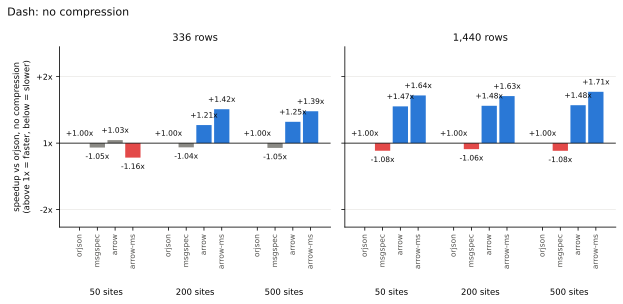

Same numbers as the chart (speedup vs orjson without compression): 336 rows, 50 sites: orjson +1.00x, msgspec -1.05x, arrow +1.03x, arrow-ms -1.16x; 336 rows, 200 sites: orjson +1.00x, msgspec -1.04x, arrow +1.21x, arrow-ms +1.42x; 336 rows, 500 sites: orjson +1.00x, msgspec -1.05x, arrow +1.25x, arrow-ms +1.39x; 1,440 rows, 50 sites: orjson +1.00x, msgspec -1.08x, arrow +1.47x, arrow-ms +1.64x; 1,440 rows, 200 sites: orjson +1.00x, msgspec -1.06x, arrow +1.48x, arrow-ms +1.63x; 1,440 rows, 500 sites: orjson +1.00x, msgspec -1.08x, arrow +1.48x, arrow-ms +1.71x.

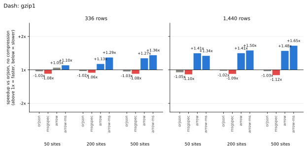

Same numbers as the chart (speedup vs orjson without compression): 336 rows, 50 sites: orjson gzip1 -1.03x, msgspec gzip1 -1.08x, arrow gzip1 +1.05x, arrow-ms gzip1 +1.10x; 336 rows, 200 sites: orjson gzip1 -1.02x, msgspec gzip1 -1.06x, arrow gzip1 +1.13x, arrow-ms gzip1 +1.29x; 336 rows, 500 sites: orjson gzip1 -1.03x, msgspec gzip1 -1.08x, arrow gzip1 +1.27x, arrow-ms gzip1 +1.36x; 1,440 rows, 50 sites: orjson gzip1 -1.05x, msgspec gzip1 -1.10x, arrow gzip1 +1.41x, arrow-ms gzip1 +1.34x; 1,440 rows, 200 sites: orjson gzip1 -1.02x, msgspec gzip1 -1.09x, arrow gzip1 +1.41x, arrow-ms gzip1 +1.50x; 1,440 rows, 500 sites: orjson gzip1 -1.03x, msgspec gzip1 -1.12x, arrow gzip1 +1.48x, arrow-ms gzip1 +1.65x.

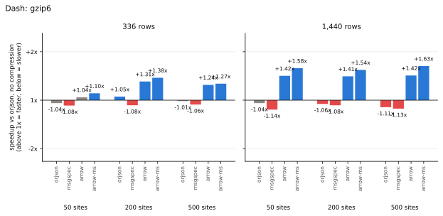

Same numbers as the chart (speedup vs orjson without compression): 336 rows, 50 sites: orjson gzip6 -1.04x, msgspec gzip6 -1.08x, arrow gzip6 +1.04x, arrow-ms gzip6 +1.10x; 336 rows, 200 sites: orjson gzip6 +1.05x, msgspec gzip6 -1.08x, arrow gzip6 +1.31x, arrow-ms gzip6 +1.38x; 336 rows, 500 sites: orjson gzip6 -1.01x, msgspec gzip6 -1.06x, arrow gzip6 +1.24x, arrow-ms gzip6 +1.27x; 1,440 rows, 50 sites: orjson gzip6 -1.04x, msgspec gzip6 -1.14x, arrow gzip6 +1.42x, arrow-ms gzip6 +1.58x; 1,440 rows, 200 sites: orjson gzip6 -1.06x, msgspec gzip6 -1.08x, arrow gzip6 +1.41x, arrow-ms gzip6 +1.54x; 1,440 rows, 500 sites: orjson gzip6 -1.11x, msgspec gzip6 -1.13x, arrow gzip6 +1.42x, arrow-ms gzip6 +1.63x.

Total time, request sent to plot painted (median), one table per compression level:

**No compression**

| Rows | Sites | orjson, none (baseline) | msgspec | arrow | arrow-ms |
| --- | --- | --- | --- | --- | --- |
| 336 | 50 | 254 ms | 266 ms = same (0.95x) | 246 ms = same (1.03x) | 295 ms ▼ **-1.16x slower** |
| 336 | 200 | 918 ms | 959 ms = same (0.96x) | 760 ms ▲ **+1.21x faster** | 645 ms ▲ **+1.42x faster** |
| 336 | 500 | 2,086 ms | 2,192 ms = same (0.95x) | 1,670 ms ▲ **+1.25x faster** | 1,496 ms ▲ **+1.39x faster** |
| 1,440 | 50 | 754 ms | 816 ms ▼ **-1.08x slower** | 514 ms ▲ **+1.47x faster** | 459 ms ▲ **+1.64x faster** |
| 1,440 | 200 | 2,737 ms | 2,914 ms ▼ **-1.06x slower** | 1,854 ms ▲ **+1.48x faster** | 1,676 ms ▲ **+1.63x faster** |
| 1,440 | 500 | 6,712 ms | 7,272 ms ▼ **-1.08x slower** | 4,521 ms ▲ **+1.48x faster** | 3,931 ms ▲ **+1.71x faster** |

**gzip1**

| Rows | Sites | orjson, none (baseline) | orjson gzip1 | msgspec gzip1 | arrow gzip1 | arrow-ms gzip1 |
| --- | --- | --- | --- | --- | --- | --- |
| 336 | 50 | 254 ms | 261 ms = same (0.97x) | 275 ms ▼ **-1.08x slower** | 243 ms = same (1.05x) | 231 ms ▲ **+1.10x faster** |
| 336 | 200 | 918 ms | 941 ms = same (0.98x) | 974 ms ▼ **-1.06x slower** | 812 ms ▲ **+1.13x faster** | 710 ms ▲ **+1.29x faster** |
| 336 | 500 | 2,086 ms | 2,154 ms = same (0.97x) | 2,262 ms ▼ **-1.08x slower** | 1,641 ms ▲ **+1.27x faster** | 1,538 ms ▲ **+1.36x faster** |
| 1,440 | 50 | 754 ms | 792 ms = same (0.95x) | 827 ms ▼ **-1.10x slower** | 534 ms ▲ **+1.41x faster** | 564 ms ▲ **+1.34x faster** |
| 1,440 | 200 | 2,737 ms | 2,786 ms = same (0.98x) | 2,974 ms ▼ **-1.09x slower** | 1,936 ms ▲ **+1.41x faster** | 1,830 ms ▲ **+1.50x faster** |
| 1,440 | 500 | 6,712 ms | 6,891 ms = same (0.97x) | 7,487 ms ▼ **-1.12x slower** | 4,528 ms ▲ **+1.48x faster** | 4,066 ms ▲ **+1.65x faster** |

**gzip6**

| Rows | Sites | orjson, none (baseline) | orjson gzip6 | msgspec gzip6 | arrow gzip6 | arrow-ms gzip6 |
| --- | --- | --- | --- | --- | --- | --- |
| 336 | 50 | 254 ms | 265 ms = same (0.96x) | 274 ms ▼ **-1.08x slower** | 244 ms = same (1.04x) | 230 ms ▲ **+1.10x faster** |
| 336 | 200 | 918 ms | 872 ms ▲ **+1.05x faster** | 987 ms ▼ **-1.08x slower** | 703 ms ▲ **+1.31x faster** | 666 ms ▲ **+1.38x faster** |
| 336 | 500 | 2,086 ms | 2,113 ms = same (0.99x) | 2,219 ms ▼ **-1.06x slower** | 1,675 ms ▲ **+1.24x faster** | 1,647 ms ▲ **+1.27x faster** |
| 1,440 | 50 | 754 ms | 786 ms = same (0.96x) | 863 ms ▼ **-1.14x slower** | 532 ms ▲ **+1.42x faster** | 477 ms ▲ **+1.58x faster** |
| 1,440 | 200 | 2,737 ms | 2,887 ms ▼ **-1.06x slower** | 2,944 ms ▼ **-1.08x slower** | 1,945 ms ▲ **+1.41x faster** | 1,774 ms ▲ **+1.54x faster** |
| 1,440 | 500 | 6,712 ms | 7,420 ms ▼ **-1.11x slower** | 7,574 ms ▼ **-1.13x slower** | 4,715 ms ▲ **+1.42x faster** | 4,118 ms ▲ **+1.63x faster** |

Where the time goes

Build (Dash: running the callback, i.e. building the go.Figure), Encode and Gzip are measured on the server. Wait is request sent to first byte (includes them), Download is first to last byte, Browser is last byte to painted.

| Rows | Sites | Variant | Wire MB | Raw MB | Build | Encode | Gzip | Wait | Download | Browser | Total |
| --- | --- | --- | --- | --- | --- | --- | --- | --- | --- | --- | --- |
| 336 | 50 | orjson | 0.69 | 0.69 | 51 | 54 | 0.0 | 108 | 1.0 | 145 | **254** |
| 336 | 50 | msgspec | 0.69 | 0.69 | 51 | 63 | 0.0 | 115 | 0.9 | 147 | **266** |
| 336 | 50 | arrow | 0.30 | 0.30 | 51 | 16 | 0.0 | 69 | 0.7 | 163 | **246** |
| 336 | 50 | arrow-ms | 0.30 | 0.30 | 138 | 15 | 0.0 | 155 | 0.8 | 139 | **295** |
| 336 | 50 | orjson gzip1 | 0.19 | 0.69 | 54 | 54 | 3.8 | 115 | 1.7 | 144 | **261** |
| 336 | 50 | msgspec gzip1 | 0.19 | 0.69 | 55 | 64 | 3.7 | 128 | 1.6 | 146 | **275** |
| 336 | 50 | arrow gzip1 | 0.14 | 0.30 | 51 | 16 | 2.7 | 73 | 1.2 | 153 | **243** |
| 336 | 50 | arrow-ms gzip1 | 0.14 | 0.30 | 55 | 17 | 2.7 | 77 | 1.1 | 151 | **231** |
| 336 | 50 | orjson gzip6 | 0.15 | 0.69 | 56 | 53 | 6.1 | 116 | 1.4 | 147 | **265** |
| 336 | 50 | msgspec gzip6 | 0.15 | 0.69 | 54 | 64 | 6.0 | 126 | 1.5 | 144 | **274** |
| 336 | 50 | arrow gzip6 | 0.14 | 0.30 | 55 | 17 | 3.6 | 80 | 1.1 | 152 | **244** |
| 336 | 50 | arrow-ms gzip6 | 0.14 | 0.30 | 52 | 17 | 3.9 | 75 | 1.1 | 155 | **230** |
| 336 | 200 | orjson | 2.73 | 2.73 | 277 | 201 | 0.0 | 480 | 2.8 | 436 | **918** |
| 336 | 200 | msgspec | 2.73 | 2.73 | 278 | 240 | 0.0 | 515 | 2.6 | 441 | **959** |
| 336 | 200 | arrow | 1.19 | 1.19 | 265 | 53 | 0.0 | 320 | 1.4 | 439 | **760** |
| 336 | 200 | arrow-ms | 1.19 | 1.19 | 213 | 54 | 0.0 | 269 | 1.3 | 374 | **645** |
| 336 | 200 | orjson gzip1 | 0.75 | 2.73 | 273 | 195 | 14 | 485 | 4.6 | 432 | **941** |
| 336 | 200 | msgspec gzip1 | 0.75 | 2.73 | 268 | 261 | 14 | 531 | 4.5 | 439 | **974** |
| 336 | 200 | arrow gzip1 | 0.55 | 1.19 | 302 | 53 | 10 | 369 | 3.1 | 440 | **812** |
| 336 | 200 | arrow-ms gzip1 | 0.55 | 1.19 | 210 | 57 | 10 | 290 | 2.8 | 379 | **710** |
| 336 | 200 | orjson gzip6 | 0.59 | 2.73 | 205 | 207 | 24 | 443 | 3.8 | 426 | **872** |
| 336 | 200 | msgspec gzip6 | 0.59 | 2.73 | 282 | 256 | 23 | 547 | 4.2 | 437 | **987** |
| 336 | 200 | arrow gzip6 | 0.53 | 1.19 | 189 | 54 | 13 | 264 | 2.7 | 436 | **703** |
| 336 | 200 | arrow-ms gzip6 | 0.53 | 1.19 | 207 | 54 | 14 | 280 | 2.6 | 383 | **666** |
| 336 | 500 | orjson | 6.82 | 6.82 | 562 | 604 | 0.0 | 1,158 | 10 | 904 | **2,086** |
| 336 | 500 | msgspec | 6.82 | 6.82 | 553 | 709 | 0.0 | 1,273 | 11 | 908 | **2,192** |
| 336 | 500 | arrow | 2.96 | 2.96 | 573 | 131 | 0.0 | 751 | 2.7 | 923 | **1,670** |
| 336 | 500 | arrow-ms | 2.96 | 2.96 | 542 | 131 | 0.0 | 675 | 3.0 | 823 | **1,496** |
| 336 | 500 | orjson gzip1 | 1.88 | 6.82 | 568 | 612 | 35 | 1,217 | 10 | 927 | **2,154** |
| 336 | 500 | msgspec gzip1 | 1.88 | 6.82 | 576 | 673 | 38 | 1,330 | 10 | 926 | **2,262** |
| 336 | 500 | arrow gzip1 | 1.37 | 2.96 | 547 | 133 | 25 | 710 | 5.8 | 925 | **1,641** |
| 336 | 500 | arrow-ms gzip1 | 1.37 | 2.96 | 562 | 129 | 27 | 718 | 5.8 | 814 | **1,538** |
| 336 | 500 | orjson gzip6 | 1.47 | 6.82 | 538 | 595 | 58 | 1,195 | 10 | 905 | **2,113** |
| 336 | 500 | msgspec gzip6 | 1.47 | 6.82 | 572 | 682 | 59 | 1,292 | 11 | 917 | **2,219** |
| 336 | 500 | arrow gzip6 | 1.32 | 2.96 | 568 | 128 | 34 | 732 | 6.0 | 938 | **1,675** |
| 336 | 500 | arrow-ms gzip6 | 1.32 | 2.96 | 624 | 147 | 36 | 809 | 5.6 | 832 | **1,647** |
| 1,440 | 50 | orjson | 2.91 | 2.91 | 166 | 201 | 0.0 | 441 | 3.0 | 310 | **754** |
| 1,440 | 50 | msgspec | 2.91 | 2.91 | 162 | 243 | 0.0 | 506 | 2.8 | 308 | **816** |
| 1,440 | 50 | arrow | 1.18 | 1.18 | 161 | 37 | 0.0 | 201 | 1.5 | 312 | **514** |
| 1,440 | 50 | arrow-ms | 1.18 | 1.18 | 161 | 37 | 0.0 | 200 | 1.3 | 258 | **459** |
| 1,440 | 50 | orjson gzip1 | 0.86 | 2.91 | 257 | 200 | 15 | 472 | 4.7 | 311 | **792** |
| 1,440 | 50 | msgspec gzip1 | 0.86 | 2.91 | 246 | 256 | 15 | 507 | 5.1 | 315 | **827** |
| 1,440 | 50 | arrow gzip1 | 0.64 | 1.18 | 165 | 36 | 12 | 215 | 3.2 | 316 | **534** |
| 1,440 | 50 | arrow-ms gzip1 | 0.64 | 1.18 | 252 | 37 | 12 | 304 | 3.0 | 261 | **564** |
| 1,440 | 50 | orjson gzip6 | 0.84 | 2.91 | 166 | 283 | 32 | 475 | 4.6 | 307 | **786** |
| 1,440 | 50 | msgspec gzip6 | 0.84 | 2.91 | 171 | 332 | 31 | 536 | 5.1 | 330 | **863** |
| 1,440 | 50 | arrow gzip6 | 0.56 | 1.18 | 159 | 37 | 15 | 218 | 3.1 | 311 | **532** |
| 1,440 | 50 | arrow-ms gzip6 | 0.56 | 1.18 | 168 | 37 | 15 | 220 | 3.3 | 255 | **477** |
| 1,440 | 200 | orjson | 11.61 | 11.61 | 770 | 976 | 0.0 | 1,750 | 18 | 966 | **2,737** |
| 1,440 | 200 | msgspec | 11.61 | 11.61 | 785 | 1,144 | 0.0 | 1,945 | 19 | 967 | **2,914** |
| 1,440 | 200 | arrow | 4.72 | 4.72 | 762 | 133 | 0.0 | 896 | 5.0 | 955 | **1,854** |
| 1,440 | 200 | arrow-ms | 4.72 | 4.72 | 755 | 136 | 0.0 | 889 | 4.2 | 783 | **1,676** |
| 1,440 | 200 | orjson gzip1 | 3.43 | 11.61 | 704 | 977 | 59 | 1,814 | 20 | 961 | **2,786** |
| 1,440 | 200 | msgspec gzip1 | 3.43 | 11.61 | 748 | 1,148 | 60 | 2,013 | 20 | 956 | **2,974** |
| 1,440 | 200 | arrow gzip1 | 2.54 | 4.72 | 701 | 137 | 50 | 898 | 12 | 1,026 | **1,936** |
| 1,440 | 200 | arrow-ms gzip1 | 2.54 | 4.72 | 787 | 143 | 50 | 979 | 12 | 840 | **1,830** |
| 1,440 | 200 | orjson gzip6 | 3.36 | 11.61 | 716 | 961 | 124 | 1,878 | 19 | 959 | **2,887** |
| 1,440 | 200 | msgspec gzip6 | 3.36 | 11.61 | 700 | 1,128 | 128 | 1,981 | 20 | 945 | **2,944** |
| 1,440 | 200 | arrow gzip6 | 2.23 | 4.72 | 789 | 131 | 58 | 981 | 10 | 956 | **1,945** |
| 1,440 | 200 | arrow-ms gzip6 | 2.23 | 4.72 | 772 | 134 | 58 | 967 | 8.8 | 791 | **1,774** |
| 1,440 | 500 | orjson | 29.00 | 29.00 | 1,966 | 2,631 | 0.0 | 4,592 | 47 | 2,076 | **6,712** |
| 1,440 | 500 | msgspec | 29.00 | 29.00 | 1,844 | 3,258 | 0.0 | 5,113 | 54 | 2,123 | **7,272** |
| 1,440 | 500 | arrow | 11.79 | 11.79 | 1,978 | 317 | 0.0 | 2,305 | 11 | 2,174 | **4,521** |
| 1,440 | 500 | arrow-ms | 11.79 | 11.79 | 1,925 | 318 | 0.0 | 2,234 | 10 | 1,705 | **3,931** |
| 1,440 | 500 | orjson gzip1 | 8.56 | 29.00 | 1,947 | 2,582 | 149 | 4,735 | 54 | 2,102 | **6,891** |
| 1,440 | 500 | msgspec gzip1 | 8.56 | 29.00 | 1,887 | 3,302 | 149 | 5,352 | 53 | 2,082 | **7,487** |
| 1,440 | 500 | arrow gzip1 | 6.36 | 11.79 | 1,855 | 324 | 126 | 2,307 | 26 | 2,229 | **4,528** |
| 1,440 | 500 | arrow-ms gzip1 | 6.36 | 11.79 | 1,932 | 325 | 126 | 2,384 | 26 | 1,656 | **4,066** |
| 1,440 | 500 | orjson gzip6 | 8.40 | 29.00 | 1,932 | 3,012 | 316 | 5,241 | 58 | 2,119 | **7,420** |
| 1,440 | 500 | msgspec gzip6 | 8.40 | 29.00 | 1,841 | 3,195 | 324 | 5,373 | 48 | 2,153 | **7,574** |
| 1,440 | 500 | arrow gzip6 | 5.56 | 11.79 | 2,050 | 323 | 145 | 2,528 | 22 | 2,198 | **4,715** |
| 1,440 | 500 | arrow-ms gzip6 | 5.56 | 11.79 | 1,879 | 319 | 147 | 2,349 | 23 | 1,749 | **4,118** |

### Dash vs FastAPI

Same transport, compression and data. ⚠️ marks Dash taking 1.5x FastAPI's time or more (72 cases). In JSON, Dash's figure repeats the timestamps in every trace, where FastAPI sends each column once, so its payload grows with the trace count.

All cases

| Rows | Sites | Variant | FastAPI ms | Dash ms | Dash / FastAPI | Wire MB FastAPI / Dash |
| --- | --- | --- | --- | --- | --- | --- |
| 336 | 50 | orjson | 125 | 254 | ⚠️ **2.03x** | 0.31 / 0.69 |
| 336 | 50 | msgspec | 122 | 266 | ⚠️ **2.18x** | 0.31 / 0.69 |
| 336 | 50 | arrow | 128 | 246 | ⚠️ **1.93x** | 0.15 / 0.30 |
| 336 | 50 | arrow-ms | 121 | 295 | ⚠️ **2.45x** | 0.15 / 0.30 |
| 336 | 50 | orjson gzip1 | 131 | 261 | ⚠️ **1.99x** | 0.15 / 0.19 |
| 336 | 50 | msgspec gzip1 | 128 | 275 | ⚠️ **2.15x** | 0.15 / 0.19 |
| 336 | 50 | arrow gzip1 | 130 | 243 | ⚠️ **1.87x** | 0.13 / 0.14 |
| 336 | 50 | arrow-ms gzip1 | 119 | 231 | ⚠️ **1.94x** | 0.13 / 0.14 |
| 336 | 50 | orjson gzip6 | 145 | 265 | ⚠️ **1.83x** | 0.15 / 0.15 |
| 336 | 50 | msgspec gzip6 | 145 | 274 | ⚠️ **1.90x** | 0.15 / 0.15 |
| 336 | 50 | arrow gzip6 | 131 | 244 | ⚠️ **1.86x** | 0.13 / 0.14 |
| 336 | 50 | arrow-ms gzip6 | 125 | 230 | ⚠️ **1.85x** | 0.13 / 0.14 |
| 336 | 200 | orjson | 284 | 918 | ⚠️ **3.24x** | 1.23 / 2.73 |
| 336 | 200 | msgspec | 288 | 959 | ⚠️ **3.34x** | 1.23 / 2.73 |
| 336 | 200 | arrow | 283 | 760 | ⚠️ **2.68x** | 0.57 / 1.19 |
| 336 | 200 | arrow-ms | 283 | 645 | ⚠️ **2.28x** | 0.57 / 1.19 |
| 336 | 200 | orjson gzip1 | 290 | 941 | ⚠️ **3.25x** | 0.62 / 0.75 |
| 336 | 200 | msgspec gzip1 | 295 | 974 | ⚠️ **3.30x** | 0.62 / 0.75 |
| 336 | 200 | arrow gzip1 | 295 | 812 | ⚠️ **2.76x** | 0.53 / 0.55 |
| 336 | 200 | arrow-ms gzip1 | 266 | 710 | ⚠️ **2.66x** | 0.53 / 0.55 |
| 336 | 200 | orjson gzip6 | 346 | 872 | ⚠️ **2.52x** | 0.58 / 0.59 |
| 336 | 200 | msgspec gzip6 | 349 | 987 | ⚠️ **2.83x** | 0.58 / 0.59 |
| 336 | 200 | arrow gzip6 | 296 | 703 | ⚠️ **2.38x** | 0.52 / 0.53 |
| 336 | 200 | arrow-ms gzip6 | 274 | 666 | ⚠️ **2.43x** | 0.52 / 0.53 |
| 336 | 500 | orjson | 568 | 2,086 | ⚠️ **3.67x** | 3.07 / 6.82 |
| 336 | 500 | msgspec | 569 | 2,192 | ⚠️ **3.86x** | 3.07 / 6.82 |
| 336 | 500 | arrow | 558 | 1,670 | ⚠️ **2.99x** | 1.43 / 2.96 |
| 336 | 500 | arrow-ms | 492 | 1,496 | ⚠️ **3.04x** | 1.43 / 2.96 |
| 336 | 500 | orjson gzip1 | 587 | 2,154 | ⚠️ **3.67x** | 1.54 / 1.88 |
| 336 | 500 | msgspec gzip1 | 615 | 2,262 | ⚠️ **3.68x** | 1.54 / 1.88 |
| 336 | 500 | arrow gzip1 | 624 | 1,641 | ⚠️ **2.63x** | 1.31 / 1.37 |
| 336 | 500 | arrow-ms gzip1 | 570 | 1,538 | ⚠️ **2.70x** | 1.31 / 1.37 |
| 336 | 500 | orjson gzip6 | 785 | 2,113 | ⚠️ **2.69x** | 1.44 / 1.47 |
| 336 | 500 | msgspec gzip6 | 757 | 2,219 | ⚠️ **2.93x** | 1.44 / 1.47 |
| 336 | 500 | arrow gzip6 | 581 | 1,675 | ⚠️ **2.88x** | 1.30 / 1.32 |
| 336 | 500 | arrow-ms gzip6 | 542 | 1,647 | ⚠️ **3.04x** | 1.30 / 1.32 |
| 1,440 | 50 | orjson | 223 | 754 | ⚠️ **3.39x** | 1.34 / 2.91 |
| 1,440 | 50 | msgspec | 225 | 816 | ⚠️ **3.63x** | 1.34 / 2.91 |
| 1,440 | 50 | arrow | 221 | 514 | ⚠️ **2.33x** | 0.60 / 1.18 |
| 1,440 | 50 | arrow-ms | 186 | 459 | ⚠️ **2.46x** | 0.60 / 1.18 |
| 1,440 | 50 | orjson gzip1 | 229 | 792 | ⚠️ **3.47x** | 0.66 / 0.86 |
| 1,440 | 50 | msgspec gzip1 | 234 | 827 | ⚠️ **3.53x** | 0.66 / 0.86 |
| 1,440 | 50 | arrow gzip1 | 236 | 534 | ⚠️ **2.26x** | 0.56 / 0.64 |
| 1,440 | 50 | arrow-ms gzip1 | 209 | 564 | ⚠️ **2.70x** | 0.56 / 0.64 |
| 1,440 | 50 | orjson gzip6 | 294 | 786 | ⚠️ **2.67x** | 0.62 / 0.84 |
| 1,440 | 50 | msgspec gzip6 | 294 | 863 | ⚠️ **2.93x** | 0.62 / 0.84 |
| 1,440 | 50 | arrow gzip6 | 240 | 532 | ⚠️ **2.22x** | 0.56 / 0.56 |
| 1,440 | 50 | arrow-ms gzip6 | 216 | 477 | ⚠️ **2.21x** | 0.56 / 0.56 |
| 1,440 | 200 | orjson | 622 | 2,737 | ⚠️ **4.40x** | 5.27 / 11.61 |
| 1,440 | 200 | msgspec | 633 | 2,914 | ⚠️ **4.61x** | 5.27 / 11.61 |
| 1,440 | 200 | arrow | 598 | 1,854 | ⚠️ **3.10x** | 2.37 / 4.72 |
| 1,440 | 200 | arrow-ms | 480 | 1,676 | ⚠️ **3.50x** | 2.37 / 4.72 |
| 1,440 | 200 | orjson gzip1 | 649 | 2,786 | ⚠️ **4.29x** | 2.63 / 3.43 |
| 1,440 | 200 | msgspec gzip1 | 659 | 2,974 | ⚠️ **4.51x** | 2.63 / 3.43 |
| 1,440 | 200 | arrow gzip1 | 640 | 1,936 | ⚠️ **3.02x** | 2.23 / 2.54 |
| 1,440 | 200 | arrow-ms gzip1 | 530 | 1,830 | ⚠️ **3.45x** | 2.23 / 2.54 |
| 1,440 | 200 | orjson gzip6 | 936 | 2,887 | ⚠️ **3.08x** | 2.46 / 3.36 |
| 1,440 | 200 | msgspec gzip6 | 925 | 2,944 | ⚠️ **3.18x** | 2.46 / 3.36 |
| 1,440 | 200 | arrow gzip6 | 652 | 1,945 | ⚠️ **2.98x** | 2.22 / 2.23 |
| 1,440 | 200 | arrow-ms gzip6 | 556 | 1,774 | ⚠️ **3.19x** | 2.22 / 2.23 |
| 1,440 | 500 | orjson | 1,338 | 6,712 | ⚠️ **5.02x** | 13.14 / 29.00 |
| 1,440 | 500 | msgspec | 1,326 | 7,272 | ⚠️ **5.49x** | 13.14 / 29.00 |
| 1,440 | 500 | arrow | 1,264 | 4,521 | ⚠️ **3.58x** | 5.92 / 11.79 |
| 1,440 | 500 | arrow-ms | 1,049 | 3,931 | ⚠️ **3.75x** | 5.92 / 11.79 |
| 1,440 | 500 | orjson gzip1 | 1,474 | 6,891 | ⚠️ **4.68x** | 6.56 / 8.56 |
| 1,440 | 500 | msgspec gzip1 | 1,502 | 7,487 | ⚠️ **4.98x** | 6.56 / 8.56 |
| 1,440 | 500 | arrow gzip1 | 1,503 | 4,528 | ⚠️ **3.01x** | 5.57 / 6.36 |
| 1,440 | 500 | arrow-ms gzip1 | 1,199 | 4,066 | ⚠️ **3.39x** | 5.57 / 6.36 |
| 1,440 | 500 | orjson gzip6 | 2,164 | 7,420 | ⚠️ **3.43x** | 6.15 / 8.40 |
| 1,440 | 500 | msgspec gzip6 | 2,112 | 7,574 | ⚠️ **3.59x** | 6.15 / 8.40 |
| 1,440 | 500 | arrow gzip6 | 1,455 | 4,715 | ⚠️ **3.24x** | 5.55 / 5.56 |
| 1,440 | 500 | arrow-ms gzip6 | 1,193 | 4,118 | ⚠️ **3.45x** | 5.55 / 5.56 |

## 4. Optimisations (separate microbenchmarks)

Each one changes one thing on a small sample, measured on its own. The timestamp one decided how the *arrow* and *arrow-ms* transports above handle dates.

### Timestamps: four ways to hand Arrow dates to plotly.js

Browser only (no server, no network): decode the payload, build traces, `Plotly.react`, paint. Same Arrow payload for every Arrow mode; the conversions are in [web/dates.js](web/dates.js). *toISOString*: one Date and string per value. *Fast ISO strings*: the same strings with the date part made once per day and the time part once per second of the day. *Date objects*: what I use today when passing Arrow data to plotly.js by hand. *UTC ms, patched plotly.js*: a Float64Array that plotly.js takes as is after the one-condition change in [patches/optimisations/plotly-date-typed-array.patch](patches/optimisations/plotly-date-typed-array.patch). The last two columns drop the timestamp column (row index on a linear axis) to show what dates cost. The browser runs in UTC so all modes with dates draw the same axis ranges, which is checked.

- **Command:** `python microbench/optimisations.py --repeats 3`
- **Finished:** 2026-11-18T22:38:13+00:00 (median of 3), WebGL on `ANGLE (Microsoft Corporation, D3D12 (NVIDIA RTX 500 Ada Generation Laptop GPU), OpenGL 4.6)`

| Case | orjson JSON, stock plotly.js (baseline) | Arrow, toISOString, stock plotly.js | Arrow, fast ISO strings, stock plotly.js | Arrow, Date objects, stock plotly.js | Arrow, UTC ms, patched plotly.js | No timestamps: orjson JSON | No timestamps: Arrow |
| --- | --- | --- | --- | --- | --- | --- | --- |
| Forecast (stacked SVG, float64, nulls): 1,440 rows x 50 traces | 211 ms | 216 ms = same (0.98x) | 217 ms = same (0.97x) | 189 ms ▲ **+1.12x faster** | 189 ms ▲ **+1.12x faster** | 192 ms ▲ **+1.10x faster** | 182 ms ▲ **+1.16x faster** |
| Forecast (stacked SVG, float64, nulls): 1,440 rows x 500 traces | 1,226 ms | 1,197 ms = same (1.02x) | 1,199 ms = same (1.02x) | 1,005 ms ▲ **+1.22x faster** | 934 ms ▲ **+1.31x faster** | 925 ms ▲ **+1.33x faster** | 910 ms ▲ **+1.35x faster** |
| Scale (scattergl, float32): 1,000,000 rows x 1 trace | 1,000 ms | 1,257 ms ▼ **-1.26x slower** | 1,048 ms = same (0.95x) | 725 ms ▲ **+1.38x faster** | 548 ms ▲ **+1.83x faster** | 555 ms ▲ **+1.80x faster** | 553 ms ▲ **+1.81x faster** |
| Scale (scattergl, float32): 100,000 rows x 10 traces | 874 ms | 870 ms = same (1.00x) | 858 ms = same (1.02x) | 588 ms ▲ **+1.49x faster** | 512 ms ▲ **+1.71x faster** | 505 ms ▲ **+1.73x faster** | 500 ms ▲ **+1.75x faster** |

Date objects are shown in the browser's local time, ISO strings and patched UTC ms as written; only the first suits a chart that must follow the viewer's timezone. Patched plotly.js reads numbers on a date axis differently from today (local-time ms), so upstream it would need to be opt-in.

*Tried, not adopted:* making the UTC ms on the server (casting the timestamp column to float64) saved only a few percent over converting in the browser. It also moves an O(n) cast to the server, and the payload no longer carries the Arrow timestamp type.

### Dash: send an array repeated across traces once

Dash with Arrow and gzip1, end to end, forecast workload (go.Figure + go.Scatter, as a typical Dash app builds charts). go.Figure copies x into every trace. *Without*: the patch as benchmarked, one Arrow column per trace, each converted to dates in the browser. *With*: [microbench/dash_shared_x.py](microbench/dash_shared_x.py) reuses the column of an earlier array with identical contents, so x goes once.

- **Command:** `python microbench/optimisations.py --repeats 3`
- **Finished:** 2026-11-18T22:38:13+00:00 (median of 3), WebGL on `ANGLE (Microsoft Corporation, D3D12 (NVIDIA RTX 500 Ada Generation Laptop GPU), OpenGL 4.6)`

| Case | Without (ms) | With (ms) | Change |
| --- | --- | --- | --- |
| Forecast: 336 rows x 50 traces (wire 141 kB -> 133 kB) | 232 | 225 | = same (1.03x) |
| Forecast: 1,440 rows x 50 traces (wire 639 kB -> 554 kB) | 562 | 508 | ▲ **+1.11x faster** |
| Forecast: 1,440 rows x 200 traces (wire 2.5 MB -> 2.2 MB) | 1,886 | 1,868 | = same (1.01x) |
| Forecast: 1,440 rows x 500 traces (wire 6.4 MB -> 5.5 MB) | 4,496 | 4,545 | = same (0.99x) |

*Not adopted.* It makes the payload about 15% smaller, but the total barely moves: forecast charts have few rows per trace, so the repeated timestamps are a small part of the work next to building the go.Figure and drawing stacked SVG. FastAPI already sends x once.

### Dash app code: drop the timezone from the index before plotting

Dash end to end, like bench.py: request sent to plot painted, no compression, forecast workload (half-hourly float64 with nulls, stacked SVG `scatter`). The DataFrame index is in Europe/London (from `tz_convert`), either **tz-aware** or with the zone dropped (`df.index.tz_convert("Europe/London").tz_localize(None)`), served by [microbench/dash_tz_index.py](microbench/dash_tz_index.py). plotly.py stores a tz-aware index as an object array of `pd.Timestamp` in every trace, and every encoder then walks it in Python. Both draw the same chart (plotly.js shows a date string's wall-clock time and ignores its offset), which is checked. Baseline: tz-aware index with stock Dash (orjson). *arrow-ms* uses the patched plotly.js.

- **Command:** `python microbench/optimisations.py --only tz-index --repeats 3`
- **Finished:** 2026-11-19T01:55:01+00:00 (median of 3), WebGL on `ANGLE (Microsoft Corporation, D3D12 (NVIDIA RTX 500 Ada Generation Laptop GPU), OpenGL 4.6)`

| Case | tz-aware index, orjson | tz-aware index, msgspec | tz-aware index, arrow | tz-aware index, arrow-ms | zone dropped, orjson | zone dropped, msgspec | zone dropped, arrow | zone dropped, arrow-ms |
| --- | --- | --- | --- | --- | --- | --- | --- | --- |
| 336 rows x 50 traces | 436 ms | 498 ms ▼ **-1.14x slower** | 341 ms ▲ **+1.28x faster** | 339 ms ▲ **+1.29x faster** | 168 ms ▲ **+2.60x faster** | 162 ms ▲ **+2.69x faster** | 164 ms ▲ **+2.67x faster** | 153 ms ▲ **+2.85x faster** |
| 1,440 rows x 50 traces | 1,504 ms | 1,547 ms = same (0.97x) | 1,079 ms ▲ **+1.39x faster** | 1,021 ms ▲ **+1.47x faster** | 370 ms ▲ **+4.07x faster** | 365 ms ▲ **+4.12x faster** | 336 ms ▲ **+4.47x faster** | 276 ms ▲ **+5.45x faster** |
| 1,440 rows x 200 traces | 5,702 ms | 5,881 ms = same (0.97x) | 3,850 ms ▲ **+1.48x faster** | 3,671 ms ▲ **+1.55x faster** | 1,117 ms ▲ **+5.11x faster** | 1,095 ms ▲ **+5.21x faster** | 1,074 ms ▲ **+5.31x faster** | 848 ms ▲ **+6.72x faster** |
| 1,440 rows x 500 traces | 14,243 ms | 14,716 ms = same (0.97x) | 9,374 ms ▲ **+1.52x faster** | 8,894 ms ▲ **+1.60x faster** | 2,484 ms ▲ **+5.73x faster** | 2,452 ms ▲ **+5.81x faster** | 2,346 ms ▲ **+6.07x faster** | 1,878 ms ▲ **+7.59x faster** |

Where the time goes

| Case | Variant | Build | Encode | Wait | Browser | Total | Wire MB |
| --- | --- | --- | --- | --- | --- | --- | --- |
| 336 rows x 50 traces | tz-aware index, orjson | 154 | 140 | 296 | 142 | **436** | 0.69 |
| 336 rows x 50 traces | tz-aware index, msgspec | 146 | 182 | 336 | 148 | **498** | 0.69 |
| 336 rows x 50 traces | tz-aware index, arrow | 150 | 44 | 196 | 147 | **341** | 0.30 |
| 336 rows x 50 traces | tz-aware index, arrow-ms | 157 | 43 | 204 | 136 | **339** | 0.30 |
| 336 rows x 50 traces | zone dropped, orjson | 13 | 7.0 | 22 | 144 | **168** | 0.65 |
| 336 rows x 50 traces | zone dropped, msgspec | 13 | 6.7 | 21 | 140 | **162** | 0.65 |
| 336 rows x 50 traces | zone dropped, arrow | 13 | 1.8 | 17 | 146 | **164** | 0.30 |
| 336 rows x 50 traces | zone dropped, arrow-ms | 13 | 1.7 | 16 | 137 | **153** | 0.30 |
| 1,440 rows x 50 traces | tz-aware index, orjson | 607 | 588 | 1,198 | 315 | **1,504** | 2.91 |
| 1,440 rows x 50 traces | tz-aware index, msgspec | 548 | 682 | 1,238 | 309 | **1,547** | 2.91 |
| 1,440 rows x 50 traces | tz-aware index, arrow | 600 | 167 | 769 | 309 | **1,079** | 1.18 |
| 1,440 rows x 50 traces | tz-aware index, arrow-ms | 615 | 148 | 765 | 259 | **1,021** | 1.18 |
| 1,440 rows x 50 traces | zone dropped, orjson | 15 | 18 | 36 | 331 | **370** | 2.76 |
| 1,440 rows x 50 traces | zone dropped, msgspec | 14 | 18 | 34 | 328 | **365** | 2.76 |
| 1,440 rows x 50 traces | zone dropped, arrow | 15 | 3.6 | 20 | 314 | **336** | 1.18 |
| 1,440 rows x 50 traces | zone dropped, arrow-ms | 14 | 3.2 | 19 | 255 | **276** | 1.18 |
| 1,440 rows x 200 traces | tz-aware index, orjson | 2,297 | 2,432 | 4,751 | 947 | **5,702** | 11.61 |
| 1,440 rows x 200 traces | tz-aware index, msgspec | 2,288 | 2,606 | 4,913 | 950 | **5,881** | 11.61 |
| 1,440 rows x 200 traces | tz-aware index, arrow | 2,273 | 592 | 2,868 | 966 | **3,850** | 4.72 |
| 1,440 rows x 200 traces | tz-aware index, arrow-ms | 2,278 | 586 | 2,866 | 804 | **3,671** | 4.72 |
| 1,440 rows x 200 traces | zone dropped, orjson | 51 | 84 | 140 | 959 | **1,117** | 11.03 |
| 1,440 rows x 200 traces | zone dropped, msgspec | 50 | 78 | 132 | 952 | **1,095** | 11.03 |
| 1,440 rows x 200 traces | zone dropped, arrow | 55 | 11 | 68 | 1,002 | **1,074** | 4.72 |
| 1,440 rows x 200 traces | zone dropped, arrow-ms | 52 | 9.5 | 64 | 777 | **848** | 4.72 |
| 1,440 rows x 500 traces | tz-aware index, orjson | 5,788 | 6,301 | 12,099 | 2,098 | **14,243** | 29.00 |
| 1,440 rows x 500 traces | tz-aware index, msgspec | 5,773 | 6,658 | 12,503 | 2,079 | **14,716** | 29.00 |
| 1,440 rows x 500 traces | tz-aware index, arrow | 5,690 | 1,462 | 7,183 | 2,181 | **9,374** | 11.79 |
| 1,440 rows x 500 traces | tz-aware index, arrow-ms | 5,713 | 1,468 | 7,255 | 1,665 | **8,894** | 11.79 |
| 1,440 rows x 500 traces | zone dropped, orjson | 129 | 207 | 341 | 2,104 | **2,484** | 27.56 |
| 1,440 rows x 500 traces | zone dropped, msgspec | 136 | 200 | 349 | 2,090 | **2,452** | 27.56 |
| 1,440 rows x 500 traces | zone dropped, arrow | 133 | 20 | 164 | 2,173 | **2,346** | 11.79 |
| 1,440 rows x 500 traces | zone dropped, arrow-ms | 127 | 23 | 150 | 1,720 | **1,878** | 11.79 |

*Side finding, optional and out of scope for the transport work:* an app change, no Dash or plotly.js change. Dropping the zone draws the same chart and helps every transport. The main benchmarks keep the tz-aware index. The end-to-end forecast benchmark (section 3) uses a UTC index, which plotly.py converts faster than a London one, so its Dash *Build* and JSON *Encode* times understate this cost.

### Compression: the benchmark's gzip, framework defaults, and zstd

Server only: the time to compress one response body, and its size. The benchmarks above compress with `gzip.compress` at level 1 in [transports.py](transports.py). Dash compresses only with `compress=True` and Flask-Compress installed; FastAPI only with Starlette's `GZipMiddleware`. Both use the same zlib, at level 6 and level 9 by default. zstd is in the Python 3.15 standard library and is accepted by current Chrome, Edge and Firefox (`Content-Encoding: zstd`). Values are full-precision random floats, which compress less than typical real data.

- **Command:** `python microbench/optimisations.py --only compression --repeats 3`
- **Finished:** 2026-11-19T11:18:00+00:00 (median of 3)

| Case | gzip level 1, as benchmarked (`gzip.compress`) | Flask-Compress default (gzip level 6) | Starlette GZipMiddleware default (gzip level 9, 64 kB chunks) | zstd level 1 | zstd level 3 (zstd's default) |
| --- | --- | --- | --- | --- | --- |
| FastAPI, orjson, scale 10M points x 10 traces (117.6 MB) | 855 ms | 6,806 ms ▼ **-7.96x slower** | 22,792 ms ▼ **-26.67x slower** | 380 ms ▲ **+2.25x faster** | 759 ms ▲ **+1.13x faster** |
| FastAPI, arrow, scale 10M points x 10 traces (48.0 MB) | 826 ms | 2,220 ms ▼ **-2.69x slower** | 7,584 ms ▼ **-9.18x slower** | 76 ms ▲ **+10.81x faster** | 133 ms ▲ **+6.23x faster** |
| Dash, orjson, forecast 1,440 rows x 500 sites (29.0 MB) | 163 ms | 364 ms ▼ **-2.24x slower** | 494 ms ▼ **-3.04x slower** | 27 ms ▲ **+6.07x faster** | 61 ms ▲ **+2.68x faster** |

Sizes

| Case | Variant | Total | Wire MB |
| --- | --- | --- | --- |
| FastAPI, orjson, scale 10M points x 10 traces (117.6 MB) | gzip level 1, as benchmarked (`gzip.compress`) | **855** | 46.27 |
| FastAPI, orjson, scale 10M points x 10 traces (117.6 MB) | Flask-Compress default (gzip level 6) | **6,806** | 40.67 |
| FastAPI, orjson, scale 10M points x 10 traces (117.6 MB) | Starlette GZipMiddleware default (gzip level 9, 64 kB chunks) | **22,792** | 39.91 |
| FastAPI, orjson, scale 10M points x 10 traces (117.6 MB) | zstd level 1 | **380** | 37.98 |
| FastAPI, orjson, scale 10M points x 10 traces (117.6 MB) | zstd level 3 (zstd's default) | **759** | 41.75 |
| FastAPI, arrow, scale 10M points x 10 traces (48.0 MB) | gzip level 1, as benchmarked (`gzip.compress`) | **826** | 35.50 |
| FastAPI, arrow, scale 10M points x 10 traces (48.0 MB) | Flask-Compress default (gzip level 6) | **2,220** | 35.19 |
| FastAPI, arrow, scale 10M points x 10 traces (48.0 MB) | Starlette GZipMiddleware default (gzip level 9, 64 kB chunks) | **7,584** | 35.18 |
| FastAPI, arrow, scale 10M points x 10 traces (48.0 MB) | zstd level 1 | **76** | 35.28 |
| FastAPI, arrow, scale 10M points x 10 traces (48.0 MB) | zstd level 3 (zstd's default) | **133** | 35.04 |
| Dash, orjson, forecast 1,440 rows x 500 sites (29.0 MB) | gzip level 1, as benchmarked (`gzip.compress`) | **163** | 8.56 |
| Dash, orjson, forecast 1,440 rows x 500 sites (29.0 MB) | Flask-Compress default (gzip level 6) | **364** | 8.40 |
| Dash, orjson, forecast 1,440 rows x 500 sites (29.0 MB) | Starlette GZipMiddleware default (gzip level 9, 64 kB chunks) | **494** | 8.39 |
| Dash, orjson, forecast 1,440 rows x 500 sites (29.0 MB) | zstd level 1 | **27** | 5.94 |
| Dash, orjson, forecast 1,440 rows x 500 sites (29.0 MB) | zstd level 3 (zstd's default) | **61** | 5.89 |

The benchmark's gzip level 1 costs the same as the frameworks' gzip at level 1: it is the same zlib. Their default levels are 2-27x slower for a payload at most 14% smaller. zstd level 1 is 2-11x faster than gzip level 1, and its payload 1-31% smaller. *Not part of the benchmarks above, which use gzip; measured here as a lead.*
